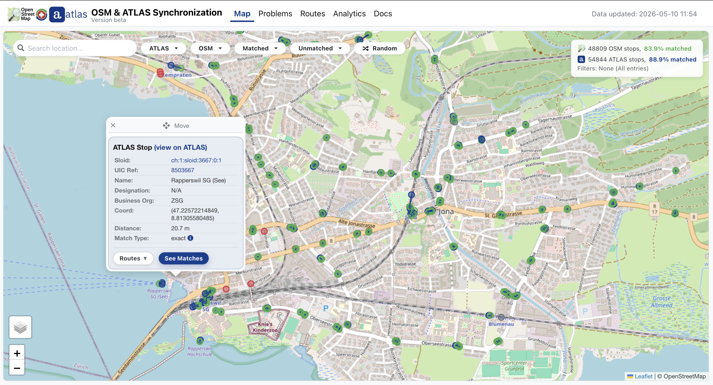
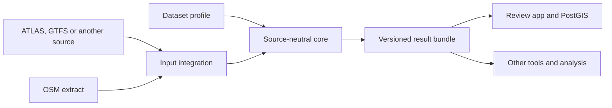

# Public Transport Matching and Review

Compare official public transport stops and routes with OpenStreetMap, explain discrepancies, and inspect the results on a map. The Swiss deployment uses ATLAS and GTFS at [atlas.osm.ch](https://atlas.osm.ch).



This repository is the review application. It is developed beside an independently runnable matching-engine checkout:

| Project | Purpose | Start here |
|---|---|---|
| Sibling `engine/` — `osm-public-transport-matcher` | Producer package: source-neutral core, curated input integrations, profiles and result-bundle production. | Engine repository README |
| Review application — repository root | Flask API, PostGIS importer, map, problems, routes and reports. Reads versioned bundles without installing the engine. | Instructions below |



The projects share the engine-owned versioned result format, with no cross-project Python imports. Docker receives the sibling checkout as a named `engine` build context: the scheduler installs its CLI, while the app image copies only its documentation and package-version metadata. The web documentation portal displays both documentation trees while keeping their ownership explicit.

## Try the engine without Docker or a database

With Python 3.10 or later:

```bash
python -m venv ../engine/.venv
source ../engine/.venv/bin/activate
python -m pip install -e '../engine[gtfs,test]'
osm-public-transport-matcher gtfs --source ../engine/examples/gtfs --namespace demo --osm ../engine/examples/osm.xml --output /tmp/transport-demo
```

The example is synthetic and uses no Swiss identifiers. The core library only needs NumPy/SciPy; curated integrations install through optional extras. Other datasets can use their own adapters, which implement the public adapter contract without changes to the engine ([what belongs in the engine](../engine/documentation/1.%20Download%20and%20process%20data.md#what-belongs-in-this-distribution)). See the sibling engine repository README for its Python API and Swiss workflow.

Run `deactivate` before setting up a separate application environment.

## Pin the engine version

`engine.ref` holds the full commit SHA of the engine this app is built and tested with. CI checks out that commit. Docker builds install your local checkout from `ENGINE_DIR` (default `../engine`; set it in `.env` if yours lives elsewhere), so before building, check that it is clean and exactly at the pin:

```bash
./scripts/verify_engine_checkout.sh
```

To upgrade the engine, put the new SHA in `engine.ref` and commit it. The meaning of package versions, Git tags, SHA pins and schema versions is documented in [Dependencies and builds](documentation/3.1%20Dependency%20Management%20&%20Build%20Strategy.md#engine-release-identity-and-deployment-pin).

## Run the review app with example results

With Docker Desktop and Compose v2, a small synthetic bundle runs the website without a matching run or an engine installation: follow [Try it with the example bundle](documentation/1.1%20Import%20Process.md#try-it-with-the-example-bundle). Its commands set `REVIEW_CONFIG` to a presentation without Swiss specifics; matching policies live in the engine, not in that configuration.

## Run the Swiss deployment pipeline

```bash
./scripts/verify_engine_checkout.sh
docker compose up --build -d
docker exec stop_sync_osm_atlas_scheduler python -m backend.jobs.job_runner --mode full --trigger manual
```

The scheduler starts the `osm-public-transport-matcher` executable, which writes a complete result bundle, and asks the app importer to publish it. Scheduled runs start every `PIPELINE_SCHEDULE_INTERVAL_HOURS` hours (one by default), the first one interval after the scheduler starts, so a new deployment has no data until you start a run by hand as above. [Background scheduler](documentation/3.3%20Background%20Scheduler.md) describes the run modes (`full`, `match-import`, `import`), who writes the shared status, how a dead run is detected and the settings. Its [operational checks](documentation/3.3%20Background%20Scheduler.md#operational-checks) cover a scheduler container that needs rebuilding.

The engine requires no database credentials. The importer validates the bundle and loads it into a private PostGIS schema while readers keep the published snapshot, then switches in one transaction ([Bundle import and publication](documentation/1.1%20Import%20Process.md)).

## Configuration and development

Copy `env.example` to `.env` to override settings. Source snapshots and runtime state live under `data/`; PostGIS persists in the Compose volume. Long-running services restart unless manually stopped. Database migrations run through the one-shot `migrator` service.

For day-to-day web development, run this from the application checkout:

```bash
make dev
```

Open [localhost:5001](http://localhost:5001). Compose mounts this checkout into `/app`: Python edits reload Flask automatically, and template, JavaScript and CSS edits appear when you refresh the browser. The Flask CLI reloader also recovers after you fix a syntax error. Dependency or Dockerfile changes require another `make dev` to rebuild the image. The scheduler and its installed engine need rebuilding/restarting separately when their code changes.

After moving or renaming the workspace, run `make dev` from its new location. Docker Desktop's Start button reuses the absolute bind paths recorded when the container was created; `docker compose up` recreates containers with the current paths while retaining the PostGIS volume. To also update the scheduler's paths, run `docker compose up --build -d scheduler`.

Run the supported quality workflow from this repository with Docker Desktop, Compose v2 and the sibling engine checkout available:

```bash
make quality-fast-container # lint, ownership, architecture and focused contract checks
make quality                # full suites, real PostGIS, coverage, structural debt and report
make quality-down           # remove the disposable quality services and volumes
```

The full command builds the Python 3.13 and Node 22 tooling, keeps the app and engine Python environments apart and starts its own disposable PostGIS database. For fast native iteration, use `make quality-fast` after installing the supported toolchain. An ordinary app-only test run skips the PostGIS publication and engine contract tests, so it does not replace the full run.

[Running the quality checks](documentation/4.4%20Running%20Quality%20Checks.md) covers native setup, the commands and evidence files, the module catalog, baselines, CI and troubleshooting. [Code quality](documentation/4.3%20Code%20Quality.md#how-the-report-reaches-the-site) explains how the report reaches the site with `make deploy-report` before each deployment.

## Contributing and documentation

Start with the [contributor guide](documentation/Contributing.md). A matching-rule contribution can use a tiny offline fixture; a UI contribution can use the example bundle. No national download is required to begin.

- [Documentation overview](documentation/0.%20Intro.md)
- [Glossary](documentation/0.5%20Glossary.md)
- [Engine documentation](../engine/documentation/1.%20Download%20and%20process%20data.md)
- [Review application changelog](documentation/Changelog.md)
- [Matching engine changelog](../engine/documentation/Changelog.md)
- [Engine and app architecture](documentation/3.%20System%20Architecture.md)
- [Result bundle format](../engine/documentation/Result%20bundle%20format.md)
- [Bundle import and publication](documentation/1.1%20Import%20Process.md)
- [Tests and CI](documentation/4.%20Test.md)
- [Code quality and the dashboard](documentation/4.3%20Code%20Quality.md) (the dashboard itself is at `/quality` on the running site)
- [Running the quality checks](documentation/4.4%20Running%20Quality%20Checks.md)

This repository's code is AGPL-3.0-or-later. Source dataset attribution is recorded separately in result metadata.

For GTFS acceleration, independent source caches, COPY imports, configuration and benchmark commands, see [Pipeline performance](../engine/documentation/5.2%20Pipeline%20Performance.md).
