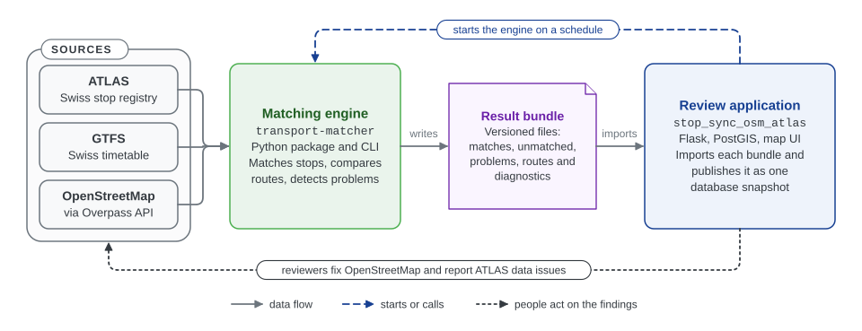

# 0. Project overview

This project compares official public transport data with OpenStreetMap (OSM), explains where they disagree and shows the result on a map, so that both datasets can be improved. The Swiss deployment, [atlas.osm.ch](https://atlas.osm.ch), compares **ATLAS**, Switzerland's official stop registry, and the Swiss **GTFS** timetable with OSM. The matching engine can process other GTFS feeds as well.

This page explains how the project works, what it links, and how to find your way through the documentation. Unfamiliar terms are defined in the [glossary](0.1%20Glossary.md).

## How the project works

- The **matching engine** (`public-transport-matcher`) downloads or reads the public sources, matches stops and routes, and detects data problems. It is a separate Python package with its own repository, and needs no web server or database. Format adapters turn each source (ATLAS, any GTFS feed, OSM) into common records, a dataset profile sets the matching rules, and a source-neutral core does the matching ([E1](../engine/documentation/1.%20Download%20and%20process%20data.md)).
- It writes a **result bundle**: a versioned directory of files containing every match, unmatched stop, problem and route comparison. The bundle is the only data that passes from the engine to the application.
- The **review application** (this repository) imports each bundle into a PostGIS database and presents it on a website: a map, a problems page, route comparisons, statistics and reports. Its scheduler runs a pinned engine release on a schedule (daily by default) and publishes each new result as one database snapshot. Other sites and scripts can read the same bundle format.
- Reviewers use the findings to fix OpenStreetMap and to report issues in ATLAS. The next run measures the improvement.

## What the project links

Official data and OSM describe the same stops very differently. The figure follows one stop with two platforms through the three datasets.

The figure numbers the four links the project maintains from top to bottom. Link 2 is the main result; the other three make it reliable.

1. **OSM node ↔ OSM node.** OSM often maps one platform as two nodes, a platform and a stop position on the road. Before matching, the engine groups such nodes into one [OSM stop unit](0.1%20Glossary.md#osm-stop-unit), so that both are matched together. See [OSM grouping](../engine/documentation/2.%20Matching%20process.md#osm-grouping-before-the-rules).
2. **ATLAS platform ↔ OSM stop.** Each official platform is matched to the OSM element or elements that represent it, by a fixed sequence of [matching rules](0.1%20Glossary.md#matching-rule): shared identifiers, names, routes and distance. See [E2 Matching process](../engine/documentation/2.%20Matching%20process.md).
3. **GTFS `stop_id` ↔ ATLAS SLOID.** Routes come from the GTFS timetable, which identifies stops by `stop_id`. The engine resolves every `stop_id` to an ATLAS [SLOID](0.1%20Glossary.md#sloid), so that a route's stops can be compared with OSM. See [E1.2 GTFS and ATLAS](../engine/documentation/1.2%20GTFS%20ATLAS%20data.md).
4. **GTFS route ↔ OSM route relation.** Whole lines and their directions are compared, using the resolved stop identities. Shared routes are also evidence for link 2: a nearby OSM node served by the same route and direction is very likely the same stop. See [E3 Routes](../engine/documentation/3.%20Routes.md).

Where the datasets disagree, the engine records a [problem](0.1%20Glossary.md#problem): a matched pair that is too far apart, a stop without a counterpart, conflicting names or platform codes, duplicates, or a match that contradicts the route evidence. See [E4 Problems](../engine/documentation/4.%20Problems.md).

## Key statistics

These values come from the currently published dataset and update with every import.

| Metric | Value |
|--------|-------|
| ATLAS platforms | {{stat:summary.atlas_platforms}} |
| OSM nodes | {{stat:summary.osm_nodes}} |
| OSM stop units | {{stat:summary.osm_stops}} |
| ATLAS match rate | {{stat:summary.match_rate_percent}} |
| Matched pairs (ATLAS ↔ OSM) | {{stat:summary.matched_pairs}} |
| Unmatched ATLAS platforms | {{stat:summary.unmatched_atlas}} |
| Unmatched OSM stop units | {{stat:summary.unmatched_osm}} |

## Two projects, one contract

The engine and the review application are separate repositories with separate releases, tests and dependencies. They are developed side by side as sibling checkouts.

| | Matching engine | Review application |
|---|---|---|
| Repository | The `public-transport-matcher` package, checked out beside this one as `../engine` | `stop_sync_osm_atlas` (this repository) |
| Does | Acquisition, input parsing, stop and route matching, problem detection, result bundles | Scheduling, bundle import, PostGIS, web API, map and review pages, reports |
| Depends on | NumPy and SciPy; optional extras add pandas, DuckDB and geospatial libraries | Flask, SQLAlchemy, PostgreSQL/PostGIS |
| Never | imports Flask, SQLAlchemy or application code, or opens the application database | imports engine code or re-implements a matching rule |
| Documentation | [E1–E6](../engine/documentation/1.%20Download%20and%20process%20data.md), in the engine repository | [A1–A4](1.%20Database.md), in this repository |

Three things connect them: the scheduler starts the engine's command-line tool as a separate process, the engine reports progress as JSON lines on its output, and the engine writes a [result bundle](../engine/documentation/Result%20bundle%20format.md) that the application imports. [A3 Architecture](3.%20System%20Architecture.md) shows the complete picture.

## How to read this documentation

The sidebar has four groups. The letter in a page number says which project owns the page: **E** for the engine, **A** for the review application.

| Group | Pages | Read it to understand |
|---|---|---|
| Project overview | 0, 0.1 | What the project does, and its vocabulary |
| Engine input integrations | E1 | How ATLAS, GTFS and OSM are downloaded and parsed |
| Matching engine core | E2–E6 | How stops and routes are matched, how problems are found, and the result bundle |
| Review application & deployment | A1–A4 | How bundles are imported, how the website works, and how it is deployed and tested |

Suggested reading paths:

- **To understand the results on the map**: this page, [E2 Matching process](../engine/documentation/2.%20Matching%20process.md), [E4 Problems](../engine/documentation/4.%20Problems.md), then [A2.4 Problems page](2.4%20Problems%20Page.md).
- **To operate a deployment**: [A3 Architecture](3.%20System%20Architecture.md), [A3.3 Background scheduler](3.3%20Background%20Scheduler.md), [A1.1 Bundle import and publication](1.1%20Import%20Process.md).
- **To change a matching rule or add a dataset**: [E2 Matching process](../engine/documentation/2.%20Matching%20process.md), [E1 Input integrations](../engine/documentation/1.%20Download%20and%20process%20data.md), and the engine's contributor guide.
- **To change the website**: [A2 Web app](2.%20Web%20app.md), [A4 Web app tests](4.%20Test.md), [Contributing](Contributing.md).
- **To edit the documentation**: the [documentation style guide](Documentation%20style%20guide.md).

## Documentation sections

| Owner | Section | Content |
|---|---|---|
| Engine | **[E1 Input integrations & acquisition](../engine/documentation/1.%20Download%20and%20process%20data.md)** | Format adapters, the Swiss integration, downloads and caches |
| Engine | **[E2 Matching process](../engine/documentation/2.%20Matching%20process.md)** | Dataset profiles, OSM grouping and the stop-matching rules |
| Engine | **[E3 Routes](../engine/documentation/3.%20Routes.md)** | The route model and route-to-route matching |
| Engine | **[E4 Problems](../engine/documentation/4.%20Problems.md)** | Problem types and priorities |
| Engine | **[E5 Operations & performance](../engine/documentation/5.%20Operations%20and%20performance.md)** | Source caching, performance and the progress contract |
| Engine | **[E6 Engine tests](../engine/documentation/6.%20Pipeline%20tests.md)** | The engine's offline test suite |
| Engine | **[Result bundle format](../engine/documentation/Result%20bundle%20format.md)** | The file contract between the projects |
| Application | **[A1 Database & bundle import](1.%20Database.md)** | Database tables, bundle validation and snapshot publication |
| Application | **[A2 Web app](2.%20Web%20app.md)** | Map, filters, statistics, problems, routes, reports and the documentation portal |
| Application | **[A3 Architecture & deployment](3.%20System%20Architecture.md)** | Architecture, builds, security, scheduling and pipeline progress |
| Application | **[A4 Web app tests](4.%20Test.md)** | Backend, browser and contract tests, and code quality |
| Both | **[Contributing](Contributing.md)** | Where to start a contribution |

Release history follows the same split: the [review application changelog](Changelog.md) and the [matching engine changelog](../engine/documentation/Changelog.md). A change to the result bundle appears in both.

## Source code

The review application is published at **[github.com/openTdataCH/stop_sync_osm_atlas](https://github.com/openTdataCH/stop_sync_osm_atlas)**.
