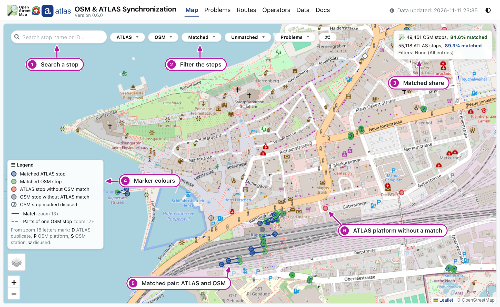
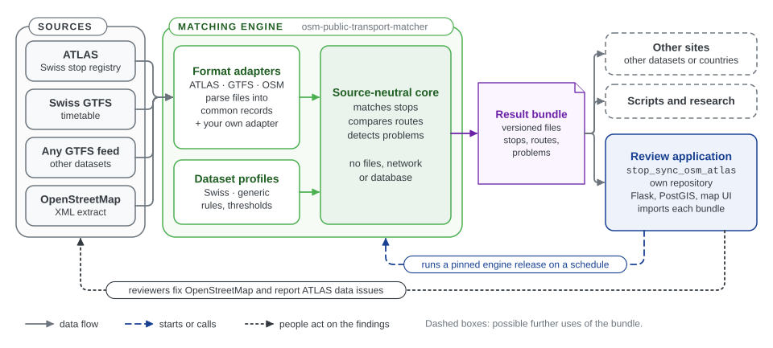
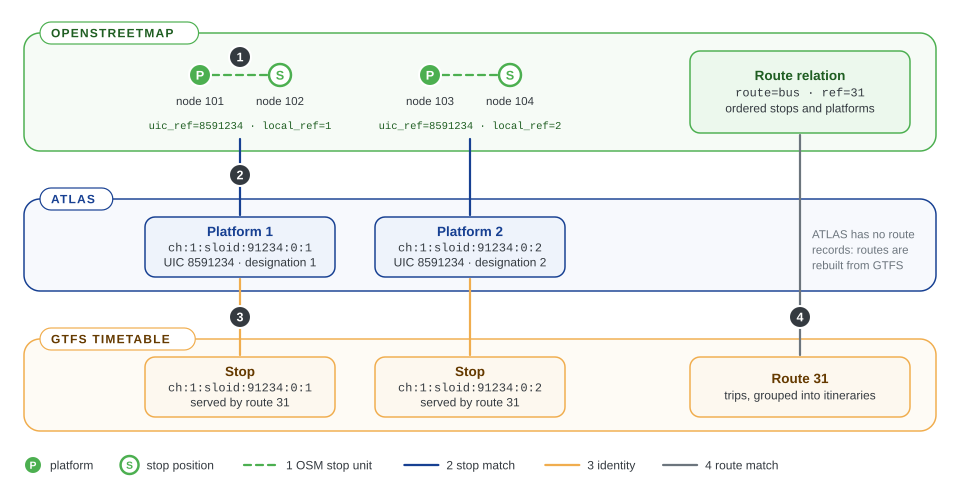

# 0. User guide

This site compares Switzerland's official public transport data with OpenStreetMap (OSM) and shows where they disagree, so that mappers can fix OSM and data stewards can correct the official data. On a regular schedule, every hour by default, it reads **ATLAS**, the Federal Office of Transport's registry of stops, the **GTFS** timetable from [opentransportdata.swiss](https://opentransportdata.swiss) and the current OSM data. It matches each ATLAS platform with the OSM elements that represent it, compares the timetable's lines with OSM routes, and lists every disagreement as a [problem](0.4%20Glossary.md#problem). The public site is [atlas.osm.ch](https://atlas.osm.ch).

## For users

- <i class="fas fa-exclamation-triangle"></i> **Problems** · [Working through problems](0.1%20Working%20through%20problems.md) — What the datasets disagree on, most important first, and what to change in OSM.
- <i class="fas fa-route"></i> **Routes** · [Comparing routes](0.2%20Comparing%20routes.md) — Which timetable lines have an OSM route, and where their stops differ.
- <i class="fas fa-link"></i> **Links and API** · [Sharing links and the API](0.3%20Sharing%20links%20and%20the%20API.md) — Copy any page as a link, or read a stop's matches as JSON from a script.

## The map

The site opens on the map, which shows every ATLAS platform and OSM stop with its match.

Look at the numbers in the picture:

1. **Search** a stop by its name or an identifier.
2. **Filter** the stops by dataset, by match state or by problem.
3. The share of OSM stops and ATLAS platforms that are matched, and the filters in use.
4. **The legend** names the marker colours.
5. **A matched pair**: an ATLAS platform (blue) joined by a line to its OSM stop (green). Click a marker for its popup.
6. **An ATLAS platform without a match** (red). The [Problems](0.1%20Working%20through%20problems.md) page lists them.

## How the project works

- The **matching engine** (`osm-public-transport-matcher`) downloads or reads the public sources, matches stops and routes, and detects data problems. It is a separate Python package in its own [repository of the same name](https://github.com/openTdataCH/osm-public-transport-matcher), and needs no web server or database. Format adapters turn each source (ATLAS, any GTFS feed, OSM) into common records, a dataset profile sets the matching rules, and a source-neutral core does the matching ([E1](../engine/documentation/1.%20Input%20integrations%20%26%20acquisition.md)).
- It writes a **result bundle**: a versioned directory of files containing every match, unmatched stop, problem and route comparison. The bundle is the only data that passes from the engine to the application.
- The **review application** ([stop_sync_osm_atlas](https://github.com/openTdataCH/stop_sync_osm_atlas)) imports each bundle into a PostGIS database and presents it on a website: a map, a problems page, route comparisons, statistics and reports. Its scheduler runs a pinned engine release on a schedule (every hour by default) and publishes each new result as one database snapshot. Other sites and scripts can read the same bundle format.
- Reviewers can use the findings to fix OpenStreetMap and to report issues in ATLAS. Each run reads the latest data from every source, so corrected stops drop off the problem list.

## What the project links

Official data and OSM describe the same stops very differently. The figure follows one stop with two platforms through the three datasets.

The figure numbers the four links the project maintains from top to bottom. Link 2 is the main result; the other three make it reliable.

1. **OSM node ↔ OSM node.** OSM often maps one platform as two nodes, a platform and a stop position on the road. Before matching, the engine groups such nodes into one [OSM stop unit](0.4%20Glossary.md#osm-stop-unit), so that both are matched together. See [OSM grouping](../engine/documentation/2.%20Matching%20process.md#osm-grouping-before-the-rules).
2. **ATLAS platform ↔ OSM stop.** Each official platform is matched to the OSM element or elements that represent it, by a fixed sequence of [matching rules](0.4%20Glossary.md#matching-rule): shared identifiers, names, routes and distance. See [E2 Matching process](../engine/documentation/2.%20Matching%20process.md).
3. **GTFS `stop_id` ↔ ATLAS SLOID.** Routes come from the GTFS timetable, which identifies stops by `stop_id`. The engine resolves every `stop_id` to an ATLAS [SLOID](0.4%20Glossary.md#sloid), so that a route's stops can be compared with OSM. See [E1.2 GTFS and ATLAS](../engine/documentation/1.2%20Swiss%20GTFS%20and%20ATLAS.md).
4. **GTFS route ↔ OSM route relation.** Whole lines and their directions are compared, using the resolved stop identities. Shared routes are also evidence for link 2: a nearby OSM node served by the same route and direction is very likely the same stop. See [E3 Routes](../engine/documentation/3.%20Routes.md).

Where the datasets disagree, the engine records a [problem](0.4%20Glossary.md#problem): a matched pair that is too far apart, a stop without a counterpart, conflicting names or platform codes, duplicates, or a match that contradicts the route evidence. See [E4 Problems](../engine/documentation/4.%20Problems.md).

## Key statistics

These values come from the published dataset and update with every import.

| Metric | Value |
|--------|-------|
| ATLAS platforms | {{stat:summary.atlas_platforms}} |
| OSM nodes | {{stat:summary.osm_nodes}} |
| OSM stop units | {{stat:summary.osm_stops}} |
| ATLAS match rate | {{stat:summary.match_rate_percent}} |
| Matched pairs (ATLAS ↔ OSM) | {{stat:summary.matched_pairs}} |
| Unmatched ATLAS platforms | {{stat:summary.unmatched_atlas}} |
| Unmatched OSM stop units | {{stat:summary.unmatched_osm}} |
