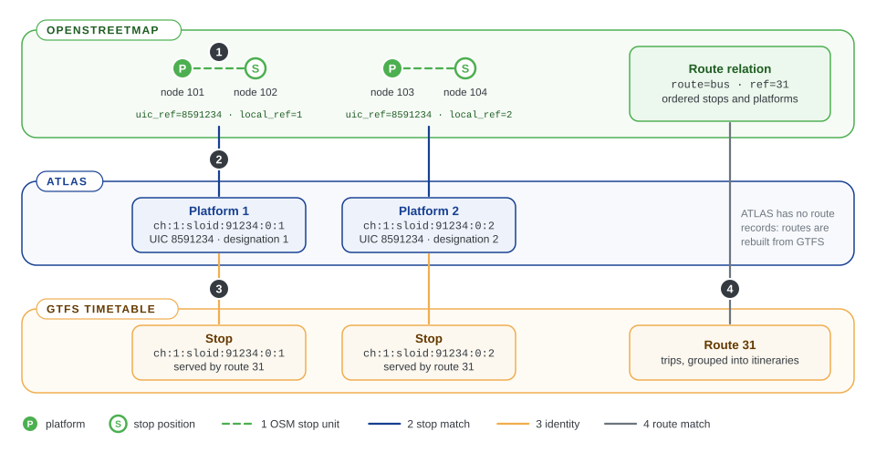

# 0.1 Glossary

The terms used across both documentation trees, grouped by topic. Each term has its own heading, so other pages can link straight to it, as in [dataset profile](#dataset-profile).

The figure shows most terms of the first two groups on one illustrative stop.

## Datasets and identifiers

### ATLAS

Switzerland's official registry of public transport locations, maintained for the Federal Office of Transport and published on [opentransportdata.swiss](https://opentransportdata.swiss). The project uses its *traffic point elements* of type `BOARDING_PLATFORM`: one record per platform. See [E1.1 ATLAS stops](../engine/documentation/1.1%20ATLAS%20stops.md).

### Service point

A stop or station as a whole in ATLAS, for example *Zürich HB*. It has a [UIC number](#uic-number) and a [SLOID](#sloid) such as `ch:1:sloid:3000`. Its platforms are the records the project matches.

### SLOID

The Swiss location identifier of an ATLAS service point or platform: `ch:1:sloid:<number>:<area>:<platform>`, where `<number>` is the UIC number without the country prefix `85` and without leading zeros. Example: platform 33 of Zürich HB is `ch:1:sloid:3000:501:33`. The area part can be empty (`ch:1:sloid:75014::80`).

### UIC number

The seven-digit station number shared by all platforms of one service point. Swiss numbers start with `85`, for example `8503000`. It appears as `number` in ATLAS and as the `uic_ref` tag in OpenStreetMap, and is the Swiss profile's [station reference](#reference-rule).

### Platform code

The label of a single platform: `designation` in ATLAS, `platform_code` in GTFS and `local_ref` in OpenStreetMap. Several rules use it to choose between platforms of the same station.

### GTFS

The General Transit Feed Specification, the standard timetable format. A feed is a set of CSV files: `stops.txt`, `routes.txt`, `trips.txt` and `stop_times.txt` matter here. The Swiss feed comes from opentransportdata.swiss; other agencies' feeds can be matched with the generic GTFS integration. See [E1.2 GTFS and ATLAS](../engine/documentation/1.2%20GTFS%20ATLAS%20data.md).

### stop_id

A GTFS stop identifier. In the current Swiss feed, platform `stop_id`s are usually the platform's SLOID; the engine still resolves every `stop_id` to a SLOID explicitly, because parent stations, generated identifiers and older feeds do not follow that convention.

### Namespace

A short name that identifies the source dataset or feed inside every key: `atlas` for the Swiss integration, or the value of `--namespace` for a GTFS feed. Equal raw identifiers from different namespaces never count as the same stop.

### Source stop

The engine's source-neutral name for a stop of the official dataset (an ATLAS platform or a GTFS stop), the `SourceStop` record. Its key is `<namespace>:<source_id>`, for example `atlas:ch:1:sloid:3000:501:33`.

## OpenStreetMap modelling

### OSM element

A positioned OpenStreetMap object that can represent a stop: a node, or a supported way represented by its centre. Keys include the type, for example `osm:node:123`. Elements are selected by tags such as `public_transport=platform`, `highway=bus_stop` or `railway=tram_stop`; see [E1.3 OSM data](../engine/documentation/1.3%20OSM%20data.md).

### Platform and stop position

The OpenStreetMap public transport scheme (PTv2) maps a stop twice: a `public_transport=platform` element where passengers wait, and a `public_transport=stop_position` node on the road or track where the vehicle stops. One ATLAS platform therefore often corresponds to two OSM nodes.

### OSM stop unit

One logical OpenStreetMap stop, built before matching: a *single* element, a *pair* (a platform with its stop position) or a *trio* (two sides with one stop position in the middle). Grouping is a [profile](#dataset-profile) option, enabled for Switzerland. See [OSM grouping](../engine/documentation/2.%20Matching%20process.md#osm-grouping-before-the-rules).

### Route relation

An OpenStreetMap relation tagged `type=route`: one direction or variant of a line, with its stops and platforms as ordered members. A `type=route_master` relation groups the route relations of one line.

## Matching

### Match

A link between one source stop and one OSM element. A source stop can have several matches (for example both nodes of a pair) and, where the profile allows station references, several source stops can share one OSM element.

### Matching rule

One step of stop matching, called a *predicate* in the code: trio, exact reference, name, route, and the distance rules. Rules run in the order the profile lists, and each rule only sees stops that are still unmatched. See [E2 Matching process](../engine/documentation/2.%20Matching%20process.md).

### Match type

The name of the rule that created a match, exported as `method`: for example `exact`, `name` or `distance_matching_3a`. Matches created by [propagation](#propagation) have the type `duplicate_propagation` or `osm_group_propagation`.

### Propagation

When a rule matches the representative of a group, the other members follow: duplicate ATLAS platforms receive `duplicate_propagation` matches and the partner of an OSM pair receives an `osm_group_propagation` match. The middle of a trio is never propagated to.

### Duplicate group

ATLAS platforms that share the same UIC number and platform code. One of them, the first by key, represents the group during matching.

### Effectively matched

The state of a trio's middle stop position when both sides of the trio are matched. It is not a match record; the map shows it linked to both sides.

### Isolated

A stop with no element of the other dataset within the profile's isolation radius (50 m by default). The map's "No OSM < 50m" filter shows isolated ATLAS platforms.

### Dataset profile

The matching policy for one dataset, a `MatchingProfile` object in the engine. It decides:

- which identifiers count as exact evidence ([reference rules](#reference-rule)),
- which [matching rules](#matching-rule) run, and in which order,
- whether OSM elements are grouped into [stop units](#osm-stop-unit), and with which distances,
- the distance limits of matching and the thresholds that set [problem](#problem) priorities.

The engine ships `profiles.SWITZERLAND` for ATLAS and uses the generic default profile for GTFS feeds. A profile is Python code inside the engine; it is unrelated to the review application's [presentation configuration](#review-configuration). See [E2 Matching process](../engine/documentation/2.%20Matching%20process.md#dataset-profiles).

### Reference rule

Part of a profile that allows one kind of source identifier to be compared with one OSM tag, for example ATLAS station numbers with `uic_ref`. Without a reference rule, equal strings are never treated as the same stop. See [E2.1 Exact matching](../engine/documentation/2.1%20Exact%20matching.md).

## Routes

### Line family

One public transport line: a GTFS `route_id` on the source side, and on the OSM side a route master, a GTFS route id tag or a synthetic key. See [E3 Routes](../engine/documentation/3.%20Routes.md).

### Itinerary

One direction or variant of a line family: a bucket of GTFS trips with the same direction and headsign, or one OSM route relation.

### Stop call

One stop of an itinerary, in order, with its resolved stop identity.

## Problems

### Problem

A detected data-quality issue, of type `distance`, `unmatched`, `attributes`, `duplicates` or `contradicts_route_matching`, with priority P1 (critical), P2 (significant) or P3 (minor). See [E4 Problems](../engine/documentation/4.%20Problems.md).

## Engine architecture

### Matching engine

The `public-transport-matcher` Python package and command-line tool, in its own repository. It reads sources, matches stops and routes, detects problems and writes a [result bundle](#result-bundle). It has no web or database dependency.

### Input integration

The dataset-specific part of the engine: acquisition, format adapters and the dataset profile for one dataset family. The Swiss integration is maintained in the engine; other datasets can use their own adapters. See [E1](../engine/documentation/1.%20Download%20and%20process%20data.md).

### Adapter

Code that parses one input format into normalized records, for example the ATLAS CSV reader or the OSM XML parser. Adapters read explicit files and never download anything.

### Acquisition

The optional engine layer that downloads sources and caches prepared products in a [workspace](#workspace), reusing them while their checksums and the servers' validators still agree. See [E5.1 Source snapshot caching](../engine/documentation/5.1%20Source%20snapshot%20caching.md).

### Workspace

The engine's directory of downloaded and prepared inputs: `data/raw`, `data/processed`, `data/cache` and `data/source_metadata.json`.

### Result bundle

The engine's output and the contract between the two projects: one directory with `manifest.json` and nine compressed JSON Lines files. `schema_version` versions the format. See [Result bundle format](../engine/documentation/Result%20bundle%20format.md).

### Capability

A feature that a bundle supports, listed in its manifest: `stops`, `problems`, `routes` and `gtfs_identity`. The review application hides views that the active bundle does not support.

## Application and deployment

### Review application

This repository: the Flask website, PostGIS database, importer and scheduler that present a bundle for review. It never imports engine code. See [A3 Architecture](3.%20System%20Architecture.md).

### Snapshot

The database copy of one bundle. *Publishing* a snapshot is the atomic switch that makes it visible; until then readers see the previous one. See [A1.1 Bundle import and publication](1.1%20Import%20Process.md).

### Run

One pipeline execution, identified by the bundle's `run_id`. Its mode is `full`, `match-import` or `import`; see [A3.3 Background scheduler](3.3%20Background%20Scheduler.md).

### Review configuration

The JSON file named by `REVIEW_CONFIG`, such as `config/switzerland.json`: the website title, labels, map area and enabled views. It changes presentation only, never matching.
