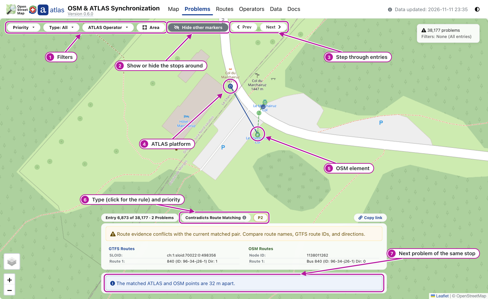
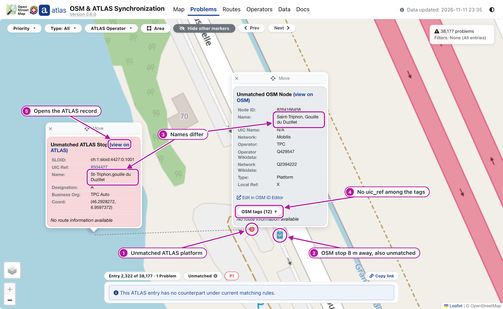
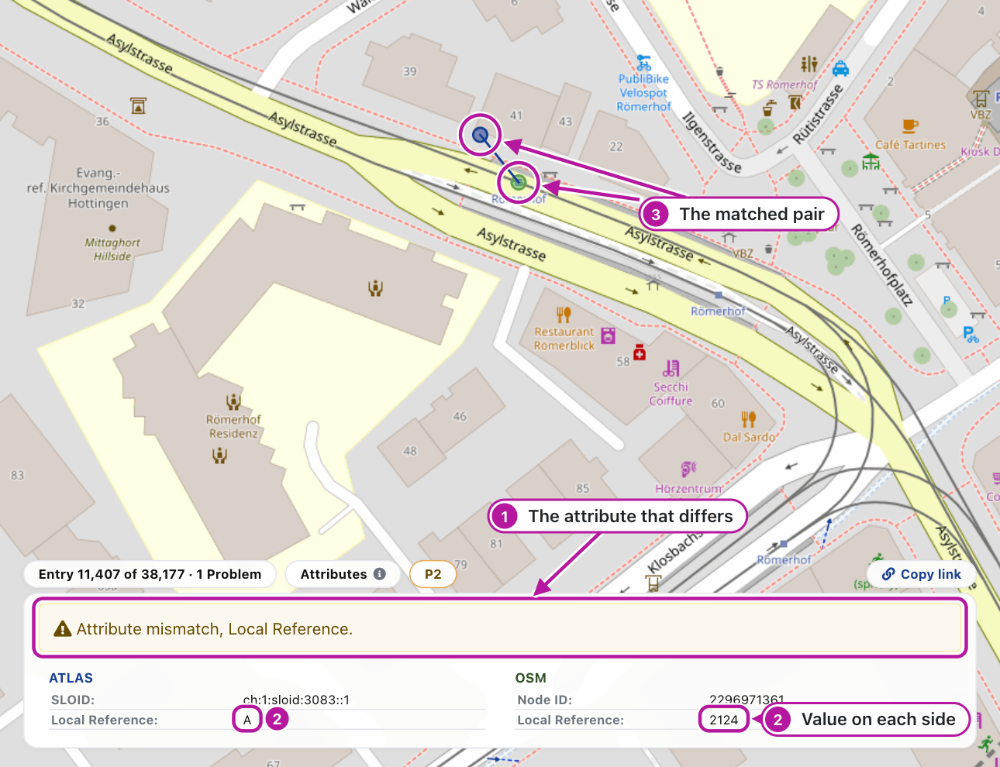

# 0.1 Working through problems

The **Problems** page shows the [problems](0.4%20Glossary.md#problem) of the matching one entry at a time, most important first. Each problem has a type and a priority: P1 critical, P2 significant or P3 minor. [E4.1](../engine/documentation/4.1%20Stop%20problems.md) gives the rule behind each priority.

## The Problems page

Look at the numbers in the picture:

1. **Filter** by **Priority**, **Type**, **ATLAS Operator** and **Area**, a rectangle you draw on a map.
2. **Hide other markers** and **See other markers** switch the stops around the problem, drawn faded, off and on.
3. **Step** with **Prev** and **Next**, or the arrow keys; press `?` for all shortcuts.
4. The ATLAS platform of the entry, navy when matched and red when not ([A2.7](2.7%20Colours%20and%20styles.md)).
5. The OSM element, green when matched. Click a marker for its popup; drag a popup by its **Move** bar to see what lies under it.
6. **The card** over the bottom of the map explains the entry. Its type chip opens the rule of the type; the chip beside it is the priority.
7. One entry gathers all problems of one stop: scroll the card for the next one.

## What each problem usually means

> [!IMPORTANT]
> A problem is a lead to check, not an instruction. Edit OSM only for what you can verify yourself, on the ground or with imagery you are allowed to use for OSM. Never copy values from this site into OSM unchecked, and never make bulk or automated edits from these lists.

Each type links to its rule and priorities in E4.1. The matching reads the OSM tags `uic_ref`, `ref:sloid` (or `railway:ref:sloid`), `name`, `uic_name`, `local_ref` and `operator`, listed in [E1.3](../engine/documentation/1.3%20OSM%20input%20and%20acquisition.md#tags-the-engine-relies-on).

- **[Distance](../engine/documentation/4.1%20Stop%20problems.md#distance-problems)**: the match is wrong, or one dataset places the stop wrongly. Long platforms explain some distance, so SBB platforms are at most P3.
- **[Unmatched](../engine/documentation/4.1%20Stop%20problems.md#unmatched-problems), ATLAS platform**: the stop is missing in OSM, mapped without the tags the matching reads, or gone. A faded marker nearby may be its counterpart.
- **Unmatched, OSM element**: the `uic_ref` is mistyped or outdated, the stop is gone, or ATLAS lacks the platform.
- **[Attributes](../engine/documentation/4.1%20Stop%20problems.md#attribute-problems)**: one side is outdated or written differently. The name check reads OSM `uic_name`, not `name`; an operator can be one operator written two ways, such as `PAG` and a full name. A different UIC number can also mean a wrong match.
- **[Duplicates](../engine/documentation/4.1%20Stop%20problems.md#duplicate-problems), ATLAS** (P2): ATLAS lists one platform twice, or gives two platforms one code.
- **Duplicates, OSM** (P3): the platform is mapped twice, a `local_ref` is wrong, or a platform and its stop position were not paired.
- **[Contradicts Route Matching](../engine/documentation/4.1%20Stop%20problems.md#contradicts-route-matching-problems)** (P2): the element may be another stop, such as the platform across the road, or an OSM route relation lists the wrong platform or is outdated.
- **[Disused OSM](../engine/documentation/4.1%20Stop%20problems.md#disused-problems)**: at P1, OSM and ATLAS disagree on whether the stop is in service. At P2, apps still treat the element as a stop, through a remaining stop tag or a route relation.
- **[OSM SLOID](../engine/documentation/4.1%20Stop%20problems.md#identifier-problems)**: at P1, copied from another stop; at P2, outdated or mistyped; at P3, another number, such as a UIC number, in the wrong tag.

This site has no reporting form: to report an ATLAS error, contact the ATLAS data owner. **(view on ATLAS)** in a popup opens the station's record.

## Two examples

### An unmatched ATLAS platform

Look at the two names: ATLAS writes *St-Triphon,gouille du Duzillet*, OSM *Saint-Triphon, Gouille du Duzillet*, and the OSM stop has no `uic_ref`. No rule links the two, so each is unmatched. They are probably the same platform; once you have verified that, a `uic_ref` on the OSM stop gives the matching its link.

### An attribute mismatch

Look at the two values: ATLAS gives the platform code `A`, OSM the `local_ref` `2124`, which is no platform code. Check the sign at the stop before you correct either side.

## Related pages

- [E4.1 Stop problems](../engine/documentation/4.1%20Stop%20problems.md): the rule and priorities of each problem type
- [A2.4 Problems page](2.4%20Problems%20page.md): how the page groups, orders and frames problems
