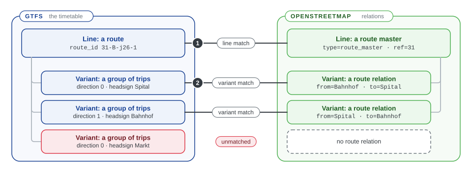
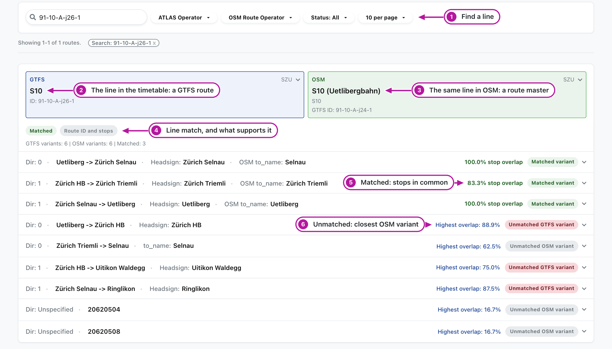
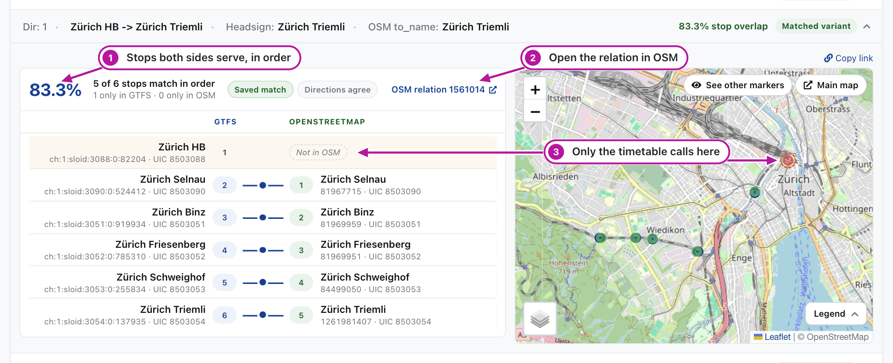
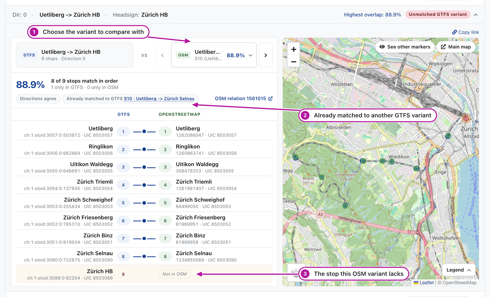

# 0.2 Comparing routes

The **Routes** menu shows which lines of the timetable are mapped in OSM, and where their stops differ. It has three tabs: the lines of the timetable and OSM, the OSM routes outside the timetable, and the link between timetable stops and ATLAS platforms.

## Lines and variants

Both sources describe public transport on two levels, a line and its variants, and the site compares them level by level.

| | GTFS timetable | OpenStreetMap |
|---|---|---|
| **Line** | A route, identified by its `route_id` | A route master: a relation tagged `type=route_master` that groups the route relations of the line |
| **Variant** | The trips of the route that share a direction and a headsign | One route relation (`type=route`): one direction or stop pattern of the line, with its stops in order |

The site matches the lines first (1), then pairs the variants of two matched lines (2). A variant without a counterpart stays unmatched, like the short run to Markt in the figure. Route relations without a route master still form a line: they are grouped by their `gtfs:route_id`, or by their line number, operator and network.

The glossary and the developer pages call a line a [line family](0.4%20Glossary.md#line-family) and a variant an [itinerary](0.4%20Glossary.md#itinerary).

## Read a line card

The **Routes** tab shows one card per matched pair of lines and one per line without a match. The screenshots on this page follow one line, the S10 of the Uetlibergbahn, as an example.

Look at the numbers in the picture:

1. **Search and filters.** Find a line by its GTFS or OSM route ID, by operator, or by status: **Matched**, **Unmatched GTFS** or **Unmatched OSM**.
2. **The line in the timetable**, a GTFS route. Click it for its details.
3. **The same line in OSM**, a route master. Click it for its details and a link to the route master.
4. **The line match.** Whether the lines are matched, and what supports the match: the route ID and the stops, the stops, or the route ID alone. Check a match by the route ID alone first, because the stops do not confirm it.
5. **A matched variant** (green). The *stop overlap* is the share of stops both variants serve in the same order.
6. **An unmatched variant** (blue). The *Highest overlap* is that of its closest variant on the other side; hover to see which. It is a hint, not a match. *No shared stops* means that no variant on the other side serves any of its stops.

## Open a variant

Click a variant row to compare its stops. The two stop lists are aligned in route order, beside a map of the stops.

Look at the numbers in the picture:

1. **The overlap** of the two variants, with the number of stops that match in order and of those only one side has.
2. **OSM relation** opens the variant's route relation in OSM.
3. **A stop only one side serves.** In this example the timetable's train starts at Zürich HB and the OSM relation one stop later. The list marks such a stop *Not in OSM* or *Not in GTFS*, and the map circles it with a dashed ring. The list also marks a stop that the sides serve at different platforms of one station.

A low overlap or a *Not in OSM* row is a lead: the relation may miss a stop, call at another platform, or follow an older route. Check it before you edit the relation.

## Compare an unmatched variant

Two variants are paired when they share at least 80% of the longer stop list in order and their directions do not disagree, and each variant is paired once. An unmatched variant opens beside its closest variant of the other side; the picker above the lists changes the variant to compare with.

Look at the numbers in the picture:

1. **The picker** lists the variants of the other side by overlap. Choose one to compare with it.
2. **Already matched** says that the compared variant is paired with another variant, here the GTFS variant that ends at Zürich Selnau.
3. **The stop that differs.** In this example the timetable's run goes on to Zürich HB, and its closest OSM variant ends one stop earlier.

An unmatched GTFS variant is a lead of the same kind: OSM may lack a relation for it, as for the longer run here, or the stops of an existing relation may differ.

## Lines with several matches

A line can have several matches, and each is a card of its own. The timetable can split one line into several routes, for example one per operator, and OSM maps the line once: the card then says *This OSM line is also matched to GTFS route …*. When a card says *This GTFS route is also matched to OSM line …*, OSM holds the line twice or in two parts, which is worth checking: its relations may belong in one route master.

[E3.2](../engine/documentation/3.2%20Route-route%20matching.md#families-that-stay-unmatched) explains why a line stays unmatched.

## Non-GTFS routes

The **Non-GTFS routes** tab lists OSM routes that are not in the Swiss timetable, such as FlixBus lines. They are never matched.

## Timetable stops and ATLAS platforms

The **SLOID ↔ GTFS stop_id** tab shows which ATLAS platform each timetable stop is linked to. That link tells the site which lines serve each platform. Blue marks an ATLAS platform with a timetable stop, orange a timetable stop with a platform, red a platform without a timetable stop and grey a timetable stop without a platform. A wrong link here is not fixed in OSM.

## Related pages

- [E3.2 Route-route matching](../engine/documentation/3.2%20Route-route%20matching.md): how lines and their variants are paired
- [A2.6 Routes pages](2.6%20Routes%20pages.md): how the Routes pages are built
