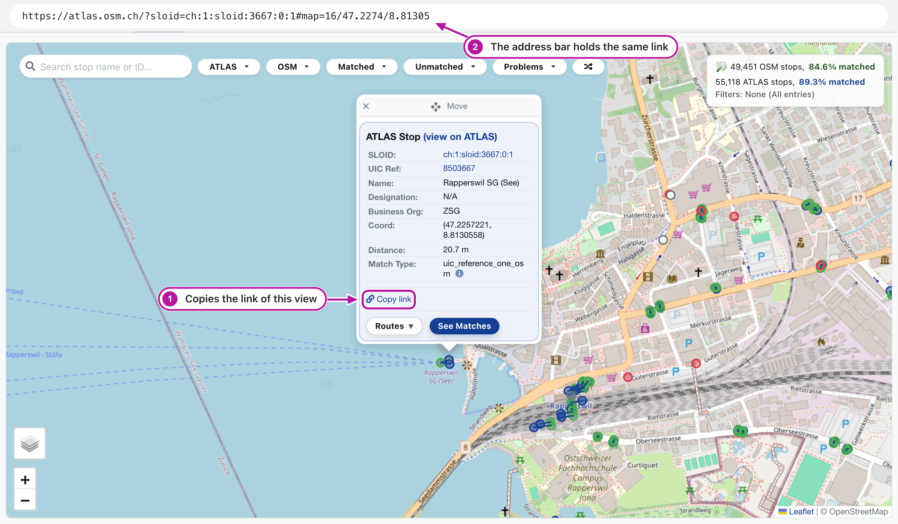
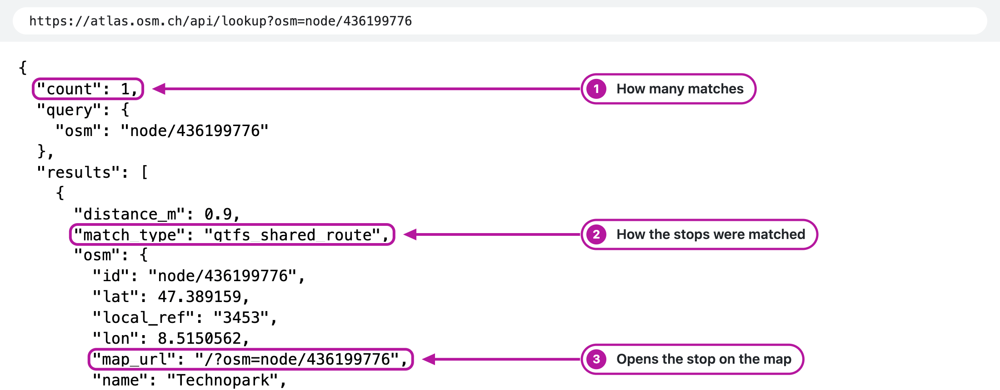

# 0.3 Sharing links and the API

## Share a view

Every page keeps what it shows in the address bar: the map its view, open popup and filters, the Problems page its filters and entry, the Routes tabs their open variant. Copy the address, or use a **Copy link** button, and the link opens the same view for anyone, as long as the data still holds it ([A2.9](2.9%20Permalinks.md)).



Look at the numbers in the picture:

1. **Copy link** in a stop's popup copies the link of this view.
2. **The address bar** already holds the same link, the stop (`sloid`) and the map position (`#map=`), so copying it works as well.

## Look up a stop from a script

Scripts can use the [public API](0.4%20Glossary.md#public-api), `/api/lookup`. Give `osm=node/<id>`, `sloid=<SLOID>` or `uic_ref=<number>`, and it returns every match of the stop as JSON:

```bash
curl -s 'https://atlas.osm.ch/api/lookup?osm=node/436199776'
```



Look at the numbers in the picture:

1. `count` says how many matches the stop has.
2. `match_type` says how the two stops were matched.
3. `map_url` is the path that opens the stop on the map.

Only the lookup is stable; other addresses under `/api/` serve the pages and change without notice. AI agents can read `/llms.txt`, which explains the site and points them to the lookup.

## Related pages

- [A2.9 Permalinks](2.9%20Permalinks.md): the link format of every page
- [A2.10 Public API](2.10%20Public%20API.md): the lookup's parameters and response fields
