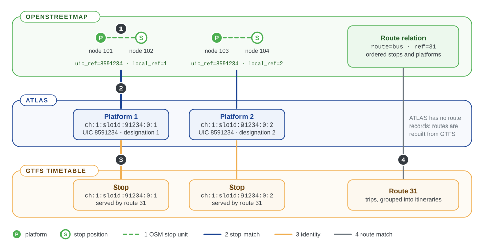

# 0.4 Glossary

The words this site and its user guide use. Terms of the code, the engine and the deployment are in the [developer glossary](Developer%20glossary.md).

The figure shows most terms of the first two groups on one illustrative stop.

## Datasets and identifiers

### ATLAS

Switzerland's official registry of public transport locations, maintained for the Federal Office of Transport and published on [opentransportdata.swiss](https://opentransportdata.swiss). The project uses its platforms: one record per platform. See [E1.1 ATLAS stops](../engine/documentation/1.1%20Swiss%20ATLAS%20stops.md).

### Service point

A stop or station as a whole in ATLAS, for example *Zürich HB*. It has a [UIC number](#uic-number) and a [SLOID](#sloid) such as `ch:1:sloid:3000`. Its platforms are the records the project matches.

### SLOID

The Swiss location identifier of an ATLAS service point or platform: `ch:1:sloid:<number>:<area>:<platform>`, where `<number>` is the UIC number without the country prefix `85` and without leading zeros. Example: platform 33 of Zürich HB is `ch:1:sloid:3000:501:33`. The area part can be empty (`ch:1:sloid:75014::80`). Mappers can tag it on the platform's OSM elements as `ref:sloid` (or `railway:ref:sloid`); matching then links them by it first ([identifier rule](#identifier-rule)).

### UIC number

The seven-digit station number shared by all platforms of one service point. Swiss numbers start with `85`, for example `8503000`. It appears as `number` in ATLAS and as the `uic_ref` tag in OpenStreetMap, and matching uses it to find the OSM elements of the same station.

### Platform code

The label of a single platform: `designation` in ATLAS, `platform_code` in GTFS and `local_ref` in OpenStreetMap. Several rules use it to choose between platforms of the same station.

### GTFS

The General Transit Feed Specification, the standard timetable format. A feed is a set of CSV files: `stops.txt`, `routes.txt`, `trips.txt` and `stop_times.txt` matter here. The Swiss feed comes from opentransportdata.swiss; other agencies' feeds can be matched too. See [E1.2 GTFS and ATLAS](../engine/documentation/1.2%20Swiss%20GTFS%20and%20ATLAS.md).

### stop_id

A GTFS stop identifier. In the Swiss feed, most platform `stop_id`s are the platform's SLOID; the engine resolves every `stop_id` to a SLOID, including those that do not follow this convention ([E1.2](../engine/documentation/1.2%20Swiss%20GTFS%20and%20ATLAS.md)).

## OpenStreetMap modelling

### OSM element

An OpenStreetMap object that can represent a stop: a node, or a way represented by its centre. Elements are selected by tags such as `public_transport=platform`, `highway=bus_stop` or `railway=tram_stop`; see [E1.3 OSM data](../engine/documentation/1.3%20OSM%20input%20and%20acquisition.md).

### Platform and stop position

The OpenStreetMap public transport scheme (PTv2) maps a stop twice: a `public_transport=platform` element where passengers wait, and a `public_transport=stop_position` node on the road or track where the vehicle stops. One ATLAS platform therefore often corresponds to two OSM nodes.

### OSM stop unit

One logical OpenStreetMap stop, built before matching: a *single* element, a *pair* (a platform with its stop position) or a *two-sided stop* (one stop position with a platform on each side of the road). Matching treats the unit as one stop, and the statistics count units, not nodes. See [OSM grouping](../engine/documentation/2.%20Matching%20process.md#osm-grouping-before-the-rules).

### Disused OSM element

An [OSM element](#osm-element) whose stop tag carries a lifecycle prefix, such as `disused:highway=bus_stop`; the prefixes are `disused:`, `abandoned:`, `removed:`, `demolished:`, `razed:`, `destroyed:` and `was:`. It is never matched and never counted as a stop. It gets a `disused` [problem](#problem) only when it still needs attention, and the map shows it when *OSM disused* is selected in the Unmatched filter. See [E1.3 OSM data](../engine/documentation/1.3%20OSM%20input%20and%20acquisition.md).

### Route relation

An OpenStreetMap relation tagged `type=route`: one direction or variant of a line, with its stops and platforms as ordered members. A `type=route_master` relation groups the route relations of one line.

## Matching

### Match

A link between one ATLAS platform and one OSM element. A platform can have several matches (for example both nodes of a pair), and some rules let several platforms share one OSM element.

### Matching rule

One way of deciding a match: by a shared identifier ([identifier rule](#identifier-rule)), as a two-sided stop, by station number and platform code, by name, by the GTFS routes that serve both stops, or by distance. The rules run in a fixed order, and each rule only sees stops that are still unmatched. See [E2 Matching process](../engine/documentation/2.%20Matching%20process.md).

### Match type

The rule and branch that created a match, named after the evidence it used: for example `sloid_identifier` (the OSM element's `ref:sloid` names the platform), `uic_reference_local_ref` (same UIC number, platform code equal to `local_ref`), `gtfs_shared_route` or `distance_only_candidate`. See [the matching rules](../engine/documentation/2.%20Matching%20process.md#the-matching-rules). Matches created by [propagation](#propagation) have the type `source_duplicate_propagation` or `osm_pair_propagation`.

### Identifier rule

The first matching rule. An OSM element tagged `ref:sloid` (or `railway:ref:sloid`) with the SLOID of an ATLAS platform within 150 m is linked to that platform before any other rule runs. A value that names a far or unknown platform, or is not a SLOID, becomes an `identifier` problem. See [E2.1](../engine/documentation/2.1%20Reference%20matching.md#identifier-matching-identifier).

### Propagation

When a rule matches one member of a group, the other members follow: the other platforms of a [duplicate group](#duplicate-group) receive `source_duplicate_propagation` matches, and the partner of an OSM pair receives an `osm_pair_propagation` match. The middle of a [two-sided stop](#osm-stop-unit) is never propagated to.

### Duplicate group

ATLAS platforms that share the same UIC number and platform code. One of them stands for the group during matching, and the others receive its matches by [propagation](#propagation).

### Effectively matched

The state of a two-sided stop's middle stop position when both of its sides are matched. It has no match of its own; the map shows it linked to both sides.

### Isolated

A stop with no element of the other dataset within 50 m. The map's "No OSM < 50m" filter shows isolated ATLAS platforms.

## Routes

### Line family

One public transport line: a GTFS `route_id` on the GTFS side, and on the OSM side a group of route relations, such as the members of a route master ([how they are grouped](../engine/documentation/3.2%20Route-route%20matching.md#step-1-build-the-families)). A line family can be matched to several families of the other side. See [E3 Routes](../engine/documentation/3.%20Routes.md).

### Itinerary

One direction or variant of a line family: the GTFS trips of one direction with the same headsign (the destination shown on the vehicle), or one OSM route relation. The Routes pages call it a *variant*.

### Stop call

One stop of an itinerary, in order.

## Problems

### Problem

A detected data-quality issue, of type `distance`, `unmatched`, `attributes`, `duplicates`, `contradicts_route_matching`, `disused` ([disused OSM element](#disused-osm-element)) or `identifier` ([identifier rule](#identifier-rule)), with priority P1 (critical), P2 (significant) or P3 (minor). See [E4 Problems](../engine/documentation/4.%20Problems.md).

## Using the site

### Snapshot

The results the site shows, from one run of the matching. A new snapshot replaces the previous one all at once when its import is complete, so a page never mixes two runs.

### Permalink

A URL that opens a page as it was when the link was copied: the map view, the open stop popup, the Problems page's entry and filters, or an open route variant. Each page keeps it in the address bar. See [0.3 Sharing links and the API](0.3%20Sharing%20links%20and%20the%20API.md).

### Public API

The part of the JSON API that scripts and AI agents may rely on: `/api/lookup`, which returns every match of a stop named by a permalink identifier. The other `/api/` endpoints serve the web pages and change without notice. See [0.3 Sharing links and the API](0.3%20Sharing%20links%20and%20the%20API.md).
