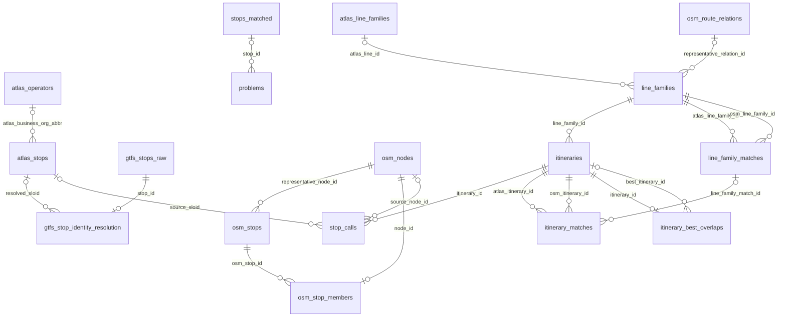

# A1 Database & bundle import

The review application keeps everything it shows in one PostgreSQL database with PostGIS, `import_db`: stops and their matches, GTFS identities, routes and problems. This chapter describes the tables. How a [result bundle](../engine/documentation/Result%20bundle%20format.md) gets into them is explained in [A1.1 Bundle import and publication](1.1%20Import%20Process.md).

The tables hold a **snapshot**: the projection of one bundle. Each import validates a new bundle, loads it into a private staging schema and then replaces all snapshot tables in one transaction, so the database never mixes two runs. `dataset_publication` records the manifest of the published run and changes in the same transaction.

Alembic migrations (`migrations/`) own the table structure; `backend/importing/` writes the rows; the engine never connects to this database. Table and column names such as `atlas_stops` and `sloid` come from the Swiss deployment; for another dataset they hold its namespaced source records ([A3](3.%20System%20Architecture.md#swiss-names-in-the-database)).

## Tables

### Stops and identities

| Table | One row per |
|---|---|
| `stops_matched` | Map entry: a matched pair, an effectively matched trio middle, an unmatched ATLAS platform or an unmatched OSM element (`stop_type`), with its match type, both positions, distance and a display point (`geom`, spatially indexed) |
| `atlas_stops` | ATLAS platform, with its name, platform code, operator and duplicate group |
| `atlas_operators` | Operator of ATLAS platforms, by abbreviation |
| `osm_nodes` | OSM element, with its projected tags |
| `osm_stops`, `osm_stop_members` | OSM stop unit (single, pair or trio), and which elements belong to it with which role |
| `gtfs_stops_raw` | GTFS stop of the Swiss feed |
| `gtfs_stop_identity_resolution` | Resolution of a GTFS `stop_id` to a SLOID ([E1.2](../engine/documentation/1.2%20GTFS%20ATLAS%20data.md)) |
| `problems` | Problem attached to a `stops_matched` row, with type and priority |

### Routes

| Table | One row per |
|---|---|
| `atlas_line_families`, `osm_route_relations` | Raw source family and OSM route relation; the only raw route tables kept |
| `line_families`, `itineraries`, `stop_calls` | The normalized route model ([E3](../engine/documentation/3.%20Routes.md)): line, direction or variant, ordered stop |
| `line_family_matches`, `itinerary_matches` | Engine route matches |
| `itinerary_best_overlaps` | Comparable itinerary, with its best counterpart of the other source |

`itinerary_best_overlaps` stores, for every ATLAS and OSM itinerary of a GTFS route family, the itinerary of the other source that shares the most stops with it in the same order, the number of those stops and the overlap ratio. `best_itinerary_id` is empty when no itinerary of the other source shares a stop. The importer computes these rows from the bundle's own route rows and publishes them with the snapshot. They are not engine results and never change `itinerary_matches`; the route browser shows them as the "Highest overlap" of unmatched variants. [A2.6](2.6%20Routes%20Pages.md#variant-stop-overlap) explains the definition and the algorithm.

## Relationships

The diagram shows the database foreign keys. `o|` on the parent side marks a nullable key. Unique constraints limit each GTFS stop to one resolution row and each OSM element to one stop unit. `stops_matched` refers to `atlas_stops` and `osm_nodes` through `sloid` and `osm_node_id` without database foreign keys; those joins exist only in the ORM, so the diagram omits them. [`documentation/print_er_diagram/`](print_er_diagram/README.md) generates a printable diagram of every column.

## What lives outside the snapshot

`dataset_publication` is not replaced by an import. Any future record of human review decisions must also live outside the snapshot tables and refer to the bundle's stable entity and problem keys, so that a new run does not erase it. Runtime state, such as pipeline status and export tasks, is kept in files, not in the database ([A3](3.%20System%20Architecture.md#who-owns-which-state)).

## Related pages

- [A1.1 Bundle import and publication](1.1%20Import%20Process.md)
- [A1.2 Statistics and timestamps](1.2%20Stats%20and%20timestamps.md)
- [A2.6 Routes pages](2.6%20Routes%20Pages.md)
- [E3 Routes](../engine/documentation/3.%20Routes.md) and [E5.1 Source snapshot caching](../engine/documentation/5.1%20Source%20snapshot%20caching.md)
