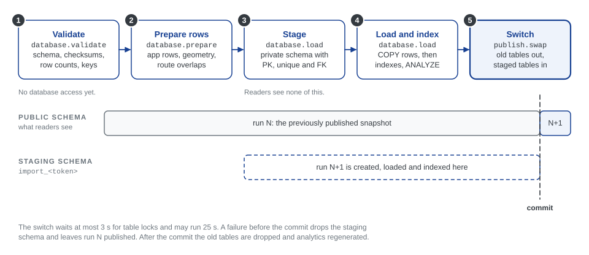

# A1.1 Bundle import and publication

The importer turns a [result bundle](../engine/documentation/Result%20bundle%20format.md) into the published database snapshot. It validates the bundle, projects it onto the application's tables, loads it beside the current data and switches it in at once. This page explains each step and what happens when one fails. Run it yourself with:

```bash
python -m backend.importing.importer /path/to/result-bundle
```

The importer makes no matching decisions: matches, stop groups, problems and route matches all come from the engine. It reads no ATLAS, GTFS or OSM files. Its only computation of its own is the [route overlap](#derived-route-overlaps) review aid.



Readers keep using the previous snapshot until one short transaction swaps in the new one. Each step shows its progress stage, as listed on the Data page ([A3.5](3.5%20Pipeline%20Progress.md)).

## 1. Validate (`database.validate`)

`backend/importing/bundle.py` reads schema version 1 and checks, before touching the database:

- the manifest and the presence, size, SHA-256 checksum and row count of all nine files;
- coordinates and entity identities;
- that every entity is matched or unmatched, exactly once;
- that the optional `disused` flag of an OSM `unmatched` row, false when absent, agrees with the element's `lifecycle`; a disused element is never effectively matched, needs no `unmatched` problem, and is the only kind of element a `disused` problem may reference;
- that matches, groups, problems and routes refer to existing entities.

The reader is the application's own implementation of the format: it imports no engine code.

The same stage then compares the bundle with the published snapshot, whose manifest is in `dataset_publication`. `check_against_published()` in `backend/importing/importer.py` refuses the bundle when the row count of `source_stops` (ATLAS platforms), `osm_nodes` (OSM elements) or `matches` is more than `PIPELINE_MAX_DROP_PERCENT` (default `20`) below the published one, with a message such as `Refused to publish: OSM elements fell from 61,204 to 0, more than the 20% allowed`. Broken inputs often still parse but yield far fewer records, and this keeps such a run from replacing a good dataset. The first publication has nothing to compare with. To publish an intended large drop, run once with `PIPELINE_MAX_DROP_PERCENT=100`, which disables the check.

## 2. Prepare rows (`database.prepare`)

`backend/importing/projection.py` maps the bundle's source-neutral records onto the application's fields: `source_routes` fill `atlas_line_families`, the `source` side of families, itineraries and matches becomes `atlas`, and stop calls keep their source stop as `source_sloid`. Swiss `atlas:<sloid>` keys become plain SLOIDs; other datasets keep their complete namespaced keys. The `atlas_*` names are local to the application and do not constrain the engine. GTFS identity rows and statistics arrive as optional extensions; when they are absent, the views that need them stay empty.

`backend/importing/importer.py` then builds the insert rows, geometries and relationships, and fills `itinerary_best_overlaps`. Every `osm_nodes` row keeps all tags of its element in `osm_tags`.

### Match types

The engine names match types, some after the dataset profile (`uic_` for Switzerland), and renames them when the profile changes. So the importer copies each match's `method` into `stops_matched.match_type` and never names one itself. A row without a match in the bundle has no match type. That includes the [effectively matched](0.5%20Glossary.md#effectively-matched) middle of a two-sided stop, which its `stop_type` tells apart. The one exception is `no_nearby_counterpart`, the application's own label for an [isolated](0.5%20Glossary.md#isolated) ATLAS platform.

`backend/services/matching_rules.py` is the only file of the application that spells match types; the filters and the analytics page look them up there by rule key. When the engine renames or adds a match type, add it to that file. The engine import contract test fails until you do, and names the missing type.

### Disused OSM elements

[Disused OSM elements](0.5%20Glossary.md#disused-osm-element) are not stops. `project_bundle()` puts them in `disused_osm` and keeps them out of `all_osm_nodes`, `unmatched_osm` and `osm_stop_units`, so they appear in no stop unit and no stop count. The importer writes their `osm_nodes` row, with `osm_lifecycle` and all tags, and a `stops_matched` row with `stop_type = osm_disused`, but no `osm_stops` or `osm_stop_members` rows. Their problems attach to that row like any other.

### Derived route overlaps

While preparing the rows, `build_fast_insert_payloads()` also fills `itinerary_best_overlaps` from the bundle's route rows: a review aid for the route browser that is published with the snapshot and never changes an engine decision. [A2.6 Variant stop overlap](2.6%20Routes%20Pages.md#variant-stop-overlap) explains what it stores and how it is computed.

## 3. Stage, and 4. load and index (`database.load`)

`backend/importing/publication.py` creates a private schema with a unique name, `import_<token>`, and creates every application table in it with its primary key, unique and foreign-key constraints. Foreign keys point to the staged tables, so PostgreSQL rejects an inconsistent row before anything is published. The rows are then loaded, the secondary and spatial indexes built, sequences advanced and the tables analysed. Readers see none of this.

## 5. Switch (`publish.swap`)

One short transaction makes the new run visible:

1. take an advisory lock, so that two imports never switch at the same time, even outside the scheduler;
2. lock the public snapshot tables, in a fixed order;
3. move the current tables into a schema `previous_<token>`, and the staged tables into `public`;
4. record the new manifest in `dataset_publication`;
5. commit.

PostgreSQL keeps each table's internal references while it moves between schemas. The transaction waits at most **3 seconds** for its locks and allows **25 seconds** per statement. After the commit, the previous schema is dropped and analytics are regenerated (`publish.analytics`).

## When something fails

| Failure | Result |
|---|---|
| Validation, projection, loading or indexing | The staging schema is dropped. The previous snapshot stays published. |
| A count fell by more than `PIPELINE_MAX_DROP_PERCENT` | `database.validate` fails before anything is staged. The previous snapshot stays published. |
| The switch cannot get its locks within 3 s, or exceeds 25 s | The transaction rolls back. The previous snapshot stays published. |
| Dropping the old schema after a successful switch | Logged separately; the publication still counts as successful |
| Generating analytics after the switch | The run ends as "Dataset published with warnings" ([A3.5](3.5%20Pipeline%20Progress.md#application-stages)) |

Only the importer's own tables are replaced; other tables are outside the publication set. The database account that imports needs permission to create schemas and to move these tables.

## Migrations and versions

Alembic owns the database structure; the bundle's `schema_version` owns the file format. They are independent: a database migration does not need a new bundle schema. Run migrations before importing; in Docker Compose, the one-shot `migrator` service does it.

One migration, `migrations/versions/0001_schema.py`, creates the whole schema of `backend/models.py`, and `tests/test_migrations.py` fails when the two differ. A schema change edits the models and adds a plain migration after `0001`; it needs no "if the column exists" guard, because a fresh database and an upgraded one reach the same shape by the same steps. Each import then rebuilds the tables from the models.

## Try it with the example bundle

A small synthetic bundle with matched and unmatched records runs the interface without a matching run:

```bash
./scripts/verify_engine_checkout.sh
REVIEW_CONFIG=config/gtfs-example.json docker compose up --build -d db migrator app
docker compose run --rm --no-deps --entrypoint '' app python -m backend.importing.importer tests/fixtures/result-v1
```

Then open `http://localhost:5001`.

- The import runs no engine code, and the `app` image contains none. Its build still copies the engine's documentation from the engine checkout (`ENGINE_DIR`, by default `../engine`); `scripts/verify_engine_checkout.sh` checks that the checkout is at the commit pinned in `engine.ref` and has no uncommitted files.
- `REVIEW_CONFIG=config/gtfs-example.json` selects a [review configuration](0.5%20Glossary.md#review-configuration) without Swiss specifics: title, labels, map defaults and feature availability. Set it in `.env` to keep it on later starts; the default is `config/switzerland.json`.
- The fixture is meant for a local development database. It is available through the development Compose bind mount, and application images do not contain it. Importing it publishes it as the active dataset.

## Loading performance

The importer streams rows with PostgreSQL `COPY` on the staging session's own connection and transaction (`backend/importing/bulk.py`):

- Primary keys, unique constraints and foreign keys are enforced during the load; secondary and spatial indexes are built after it, then `ANALYZE` runs.
- JSON is adapted explicitly, and geometry is passed as EWKT with SRID 4326. Rows that omit columns with server defaults are loaded separately, so the defaults still apply.
- New rows get deterministic IDs inside the empty staging tables, so problems can reference their stops without `INSERT … RETURNING` round trips. Sequences, including those of route tables with explicit IDs, are advanced past the loaded IDs before publication.
- No ID is allocated in, or written to, the published snapshot while staging.

| Setting | Default | Meaning |
|---|---|---|
| `DB_IMPORT_BATCH_SIZE` | `10000` | Largest number of rows per bulk operation |

The import logs the time of validation, projection, row preparation, each table's load, index creation and publication separately.

## Tests

- `tests/test_result_bundle.py` covers malformed manifests, partial files, invalid coordinates and references, complete projection, disused elements (projection, tags and inconsistent flags), and importing with engine imports blocked.
- `tests/test_snapshot_publication.py` uses a real PostGIS database to check publication, rollback after a failed load, that readers keep the old snapshot during staging, the lock timeout, escaping in text and JSON, null geometry, defaults, indexes, sequences, and that route overlaps are published with their snapshot.
- `tests/test_engine_import_contract.py` runs the real engine on its three examples and imports each bundle into PostGIS, so a field the database rejects fails before a deployment does. It also checks that every stored match type is copied from the bundle, and that `matching_rules.py` lists every match type of the Swiss examples.
- `tests/test_match_type_names.py` fails on a match type typed by hand anywhere in `backend/` outside `matching_rules.py`, and on a map filter whose value that file does not know.

Set `TEST_POSTGRES_URI` to a disposable PostGIS database whose name ends in `_test`: these tests reset its public schema. They test behaviour, not production performance.

## Code

| File | Role |
|---|---|
| `backend/importing/bundle.py` | Reads and validates the result bundle without engine code |
| `backend/importing/projection.py` | `project_bundle()`: maps the bundle's records onto the application's fields |
| `backend/importing/importer.py` | The orchestrator: `check_against_published()`, `build_fast_insert_payloads()`, `import_bundle()` and the analytics after the switch |
| `backend/importing/publication.py` | `publish_snapshot()`: the staging schema and the switch |
| `backend/importing/bulk.py` | The `COPY` writer on the staging connection |

## Related pages

- [Result bundle format](../engine/documentation/Result%20bundle%20format.md): the files the importer reads
- [A1 Database](1.%20Database.md): the tables a publication replaces
- [A1.2 Statistics and timestamps](1.2%20Stats%20and%20timestamps.md): the analytics files written after the switch
- [A3.5 Pipeline progress](3.5%20Pipeline%20Progress.md): the stages each step reports
