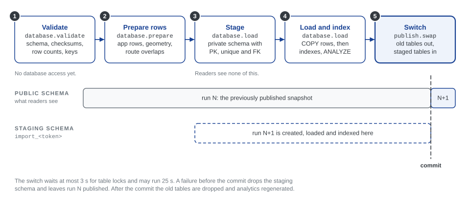

# A1.1 Bundle import and publication

The importer turns a [result bundle](../engine/documentation/Result%20bundle%20format.md) into the published database snapshot. It validates the bundle, projects it onto the application's tables, loads it beside the current data and switches it in at once. This page explains each step and what happens when one fails. Run it yourself with:

```bash
python -m backend.importing.importer /path/to/result-bundle
```

The importer makes no matching decisions: matches, stop groups, problems and route matches all come from the engine. It reads no ATLAS, GTFS or OSM files. Its only computation of its own is the [route overlap](#derived-route-overlaps) review aid.



Readers keep using the previous snapshot until one short transaction swaps in the new one. Each step shows its progress stage, as listed on the Data page ([A3.5](3.5%20Pipeline%20Progress.md)).

## 1. Validate (`database.validate`)

`backend/importing/bundle.py` reads schema version 1 and checks, before touching the database:

- the manifest and the presence, size, SHA-256 checksum and row count of all nine files;
- coordinates and entity identities;
- that every entity is matched or unmatched, exactly once;
- that matches, groups, problems and routes refer to existing entities.

The reader is the application's own implementation of the format: it imports no engine code.

## 2. Prepare rows (`database.prepare`)

`backend/importing/projection.py` maps the bundle's source-neutral records onto the application's fields: `source_routes` fill `atlas_line_families`, the `source` side of families, itineraries and matches becomes `atlas`, and stop calls keep their source stop as `source_sloid`. Swiss `atlas:<sloid>` keys become plain SLOIDs; other datasets keep their complete namespaced keys. The `atlas_*` names are local to the application and do not constrain the engine. GTFS identity rows and statistics arrive as optional extensions; when they are absent, the views that need them stay empty.

`backend/importing/importer.py` then builds the insert rows, geometries and relationships, and fills `itinerary_best_overlaps`.

### Derived route overlaps

For every ATLAS and OSM itinerary of a GTFS route family, `build_fast_insert_payloads()` finds the itinerary of the other source that shares the most stops in the same order, and stores that counterpart, the number of shared stops and the overlap ratio.

- **Input:** only this bundle's projected `line_families`, `itineraries` and `stop_calls`. It reads neither the database nor raw files.
- **When:** during *Prepare application records*, logged as the `import.itinerary_best_overlaps` timing stage; about 8 seconds for the Swiss dataset.
- **Publication:** the rows are staged and switched with the rest of the snapshot, so they always describe the published itineraries.
- **Scope:** a review aid for the route browser. It never changes `itinerary_matches` or any other engine decision.

[A2.6](2.6%20Routes%20Pages.md#variant-stop-overlap) explains the definition, the search algorithm and how route cards show the result.

**After upgrading:** migration `20261017_000007` adds the table empty, so until the next import, route cards say "Overlap not computed" for unmatched variants. The next pipeline run fills it. To fill it for the dataset already published, re-import that dataset's bundle: pipeline runs keep bundles in `data/results/<directory>/`; use the one whose `manifest.json` `run_id` matches the active run.

```bash
docker compose run --rm --no-deps --entrypoint '' app python -m backend.importing.importer data/results/<directory>
```

## 3. Stage, and 4. load and index (`database.load`)

`backend/importing/publication.py` creates a private schema with a unique name, `import_<token>`, and creates every application table in it with its primary key, unique and foreign-key constraints. Foreign keys point to the staged tables, so PostgreSQL rejects an inconsistent row before anything is published. The rows are then loaded, the secondary and spatial indexes built, sequences advanced and the tables analyzed. Readers see none of this.

## 5. Switch (`publish.swap`)

One short transaction makes the new run visible:

1. take an advisory lock, so that two imports never switch at the same time, even outside the scheduler;
2. lock the public snapshot tables, in a fixed order;
3. move the current tables into a schema `previous_<token>`, and the staged tables into `public`;
4. record the new manifest in `dataset_publication`;
5. commit.

PostgreSQL keeps each table's internal references while it moves between schemas. The transaction waits at most **3 seconds** for its locks and allows **25 seconds** per statement. After the commit, the previous schema is dropped and analytics are regenerated (`publish.analytics`).

## When something fails

| Failure | Result |
|---|---|
| Validation, projection, loading or indexing | The staging schema is dropped. The previous snapshot stays published. |
| The switch cannot get its locks within 3 s, or exceeds 25 s | The transaction rolls back. The previous snapshot stays published. |
| Dropping the old schema after a successful switch | Logged separately; the publication still counts as successful |
| Generating analytics after the switch | The run ends as "Dataset published with warnings" ([A3.5](3.5%20Pipeline%20Progress.md#application-stages)) |

Only the importer's own tables are replaced; other tables are outside the publication set. The database account that imports needs permission to create schemas and to move these tables.

## Migrations and versions

Alembic owns the database structure; the bundle's `schema_version` owns the file format. They are independent: a database migration does not need a new bundle schema. Run migrations before importing; in Docker Compose, the one-shot `migrator` service does it.

## Try it with the example bundle

Without installing the engine:

```bash
docker compose up -d db migrator
docker compose run --rm --no-deps --entrypoint '' app python -m backend.importing.importer tests/fixtures/result-v1
```

The synthetic fixture is meant for a local development database; it is available through the development Compose bind mount, and application images do not contain it. Importing it publishes it as the active dataset.

## Loading performance

The default writer streams rows with PostgreSQL `COPY` on the same connection and transaction that own the staging schema (`backend/importing/bulk.py`):

- Primary keys, unique constraints and foreign keys are enforced during the load; secondary and spatial indexes are built after it, then `ANALYZE` runs.
- JSON is adapted explicitly, and geometry is passed as EWKT with SRID 4326. Rows that omit columns with server defaults are loaded separately, so the defaults still apply.
- New rows get deterministic IDs inside the empty staging tables, so problems can reference their stops without `INSERT … RETURNING` round trips. Sequences, including those of route tables with explicit IDs, are advanced past the loaded IDs before publication.
- No ID is allocated in, or written to, the published snapshot while staging.

| Setting | Default | Meaning |
|---|---|---|
| `DB_IMPORT_METHOD` | `copy` | `insert` selects the ORM writer, kept for comparison; it uses the same staging and indexing |
| `DB_IMPORT_BATCH_SIZE` | `10000` | Largest number of rows per bulk operation |

The import logs time validation, projection, row preparation, each table's load, index creation and publication separately. [E5.2](../engine/documentation/5.2%20Pipeline%20Performance.md#measured-results) lists measured national import times.

## Tests

- `tests/test_result_bundle.py` covers malformed manifests, partial files, invalid coordinates and references, complete projection, and importing with engine imports blocked.
- `tests/test_snapshot_publication.py` uses a real PostGIS database to check publication, rollback after a failed load, that readers keep the old snapshot during staging, the lock timeout, identical tables from `COPY` and `INSERT`, escaping, null geometry, defaults, indexes, sequences, and that route overlaps are published with their snapshot.

Set `TEST_POSTGRES_URI` to a disposable PostGIS database whose name ends in `_test`: these tests reset its public schema. They test behaviour, not production performance.
