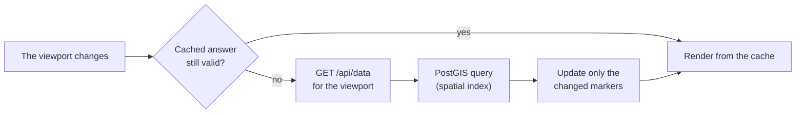

# A2.1 Map data loading and rendering

The main map shows tens of thousands of stops, so it never loads them all at once. It asks the server only for the stops in the visible area, limits how many it draws at low zoom, reuses earlier answers when it can, and updates existing markers instead of redrawing them. This page explains those mechanisms; [A2.2](2.2%20Filters%20and%20Search%20logic.md) explains the filters that every request carries.



## The viewport request

The browser calls `/api/data` with the bounding box of the visible area, slightly enlarged, and the active filters. The server selects the matching `stops_matched` rows whose display point lies in the box:

```sql
SELECT * FROM stops_matched
WHERE ST_Intersects(
    geom,
    ST_MakeEnvelope(min_lon, min_lat, max_lon, max_lat, 4326)
)
```

A second branch adds matched rows whose OSM point is in the box while their ATLAS point is outside, so a match that crosses the edge of the view is not lost. `geom` has a GiST spatial index.

## Zoom levels

| Zoom | Mode | What is loaded |
|---|---|---|
| below 13 | Overview | Without filters, only unmatched ATLAS platforms; with filters, the filtered rows, capped |
| 13 and 14 | Limited | All rows, or the filtered ones, capped at 1,800 |
| 15 and above | Full | Every row of the viewport, without a cap |

A banner explains a limited view: in overview mode it says that only unmatched ATLAS platforms are shown; when results are capped, for example "Showing first 1800 filtered results…", it suggests zooming in. The banner disappears at zoom 15, and also when the real number of rows stays below the cap. While a *Top N* distance filter is active ([A2.2](2.2%20Filters%20and%20Search%20logic.md#top-n-distances)), the map skips viewport loading and hides the banner, because that overlay loads its own rows.

The thresholds come from `static/js/shared/constants.js` and are shared by every map through `MapShared.getViewportZoomPolicy()`.

## Reusing answers

`MapViewportLoader` keeps the last answer, the visible and the enlarged request bounds, the zoom and a request identity. A new view reuses the cached answer when:

| Change | Reused? |
|---|---|
| Same zoom, still inside the enlarged bounds | Yes |
| Zooming in, the cached answer was not capped, still inside the enlarged bounds | Yes |
| Zooming out, a zoom change while capped, or moving past the enlarged bounds | No |
| Any filter change | No: `invalidateViewportCache()` clears it |

The request identity combines the zoom mode, the active filters and the `limit`; the exact zoom, offset and bounding box are deliberately left out, so an uncapped answer stays reusable while zooming in. This cache covers `/api/data` only. The summary statistics (`/api/global_stats`, [A2.3](2.3%20Global%20Stats.md)) are requested separately, with the same filters.

## Markers

Markers are keyed by `atlas-<sloid>` or `osm-<node_id>`. After each answer, existing markers are moved with `setLatLng()`, new ones added and missing ones removed, so the map does not flicker.

| Zoom | Marker type |
|---|---|
| below 18 | `L.circleMarker`, drawn on a canvas |
| 18 and above | `L.marker` with a letter for the categories below; circles otherwise |

At zoom 18 markers are recreated in their lettered form:

| Side | When | Letter |
|---|---|---|
| ATLAS | The platform belongs to a duplicate group | `D` |
| OSM | `public_transport=platform` | `P` |
| OSM | A railway station | `S` |

Colours, defined in [A2.7](2.7%20Colours%20and%20styles.md):

| Marker | Colour |
|---|---|
| Matched ATLAS | Navy `#174092` |
| Matched OSM | Green `#4CAF50` |
| Unmatched ATLAS | Red `#DC3545` |
| Unmatched OSM | Grey `#6C757D` |

Lines between matched ATLAS and OSM stops appear from zoom 13, the dashed lines of OSM pairs and trios from zoom 17.

## Stops at the same position

Several stops often share almost the same coordinates. `MarkerClusterManager` spreads them in a small circle so each stays clickable. It projects the positions to pixels at a fixed reference zoom, groups points that fall into the same grid cell, and offsets each member of a group:

```javascript
const point = map.project([lat, lon], referenceZoom);
const cellX = Math.floor(point.x / overlapDistance);
const cellY = Math.floor(point.y / overlapDistance);

const angle = (2 * Math.PI * index) / groupSize;
const displayPoint = {
    x: point.x + offsetRadius * Math.cos(angle),
    y: point.y + offsetRadius * Math.sin(angle)
};
const displayLatLng = map.unproject(displayPoint, referenceZoom);
```

Members are sorted by entity type and key first, so the layout is stable. Without a map projection, points within `0.00001` degrees count as the same position. At low zoom, offsets smaller than a pixel are skipped.

## Base maps

| Layer | Tiles from |
|---|---|
| OpenStreetMap | `tile.openstreetmap.org` |
| Transport | `tile.memomaps.de` |
| Satellite | Esri World Imagery, `server.arcgisonline.com` |

Tiles are the only external resources the browser loads ([A3.4](3.4%20Frontend%20Asset%20Management.md#what-stays-external)).

## Code

| File | Role |
|---|---|
| `backend/blueprints/data.py` | `/api/data` |
| `static/js/pages/main.js` | The main map and its requests |
| `static/js/components/map-viewport-loader.js` | Viewport cache |
| `static/js/components/map-shared.js` | Zoom policy and base layers |
| `static/js/components/map-renderer.js` | Markers and lines |
