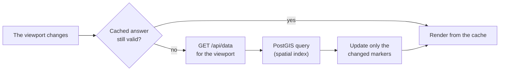

# A2.1 Map data loading and rendering

The main map shows tens of thousands of stops, so it never loads them all at once. It asks the server only for the stops in the visible area, limits how many it draws at low zoom, reuses earlier answers when it can, and updates existing markers instead of redrawing them. This page explains those mechanisms; [A2.2](2.2%20Filter%20and%20search%20logic.md) explains the filters that every request carries.



## The viewport request

The browser calls `/api/data` with the bounding box of the visible area, enlarged by 35 % of its size on each side (50 % below zoom 13), and the active filters. The server selects the matching `stops_matched` rows whose display point lies in the box:

```sql
SELECT * FROM stops_matched
WHERE ST_Intersects(
    geom,
    ST_MakeEnvelope(min_lon, min_lat, max_lon, max_lat, 4326)
)
```

A second branch adds matched rows whose OSM point is in the box while their ATLAS point is outside, so a match that crosses the edge of the view is not lost. `geom` has a GiST spatial index.

JSON answers of 1 KiB or more go out gzipped to browsers that accept it (`gzip_json()` in `backend/app.py`).

## Zoom levels

| Zoom | Mode | What is loaded |
|---|---|---|
| below 13 | Overview | Without filters, only unmatched ATLAS platforms; with filters, the filtered rows, capped |
| 13 and 14 | Limited | All rows, or the filtered ones, capped at 1,800 |
| 15 and above | Full | Every row of the viewport, without a cap |

The overview without filters is a display choice, not a filter ([A2.2](2.2%20Filter%20and%20search%20logic.md)): the request sends `stop_filter=atlas_unmatched` and `node_type=atlas`, and the map draws only the ATLAS side. As soon as any filter is active, the request carries the filters instead.

A banner explains a limited view: in overview mode it reads "Showing only unmatched ATLAS stops. Zoom in to see all."; when results are capped it says so and suggests zooming in, for example "Showing 1,800 filtered stops. Zoom in to see all."; with filters and every result loaded it gives the count, "245 stops match the filters." The banner disappears at zoom 15, and at zoom 13 and 14 without filters when the real number of rows stays below the cap. While a *Top N* distance filter is active ([A2.2](2.2%20Filter%20and%20search%20logic.md#top-n-distances)), the map skips viewport loading and hides the banner, because that overlay loads its own rows.

The thresholds come from `static/js/shared/constants.js` and are shared by every map that loads by viewport through `MapShared.getViewportZoomPolicy()`.

## Reusing answers

`MapViewportLoader` keeps the last answer, the visible and the enlarged request bounds, the zoom and a request identity. A new view reuses the cached answer when:

| Change | Reused? |
|---|---|
| Same zoom, still inside the enlarged bounds | Yes |
| Zooming in, the cached answer was not capped, still inside the enlarged bounds | Yes |
| Zooming out, a zoom change while capped, or moving past the enlarged bounds | No |
| Any filter change | No: `invalidateViewportCache()` clears it |

The request identity combines the zoom mode, the active filters and the `limit`; the exact zoom, offset and bounding box are deliberately left out, so an uncapped answer stays reusable while zooming in. This cache covers `/api/data` only. The summary statistics (`/api/global_stats`, [A2.3](2.3%20Global%20statistics.md)) are requested separately, with the same filters.

## Markers

Markers are keyed by `atlas:<sloid>` or `osm:<node_id>`. After each answer, existing markers are moved with `setLatLng()`, new ones added and missing ones removed, so the map does not flicker.

| Zoom | Marker type |
|---|---|
| below 18 | `L.circleMarker`, drawn on a canvas |
| 18 and above | `L.marker` with a letter for the categories below; circles otherwise |

`MapCore` gives every map one canvas for its circle markers and lines, so panning stays smooth with thousands of them on slower devices. The canvas reaches 0.3 of the view beyond each edge, so a drag shows what is there before the redraw at its end; above about 0.35, a full-screen iPad would pass Safari's 16.7-megapixel canvas limit and draw nothing. On a touch screen, a tap up to 5 px outside a marker still hits it. A lettered marker is an SVG icon as wide as the circle it replaces, border included.

At zoom 18 markers are recreated in their lettered form. An open popup moves to the new marker as it is, keeping its view, width and the place it was dragged to (`MapPopupController.transfer()`, `L.DraggablePopup.setSource()`):

| Side | When | Letter |
|---|---|---|
| ATLAS | The platform belongs to a duplicate group | `D` |
| OSM | `public_transport=platform` | `P` |
| OSM | A railway station | `S` |
| OSM | A [disused element](0.5%20Glossary.md#disused-osm-element) (`stop_type = osm_disused`), whatever its type | `U` |

Colours, defined in [A2.7](2.7%20Colours%20and%20styles.md):

| Marker | Colour |
|---|---|
| Matched ATLAS | Navy `#174092` |
| Matched OSM | Green `#4CAF50` |
| Unmatched ATLAS | Red `#DC3545` |
| Unmatched OSM | Grey `#6C757D` |
| Disused OSM | Hollow ring: grey `#6C757D` stroke and letter, white fill |

Lines between matched ATLAS and OSM stops appear from zoom 13, the dashed lines of OSM pairs and two-sided stops from zoom 17. Lines ignore the pointer, so a click on one reaches the marker or the map under it.

### Legend

A **Legend** control above the layer switcher explains the marker colours, the disused ring, the two kinds of line with the zoom they appear at, and the letters of zoom 18 (`static/js/components/map-legend.js`). It opens on a first visit to a screen wider than 768 px and starts closed on a narrower one; after that it stays as the viewer left it (`localStorage` key `mapLegendOpen`). Its swatches use the `--color-map-*` tokens, so they match the markers in both themes.

## Stop popups

Clicking a marker opens its popup and clicking it again closes it, for circles and lettered markers alike; a popup opened again starts on the stop's card. A popup loads its stop from a single-stop endpoint: `/api/stop_popup` for a clicked marker, `/api/stop_by_id` after a search. For an OSM element matched to several ATLAS stops, `/api/stop_popup` returns all of them, so the popup is the same at every zoom and whichever stops are loaded. Both add `osm_tags`, so an OSM popup has a collapsible **OSM tags (N)** section that lists every tag of the element, sorted by key and HTML-escaped (`.popup-osm-tags`). List payloads such as `/api/data` carry no tags: `/api/data` builds its own short rows, and `format_stop_data()` reads the deferred column only with `include_osm_tags=True` ([A1](1.%20Database%20%26%20bundle%20import.md#stops-and-identities)). Popups rendered from them, or with `hideRoutesAndNotes`, show no tag section.

A disused element's popup is headed "Disused OSM Node" and has a Status row that names its prefix, such as "Out of service in OSM (`disused:` prefix); never matched". Like an unmatched element, it shows no distance or match type.

The info icon after a match type opens the section of the docs that explains its rule, such as [Nearest-candidate rules](../engine/documentation/2.4%20Distance%20matching.md#nearest-candidate-rules) for `distance_ratio` (`getMatchDocUrl()` in `static/js/components/popup-renderer.js`).

Every stop popup opens 260 px wide (`AppConstants.POPUP.WIDTH_PX`), whichever source it shows. At that width the button row fits on one line and each coordinate fits on its own line. Coordinates show at most 7 decimals, as OSM stores them. A small map narrows the popup to 60 % of its width. The user can resize it by its edges up to 420 px (`RESIZE_MAX_WIDTH_PX`), and that width is kept until the popup closes.

**See Matches** keeps that width and compares one matched pair at a time, with ATLAS on the left and OSM on the right. The table lists the fields both sources describe: ID, UIC Ref, Name, Platform (ATLAS `designation` beside OSM `local_ref`), Operator (the business organisation beside `operator`) and Coord. Fields only OSM has, such as `uic_name`, `network`, the Wikidata IDs and the element type, are in the pair's Tags panel. A UIC Ref or Platform that differs between the two sides, or an operator mismatch, is highlighted. Distance and Match Type describe the pair, so their rows span both columns. Below the table, the tabs **ATLAS routes**, **OSM routes** and **Tags (N)** open one panel at a time, coloured by its source; a source without routes has a greyed-out tab. **Close Matches** at the top returns to the stop's card. A stop with several matches, such as an ATLAS stop matched to an OSM platform and its stop position, reads **See Matches (2)**, and tabs above the table pick the pair. Each tab names the match by what tells it apart, the OSM element type or the ATLAS platform code, and shows its distance. Switching views, pairs or panels lays the popup out in the same frame. Its width and bottom edge stay where they were, also after the user dragged it, because a drag is stored as an offset from the popup's marker.

When the map opens a popup itself (a SLOID or OSM node search, a `?sloid=` or `?osm=` link, or **Random**), it places the stop two thirds down the map instead of in the middle, so the popup above it stays clear of the top. UIC and route searches open no popup and centre the stop. The popup opens once the new view has loaded, on the marker the map draws for the stop, so the stop keeps one marker and its match lines start from it. Only a stop the active filters leave out of the map gets a marker of its own, which goes as soon as the map draws the stop.

## Stops at the same position

Several stops often share almost the same coordinates. `MarkerClusterManager` spreads them in a small circle so each stays clickable. It projects the positions to pixels at a fixed reference zoom (the map's maximum), adds each point to the nearest group whose first point lies within `overlapDistance` (10 px), using a grid of cells that size to find the candidates, and moves each member of a group `offsetRadius` (5 px) away from the group's centre:

```javascript
const point = map.project([lat, lon], referenceZoom);
const cellX = Math.floor(point.x / overlapDistance);
const cellY = Math.floor(point.y / overlapDistance);

// (dx, dy): unit vector from the group's centre to the member; a member
// exactly at the centre takes the angle (2 * Math.PI * index) / groupSize.
const displayPoint = {
    x: point.x + offsetRadius * dx,
    y: point.y + offsetRadius * dy
};
const displayLatLng = map.unproject(displayPoint, referenceZoom);
```

Members are sorted by entity type and key first, so the layout is stable. Without a map projection, points within `0.00001` degrees count as the same position. At low zoom, offsets smaller than half a pixel are skipped.

## Base maps

| Layer | Tiles from |
|---|---|
| OpenStreetMap | `tile.openstreetmap.org` |
| Transport | `tile.memomaps.de` |
| Satellite | Esri World Imagery, `server.arcgisonline.com` |

Tiles are the only external resources the browser loads ([A3.4](3.4%20Frontend%20asset%20management.md#what-stays-external)).

## Permalinks

The address bar keeps the map's view, open stop and filters, as [A2.9 Permalinks](2.9%20Permalinks.md#map) describes.

## Code

| File | Role |
|---|---|
| `backend/blueprints/data.py` | `/api/data` and `/api/stop_popup` |
| `static/js/pages/main.js` | The main map and its requests |
| `static/js/components/map-viewport-loader.js` | Viewport cache |
| `static/js/components/map-shared.js` | Zoom policy and base layers |
| `static/js/components/map-renderer.js` | Markers and lines |
| `static/js/components/map-entity-adapters.js` | Marker status and letter of each stop, including `disused` and `U` |
| `static/js/components/popup-renderer.js` | Stop popups and their OSM tag list |

## Related pages

- [A2.2 Filter and search logic](2.2%20Filter%20and%20search%20logic.md): the filters every viewport request carries
- [A2.3 Global statistics](2.3%20Global%20statistics.md): the live summary beside the map
- [A2.7 Colours and styles](2.7%20Colours%20and%20styles.md): what the marker and line colours mean
- [A2.9 Permalinks](2.9%20Permalinks.md#map): the view, stop and filters kept in the address bar
- [A1 Database](1.%20Database%20%26%20bundle%20import.md#stops-and-identities): the `stops_matched` rows behind each marker
