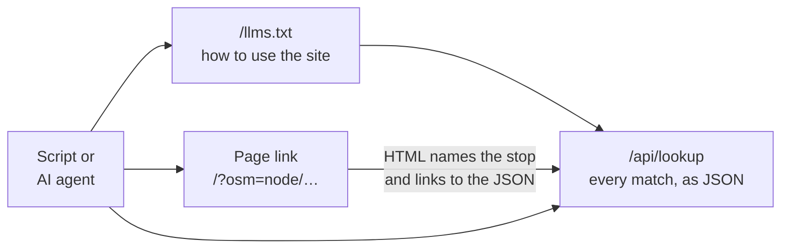

# A2.10 Public API

Scripts and AI agents can read the published [snapshot](0.1%20Glossary.md#snapshot) through one stable JSON endpoint, `/api/lookup`. This page describes that endpoint, what a page link tells a client that does not run JavaScript, and the two files that point agents to both: `/llms.txt` and `/robots.txt`. Read it when you write a script, a bot or an agent prompt against the application, or when you change one of these parts.



Read the diagram from left to right: whichever way a client arrives, it ends at the lookup, which returns the stop's matches as data.

## Why a separate endpoint

The pages draw their stops with JavaScript, so a client that only downloads HTML, such as a fetch tool or a link preview, sees an empty map. The other `/api/` endpoints serve those pages and are shaped for them:

- `/api/stop_popup` takes the database row number, which changes with every import.
- `/api/stop_by_id` returns one map entry, although a stop can be [matched](0.1%20Glossary.md#match) to several stops of the other source. In the Swiss snapshot, thousands of OSM elements and source stops have more than one match.
- Their parameters and fields change whenever a page needs it.

The lookup takes the identifiers of the [permalinks](2.9%20Permalinks.md), always returns every match, and keeps its fields stable.

## The lookup

### Request

`GET /api/lookup` takes one or more of these parameters:

| Parameter | Value | Example |
|---|---|---|
| `osm` | An [OSM element](0.1%20Glossary.md#osm-element), written as on openstreetmap.org: `node/<id>` or `way/<id>` | `osm=node/436199776` |
| `sloid` | A [source stop](0.1%20Glossary.md#source-stop) by its identifier, the [SLOID](0.1%20Glossary.md#sloid) for ATLAS | `sloid=ch:1:sloid:91391::1` |
| `uic_ref` | A station's [UIC number](0.1%20Glossary.md#uic-number): every source stop with that `uic_ref` and every OSM element tagged `uic_ref=` with it | `uic_ref=8591391` |

Several parameters narrow the result: an entry is returned only when it matches all of them. `sloid` together with `osm` names one matched pair, as Problems links do.

The parameters are those of the page links, so a link such as `/?osm=node/436199776` becomes `/api/lookup?osm=node/436199776`. The database stores ways as `way_<id>`; the lookup converts in both directions, so clients never see that form.

### Response

The response for `/api/lookup?osm=node/436199776`, with most OSM tags left out:

```json
{
  "count": 1,
  "query": {"osm": "node/436199776"},
  "results": [
    {
      "distance_m": 0.9,
      "match_type": "route_gtfs_tokens",
      "osm": {
        "id": "node/436199776",
        "lat": 47.389159,
        "local_ref": "3453",
        "lon": 8.5150562,
        "map_url": "/?osm=node/436199776",
        "name": "Technopark",
        "network": "ZVV",
        "operator": "VBZ",
        "tags": {"name": "Technopark", "public_transport": "stop_position", "railway": "tram_stop", "uic_ref": "8591391"},
        "uic_ref": "8591391",
        "url": "https://www.openstreetmap.org/node/436199776"
      },
      "problems": [{"priority": 3, "type": "duplicates"}],
      "source": {
        "designation": "",
        "lat": 47.38916303339,
        "lon": 8.51506696939,
        "map_url": "/?sloid=ch:1:sloid:91391::1",
        "name": "Zürich, Technopark",
        "operator": "VBZ",
        "sloid": "ch:1:sloid:91391::1",
        "uic_ref": "8591391"
      },
      "stop_type": "matched"
    }
  ],
  "snapshot": {
    "attribution": {"osm": "© OpenStreetMap contributors, ODbL", "source": "opentransportdata.swiss"},
    "generated_at": "2026-10-31T19:08:29.108620+00:00",
    "run_id": "aec79666-f78f-491f-8276-1dfbd24e4db8"
  },
  "source_label": "ATLAS",
  "truncated": false
}
```

| Field | Meaning |
|---|---|
| `query` | The parameters that were used |
| `source_label` | The name of the reference source in this deployment, from the [review configuration](0.1%20Glossary.md#review-configuration): `ATLAS` on atlas.osm.ch |
| `snapshot` | The published snapshot the data comes from: `run_id`, `generated_at` (when the engine produced it) and `attribution` (the data sources to credit). `null` before the first import. |
| `count` | The number of entries in `results` |
| `truncated` | `true` when more than 200 entries matched and only the first 200 are listed. The largest Swiss stations have a few dozen. |
| `results` | One entry per map entry, closest match first; entries without a distance come last |

Each entry of `results`:

| Field | Meaning |
|---|---|
| `stop_type` | `matched`, `effectively_matched`, `atlas_unmatched`, `osm_unmatched` or `osm_disused`, as in the `stops_matched` table ([A1](1.%20Database.md#stops-and-identities)) |
| `match_type` | The [match type](0.1%20Glossary.md#match-type) that made the match; `null` when unmatched |
| `distance_m` | The distance between the two positions, in metres, rounded to 0.1 m; `null` when unmatched |
| `source` | The source stop, or `null` for an OSM element without a source stop |
| `osm` | The OSM element, or `null` for a source stop without an OSM element |
| `problems` | The entry's [problems](0.1%20Glossary.md#problem) as `type` and `priority` (1 is the highest), highest priority first. The types are described in [E4.1](../engine/documentation/4.1%20Stop%20Problems.md). |

`source` holds `sloid`, `name` (the official stop name), `designation` (the [platform code](0.1%20Glossary.md#platform-code)), `uic_ref`, `operator` (the operator's abbreviation), `lat`, `lon` and `map_url`.

`osm` holds `id` (`node/<id>` or `way/<id>`), `url` (the element on openstreetmap.org), `name`, `uic_ref`, `local_ref`, `operator`, `network`, `lat`, `lon`, `tags` and `map_url`. `tags` lists every tag of the element; it is `null` for data imported before the bundle carried tags.

`map_url` is the [permalink](2.9%20Permalinks.md) that opens the stop's popup on the map. It is relative to the site that answered, so a local instance links to itself.

### Status codes

| Status | When |
|---|---|
| 200 | Always when the parameters are valid. `"count": 0` means no map entry has these identifiers in the published snapshot. |
| 400 | No parameter, or an `osm` value that is not `node/<id>` or `way/<id>`. The `error` field says what to send. |
| 429 | More than 60 requests per minute from one client ([A3.2](3.2%20Security%20and%20Rate%20Limits.md#rate-limits)) |
| 503 | The database is busy or unavailable, for example while a new snapshot is published. The response carries `Retry-After: 60`. |

An unknown stop returns 200, not 404, on purpose: some fetch tools hide the body of an error response, and an agent would then take an unknown stop for a missing endpoint.

### Stability rules

- Treat the response as a contract. Add fields when needed; rename or remove one only with an entry in the [changelog](Changelog.md).
- Use only identifiers that survive an import: SLOIDs, OSM ids and UIC numbers. Never expose a database row number.
- The data changes with every published snapshot; `snapshot.run_id` tells two snapshots apart.
- Only `/api/lookup` is public. The other `/api/` endpoints may change with any release.

## Page links without JavaScript

When the map (`/`) or the Problems page (`/problems`) is opened with a `sloid` or `osm` parameter, the server looks the stop up before it renders the page. The HTML then names the stop:

| Element | Content, for `/?osm=node/436199776` |
|---|---|
| `<title>` and `og:title` | `Technopark · node/436199776`, followed by the page's usual title |
| `<meta name="description">` and `og:description` | `OSM node/436199776 "Technopark" is matched to ATLAS ch:1:sloid:91391::1 "Zürich, Technopark" (0.9 m). Problems: duplicates P3.` |
| `<link rel="alternate" type="application/json">` | `/api/lookup?osm=node/436199776` |
| A visually hidden paragraph at the top of `<main>` | The description and the lookup link, for fetch tools that read only the body |

The description lists every match with its distance, or says that the stop has no direct match and gives its stop type. It ends with the stop's problems.

Chat applications and the OpenStreetMap community forum build their link previews from these tags, so a shared stop link shows the stop instead of the generic page title. The page sets no `og:url`: it would point to the canonical URL without parameters, and some preview services would describe that page instead.

When the link names no known stop, or its `osm` value is malformed, the page keeps its usual title and description; the browser then shows its usual message ([A2.9](2.9%20Permalinks.md#shared-behaviour)). When the database cannot answer, the page renders without the summary and logs a warning. The canonical URL and the `noindex` rule for URLs with parameters stay as they are, so search engines do not index one page per stop.

## The guide for agents: /llms.txt

`/llms.txt` follows the [llms.txt convention](https://llmstxt.org): a short Markdown file that tells a language model what the site is and how to use it. It says that the pages need JavaScript, explains the lookup's parameters, warns that the other `/api/` endpoints are internal, links to this page, the permalinks, the glossary and the problem types, and states the OSM licence.

The text is the template `templates/llms.txt`. It takes the site name and source labels from the review configuration, so another deployment describes its own source. Its links are relative, for the same reason as `map_url`.

## Which paths crawlers may fetch: /robots.txt

```text
User-agent: *
Allow: /api/lookup
Disallow: /api/
Sitemap: https://atlas.osm.ch/sitemap.xml
```

The pages and `/llms.txt` are allowed by default. `/api/lookup` is the only allowed API path, so agents that honour `robots.txt` can use it. The `Allow` line comes first because some parsers, such as Python's `urllib.robotparser`, apply the first rule that matches; parsers that follow the robots standard apply the longest match, which gives the same result.

Every `/api/` response, the lookup included, still carries `X-Robots-Tag: noindex, nofollow`, so search engines fetch it but do not index it.

## Use it from a coding agent

```bash
curl -s 'https://atlas.osm.ch/api/lookup?osm=node/436199776'
curl -s 'http://localhost:5001/api/lookup?sloid=ch:1:sloid:91391::1'
curl -s 'http://localhost:5001/api/lookup?uic_ref=8503000'
```

An agent asked "who is node 436199776 matched to on atlas.osm.ch?" finds the lookup through `/llms.txt`, or through the JSON link in the HTML of `/?osm=node/436199776`.

## Code

| File | Role |
|---|---|
| `backend/services/stop_lookup.py` | Parameters, query, response fields and the page summary (`linked_stop()`) |
| `backend/blueprints/search.py` | The `/api/lookup` route and its status codes |
| `backend/app.py` | The map and Problems routes pass the page summary to their templates |
| `templates/layouts/base.html` | Title, description, `og:` tags, JSON link and hidden paragraph |
| `backend/blueprints/seo.py` | `/robots.txt` and `/llms.txt` |
| `templates/llms.txt` | The text of `/llms.txt` |

The tests are in `tests/test_public_api.py`.

## Related pages

- [A2.9 Permalinks](2.9%20Permalinks.md): the link format whose identifiers the lookup takes
- [A3.2 Security and rate limits](3.2%20Security%20and%20Rate%20Limits.md): the lookup's rate limit
- [A1 Database](1.%20Database.md): the `stops_matched` table behind every entry
- [E4.1 Stop problems](../engine/documentation/4.1%20Stop%20Problems.md): the problem types
