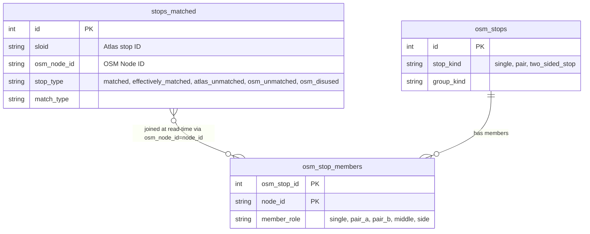

# A2.3 Global statistics

The summary above the map ("N OSM stops, X% matched · M ATLAS stops, Y% matched") describes the whole filtered dataset. This page explains how `/api/global_stats` computes those numbers in one query, and why OSM stops are counted as stop units rather than nodes.

## The tables involved

The summary combines the map rows of `stops_matched` with the OSM stop units:



An **OSM stop** in the summary is an [OSM stop unit](0.5%20Glossary.md#osm-stop-unit): a single element, a pair or a two-sided stop. Counting units rather than nodes keeps a platform mapped as two nodes from counting twice.

## Request filtering

The global stats query uses the canonical filter model defined in [A2.2 Filter and search logic](2.2%20Filters%20and%20Search%20logic.md). This includes stop scope, matching rules, smart-search tokens, ATLAS attributes, OSM attributes, OSM groups, duplicate filtering, problems, and Top N distance mode.

The stats-specific rule is scope: `/api/global_stats` is filter-scoped, not viewport-scoped. Unlike `/api/data`, it reads no map bounding-box parameters (`min_lat`, `max_lat`, `min_lon`, `max_lon`).

[Disused OSM elements](0.5%20Glossary.md#disused-osm-element) are not stops, so `_build_scoped_global_stats_query` leaves `osm_disused` rows out unless `stop_filter` selects `osm_disused`, even when no scope is selected and the map shows them. When selected, they add to `total_osm_nodes` but to no stop-unit count, because they belong to no stop unit.

`_build_scoped_global_stats_query()` in `backend/services/global_stats.py` starts from `filtered_stops_query()`, the query the map data, the random stop and the Top N overlay share, so scope and attribute filters mean the same everywhere. It then applies the disused rule above and `top_n` (`top_distance_matches()`).

### Supported request parameters

`_build_scoped_global_stats_query` reads the same active filter parameters as the map summary:

| Parameter | Purpose |
|-----------|---------|
| `stop_filter`, `match_method` | Stop scope and matched/unmatched sub-filters |
| `station_filter`, `filter_types`, `route_directions`, `route_variants` | Smart-search tokens and route filters |
| `transport_types`, `osm_entity_types`, `osm_operator`, `osm_operator_wikidata`, `missing_osm_operator_wikidata`, `osm_group_types` | OSM-side attribute and group filters |
| `atlas_operator` | ATLAS operator filter |
| `show_duplicates_only` | Structural ATLAS duplicate membership filter |
| `problem_type`, `priority` | Rows with a problem of those types and priorities |
| `top_n` | Matched-only largest-distance slice |

## Aggregation

### Effectively matched rows

The middle node of a two-sided stop has no match of its own, but counts as matched when both sides are matched. The engine decides this and exports it as `effectively_matched`; the importer stores it as `stop_type = effectively_matched`, so the query needs no join over the trio's members. At read time, an internal `effective_stop_type` treats `matched` and `effectively_matched` alike. The scope helpers select these rows as they do for the map (`build_two_sided_middle_with_matched_sides_condition()`, [A2.2](2.2%20Filters%20and%20Search%20logic.md#matched-branch)), so the counts and the markers agree on two-sided stops.

### One aggregate query

ATLAS aggregations and OSM aggregations are processed simultaneously in a single aggregate query.

```sql
WITH f AS (
    SELECT 
        sloid, 
        osm_node_id, 
        effective_stop_type
    FROM stops_matched
    WHERE <Complex Build Conditions>
)
SELECT 
    COUNT(DISTINCT f.sloid) AS total_atlas,
    COUNT(DISTINCT CASE WHEN f.effective_stop_type = 'matched' THEN f.sloid END) AS matched_atlas,
    COUNT(DISTINCT CASE WHEN f.effective_stop_type = 'atlas_unmatched' THEN f.sloid END) AS unmatched_atlas,
    COUNT(CASE WHEN f.effective_stop_type = 'matched' THEN 1 END) AS matched_pairs,
    COUNT(DISTINCT osm_stop_members.osm_stop_id) AS total_osm_stops,
    ...
FROM f
LEFT OUTER JOIN osm_stop_members ON osm_stop_members.node_id = f.osm_node_id
```

By pushing a `LEFT OUTER JOIN` out to `osm_stop_members` onto a derived base subquery (`f`), the database evaluates the shared filter conditions once, then derives both ATLAS and OSM metrics from that filtered row set. The join is by value (`osm_stop_members.node_id = f.osm_node_id`), not a declared foreign key from `stops_matched`. A node belongs to at most one stop unit (`uq_osm_stop_members_node_id`), so the join adds no rows.

The payload fields are:

| Field | Meaning |
|-------|---------|
| `total_atlas_stops` | Distinct ATLAS SLOIDs in the filtered set |
| `matched_atlas_stops` | Distinct ATLAS SLOIDs whose effective stop type is matched |
| `total_osm_stops` | Distinct logical OSM stop units reached through `osm_stop_members` |
| `matched_osm_stops` | Distinct logical OSM stop units reached from matched rows |
| `total_osm_nodes` | Distinct raw OSM node IDs in the filtered set |
| `matched_osm_nodes` | The same value as `matched_pairs_count` |
| `matched_pairs_count` | Number of rows whose effective stop type is matched |
| `unmatched_entities_count` | Unmatched ATLAS count plus unmatched logical OSM stop count |

## Runtime behaviour

Every request runs the aggregate query. The frontend sends the active filters (`appendCurrentFilterParams()`), including `top_n` and `show_duplicates_only`. During rapid filter changes, it:

- aborts any in-flight `/api/global_stats` request before starting the next one
- increments a sequence counter and ignores stale responses

## Where it appears

These metrics feed the top summary layer over the Leaflet interactive map found in `templates/pages/index.html`. The `stats_overlay()` macro provides the DOM container, and `updateHeaderSummary()` in `static/js/pages/main.js` requests `/api/global_stats` whenever users tweak filter controls (for example "UIC reference", "OSM Pairs", or "Duplicate ATLAS").

The OSM line shows `total_osm_stops` and `matched_osm_stops`. When the filtered set reaches no stop unit, for example with only **OSM disused** selected, it shows `total_osm_nodes` and `matched_osm_nodes` instead.

## Code

| File | Role |
|---|---|
| `backend/blueprints/stats.py` | `/api/global_stats` |
| `backend/services/global_stats.py` | The scoped query and the aggregation |
| `backend/queries/helpers.py` | `filtered_stops_query()` and `top_distance_matches()`, shared with the other filtered endpoints |
| `static/js/pages/main.js` | `updateHeaderSummary()`: the request and the summary text |

## Related pages

- [A2.1 Map data loading and rendering](2.1%20Map%20Data%20Loading%20and%20Rendering.md): the viewport request the map uses instead.
- [A2.2 Filter and search logic](2.2%20Filters%20and%20Search%20logic.md): the filters every request carries.
