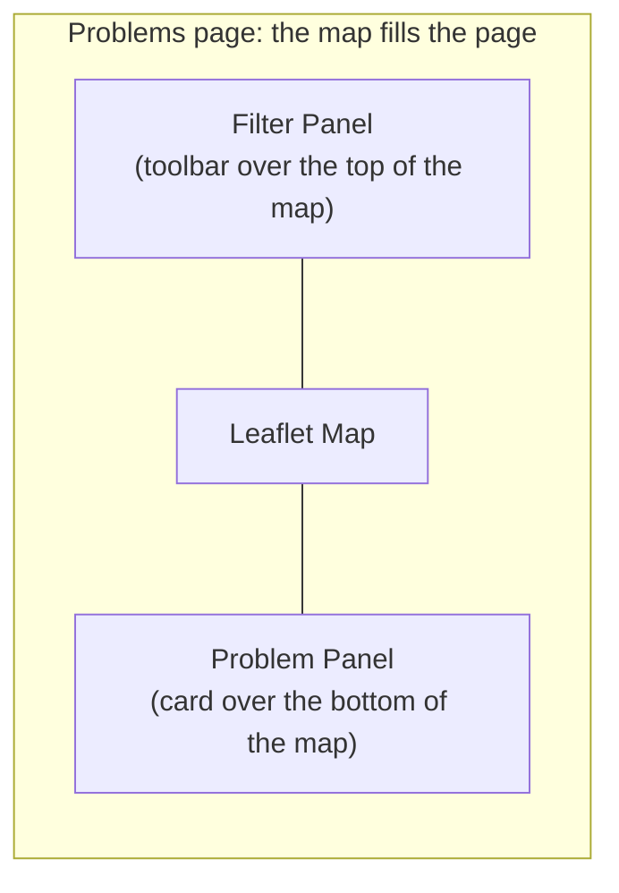
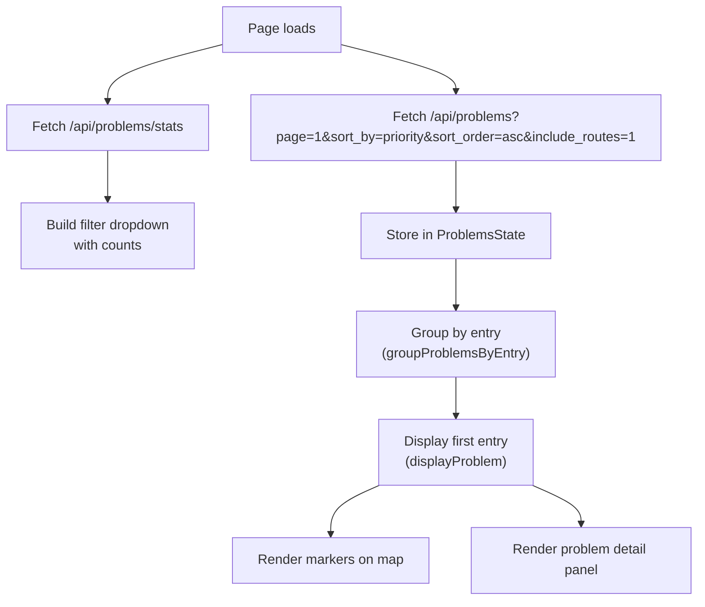

# A2.4 Problems page

The Problems page (`/problems`) presents the [problems](0.1%20Glossary.md#problem) that the engine detected ([E4](../engine/documentation/4.%20Problems.md)) one at a time, most important first, with the stops involved on a map. Reviewers filter them by type, priority, operator and area, and step through them with buttons or the keyboard.

## Layout

The map fills the page; the filter panel and the problem panel float over it:

| Section | Purpose |
|---------|---------|
| **Filter Panel** | A toolbar over the top of the map: priority, problem type, operator and area filters, the context toggle and the Prev/Next buttons. On screens up to 768 px wide it folds behind a **Filters** button. |
| **Map** | Shows markers for the current problem's ATLAS and OSM stops, with optional context markers for nearby stops. |
| **Problem Panel** | A card over the bottom of the map with the problem details. Chips at its top name the entry, the active problem's type and its priority; the type chip opens the type's section of [E4.1](../engine/documentation/4.1%20Stop%20Problems.md). |

## Problem types

Every problem has a type and a priority, P1 being the most important. [E4.1 Stop problems](../engine/documentation/4.1%20Stop%20Problems.md) explains what each type means, what is checked and how the priority is set. The page names the types as follows:

| Label | Filter name (`problem_type`) |
|---|---|
| **Distance** | `distance` |
| **Unmatched** | `unmatched` |
| **Attributes** | `attributes` |
| **Contradicts Route Matching** | `contradicts_route_matching` |
| **Duplicates** | `duplicates` |
| **Disused OSM** | `disused` |
| **OSM SLOID** | `identifier` |

The label of `identifier` is "OSM" followed by the deployment's identifier label, SLOID in Switzerland. Each type's checkbox is `#filterProblemType<Name>` and its count `#typeCount<Name>`, for example `#filterProblemTypeDisused` and `#typeCountDisused`.

### Disused OSM elements

The map draws the OSM element as a [disused marker](2.1%20Map%20Data%20Loading%20and%20Rendering.md#markers). The detail panel names its lifecycle prefix (`osm_lifecycle`, such as `disused`) and explains the case in one banner (`generateDisusedDetailsHtml()` in `problems-ui.js`):

| Priority | Banner | Cause | Suggested action |
|---|---|---|---|
| P1 | Red | ATLAS still lists a stop with the same UIC reference, and that stop has no OSM partner | Check on the ground: if the stop is in service, remove the prefix in OSM; if it is gone, the ATLAS entry is outdated |
| P2 | Amber | The element still looks active to data users: an unprefixed stop tag remains, or a route relation still lists it | Prefix or remove the remaining stop tags, and remove the element from routes that do not serve it |

The OSM popup lists every tag of the element ([A2.1](2.1%20Map%20Data%20Loading%20and%20Rendering.md#stop-popups)). [E4.1 Stop problems](../engine/documentation/4.1%20Stop%20Problems.md) describes how the engine assigns these priorities.

### OSM SLOIDs

Identifier matching links an OSM element to the ATLAS platform its SLOID names ([E2.1](../engine/documentation/2.1%20Reference%20matching.md#identifier-matching-identifier)). A value it cannot use becomes an `identifier` problem of the element, on its match rows or its unmatched row. The map draws the pair, or the element alone. The detail panel lists the element's SLOID tags beside the matched platform's SLOID, and explains the case (`generateIdentifierDetailsHtml()` in `problems-ui.js`):

| Priority | Banner | Cause | Suggested action |
|---|---|---|---|
| P1 | Red | The SLOID names a platform more than 150 m away; matching ignored it | It was probably copied from another stop: find which platform the element is and correct the tag |
| P2 | Amber | The SLOID names no ATLAS platform | Look the platform up in ATLAS; the value is outdated or mistyped |
| P3 | Blue | A value is not a SLOID (`ch:1:sloid:…`), such as a UIC number | Replace it with the platform's SLOID, or remove it |

The list API reads the element's tags (`osm_tags`) only for these problems.

## Filtering and sorting

### Filters

| Filter | Control | Effect |
|--------|---------|--------|
| **Problem type** | Dropdown with counts; its info icon opens [E4.1](../engine/documentation/4.1%20Stop%20Problems.md) | Restricts to one or more [types](#problem-types), or all |
| **Priority** | Circle pills (All, P1, P2, P3) | Restricts by priority level |
| **Operator** | Multi-select dropdown | Restricts by ATLAS operator (`atlas_business_org_abbr`) |
| **Area** | **Area** button, then a rectangle drawn on a map | Restricts to the problems inside the rectangle ([Area](#area)) |

Priority, operator, problem-type and area filters are enforced server-side.

### Area

**Area** opens a dialog with a map, on the Problems map's view. Two clicks set opposite corners of a rectangle: between them it follows the pointer, and dragging still moves the map. **Clear selection** wipes the rectangle so it can be drawn again. **Filter problems in this area** keeps the problems whose stop lies in the rectangle: its ATLAS or its OSM position, so a matched pair counts when either side is inside. The list starts again from its first entry, the type counts follow the area, and the Problems map draws the area as a dashed outline. The chip *Drawn area* removes it; so does the dialog's apply button after **Clear selection**, when it reads **Show all problems**.

The rectangle is sent as `bbox=west,south,east,north` in degrees, rounded to 5 decimals, and kept in the page's link ([A2.9](2.9%20Permalinks.md#problems)). A malformed `bbox` is refused with HTTP 400 rather than read as "everywhere". The code is `static/js/pages/problems-area.js` and `parse_area()` / `area_condition()` in `backend/services/problem_filters.py`.

### Default order

The page lists problems **by priority** by default:

| Order | Behaviour |
|------|----------|
| **Across entries** | `/api/problems` defaults to `sort_by=priority&sort_order=asc`, so entries with at least one P1 issue appear before P2, then P3 |
| **Within an entry** | Issues for the same stop are ordered by ascending priority before secondary tie-breakers |
| **Duplicate groups** | Grouped duplicates are ordered by their derived group priority (minimum member priority), then by stable identifiers |

This ordering is applied at query time. The app does **not** rely on database insertion order, because insert order is not a stable or sufficient guarantee once filtering, grouping, and pagination are involved.

### Explicit sorting

The backend accepts explicit sort parameters on `/api/problems`:

| Sort | Description |
|------|-------------|
| Largest distance | Descending by `distance_m`; only with `problem_type=distance`, otherwise stop order |
| Smallest distance | Ascending by `distance_m`; only with `problem_type=distance`, otherwise stop order |
| By priority | Ascending by priority value (`1` first) |

The page itself always requests priority order for its list.

### Active filter chips

Active filters are shown as removable chips below the filter panel using `FilterChipUtils.renderProblemChips`.

## Data flow

### Paging and prefetching

Problems are loaded in pages of 100 stops (or 100 groups in the duplicates-only view). When the user navigates within 20 entries of the end of the loaded list, the next page is automatically prefetched via `prefetchNextPageIfNeeded()`.

A [permalink](#permalinks) can open the list on a later page. The loaded pages then start there: *Next* still loads the following pages, and *Prev* at the first loaded entry loads the page before (`navigateToPreviousProblem()`).

### Entries

Problems are grouped into **entries** by location. Multiple problems at the same stop appear as a single entry with multiple issues that the user can scroll through. The grouping key is:
- For duplicates groups: `group_{group_id}`
- For a single duplicate problem, listed with other types: `group_auto_{duplicate_group_sloids or duplicate_group_node_ids}` (`dup_stop_{stop_id}` without a group), so it forms an entry with the other members' duplicate problems, apart from its stop's other problems
- For other problems: `{stop_id}_{lat}_{lon}`

## Navigation

| Action | Trigger |
|--------|---------|
| Next entry | Click **Next** button, press `→` or `Space` |
| Previous entry | Click **Prev** button, press `←`; at the start of a list opened from a link, this loads the page before |
| Scroll issues within entry | `↑` / `↓` arrows |
| Toggle shortcut help | Press `?` |
| Copy a link to the entry | Click **Copy link** next to the entry chip |

When multiple issues exist in one entry, an intersection observer tracks which issue is scrolled into view and highlights the corresponding map markers.

The map frames an entry in the part of the map that the filter toolbar and the problem panel leave visible. A single stop is centred at zoom 16; matched stops and duplicates are fitted above the panel, leaving room for the popup above them. The entry's popup pans the map until it sits below the toolbar and above the panel, also after the popup adds its *Move* bar. When the popup is taller than that space, its top stays below the toolbar. Of a duplicate group's popups, only the first pans (`static/js/pages/problems-renderer.js`).

## Duplicate groups

When **Duplicates** is the only selected type, the backend performs special grouping logic instead of returning individual problems.

### OSM duplicates (P3)
Grouped by `(uic_ref, osm_local_ref)`. All OSM nodes sharing the same UIC reference and local reference are grouped together.

### ATLAS duplicates (P2)
Grouped by `(uic_ref, atlas_designation)`. All ATLAS stops sharing the same UIC reference and designation are grouped together.

Each group contains a `members` array with individual stop data, and a centroid coordinate for map positioning.

For ordering, each duplicate group also exposes a derived group-level `priority`, computed as the minimum member priority. This lets the duplicates-only view participate in the same priority-first ordering as the rest of the page.

When duplicates are listed with other types, as in the **All** view, individual entries are shown with their stop details (source, identifier, name, coordinates).

## Context markers

Each problem has a box: the rectangle around all of its ATLAS and OSM positions (and those of its members, for a duplicate group), widened by 0.02° of latitude and longitude on every side. In Switzerland 0.02° is about 2.2 km north–south but only about 1.5 km east–west, so a problem with a single stop gets a box of roughly 4.4 km by 3 km centred on it.

The **Hide other markers** / **See other markers** toggle, on by default, loads every ATLAS and OSM stop in that box from `/api/data`, once per problem. The page's filters (priority, operator, problem type, area) choose which problems are listed; they do not apply to these context markers. Context markers are displayed at reduced opacity (0.6) and include connection lines for matched pairs. When they cannot be loaded, a banner over the map says so, names the rate limit when that is the cause ([A3.2](3.2%20Security%20and%20Rate%20Limits.md#rate-limits)), and offers **Retry**.

While a problem is shown, the map stays inside its box: it cannot be panned past the box's edges or zoomed out further than the zoom at which the box fills the map, so nothing outside the loaded area comes into view. The limit holds with or without context markers. When the problem's own fitted view is wider than the box, for example two stops far apart on a short screen, that view stays reachable. The limit is set again for each new problem, and lifted when no problem is shown.

The current problem is excluded from the context markers by identity, never by position:

- Single problems are excluded by matching `id`, `sloid`, or `osm_node_id`.
- Duplicate groups are first flattened to their `members`, then excluded using member identities.
- Nested `osm_matches` payloads are also checked when present.

Excluding by position would hide co-located duplicate stops, which are real data and stay visible as separate context markers.

## Permalinks

The address bar always names the filters and the entry on screen, so it can be shared; [A2.9 Permalinks](2.9%20Permalinks.md#problems) gives the parameters, how a link opens an entry deep in the list and how entry numbers behave there.

## API endpoints

| Endpoint | Method | Purpose |
|----------|--------|---------|
| `/api/problems` | GET | Paginated problem list with filters and duplicate-group aggregation |
| `/api/problems/stats` | GET | Problem counts by type |
| `/api/data` | GET | Context markers (nearby stops) |

### `/api/problems` parameters

| Parameter | Default | Description |
|-----------|---------|-------------|
| `page` | 1 | Page number |
| `limit` | 100 | Items per page (max 1000) |
| `problem_type` | `all` | Filter: `all`, or one or more comma-separated types: `distance`, `unmatched`, `attributes`, `contradicts_route_matching`, `duplicates`, `disused`, `identifier` |
| `sort_by` | `priority` | Sort: `priority`, `distance` (only with `problem_type=distance`), `default` or any other value for stop order |
| `sort_order` | `asc` | Order: `asc`, `desc` |
| `atlas_operator` | — | Comma-separated operator abbreviations |
| `priority` | — | One or more comma-separated priority levels, for example `1` or `1,2,3` |
| `bbox` | — | `west,south,east,north` in degrees: only stops with their ATLAS or OSM position inside. Also read by `/api/problems/stats`; malformed values answer 400 |
| `include_routes` | `0` | Include route evidence arrays in each result; the Problems page requests `1` |
| `focus_sloid`, `focus_osm_node_id` | — | A stop named by a permalink (OSM ways as `way_<id>`). With priority sorting, the response is the page that holds the stop's first entry, whatever `page` says, and carries `focus_found`. |

With a focus, the response adds `focus_found`: `true` when the returned page holds the stop, `false` when no entry of that stop matches the filters (or the sort is not by priority); the requested page is then returned.

`all` means every type in `VISIBLE_PROBLEM_TYPES` (`backend/services/problem_filters.py`). `/api/problems/stats` returns one entry per type in that list, plus `all`, built by `empty_problem_stats()`.

## Code

### Browser modules

| File | Module | Role |
|------|--------|------|
| `static/js/pages/problems-state.js` | `ProblemsState` | Centralized state (IIFE with getter/setter API) |
| `static/js/pages/problems-data.js` | `ProblemsData` | Data fetching, filtering, pagination, navigation |
| `static/js/pages/problems-map.js` | `ProblemsMap` | Map initialization, context loading, keeping the view inside the problem's box, resize |
| `static/js/pages/problems-renderer.js` | `ProblemsRenderer` | Draws the problem's markers and lines, frames the view and opens its popups |
| `static/js/pages/problems-area.js` | `ProblemsArea` | Area dialog, `bbox` formatting and parsing, dashed outline on the map |
| `static/js/pages/problems-ui.js` | `ProblemsUI` | Problem rendering, nav buttons, scroll indicators |
| `static/js/pages/problems-permalink.js` | `ProblemsPermalink` | Filters and entry in the address bar; Copy link |
| `static/js/pages/problems.js` | — | Coordinator: initializes all modules, binds event handlers |

### Backend

| File | Role |
|------|------|
| `backend/blueprints/problems.py` | `/api/problems` and `/api/problems/stats` endpoints |
| `backend/services/problem_filters.py` | `VISIBLE_PROBLEM_TYPES`, `parse_area()` and `area_condition()`; also the map's Problems filter (`has_problem_condition()`) |
| `backend/serializers/stops.py` | `format_stop_data()` — serializes `StopsMatched` to JSON |

### Template

`templates/pages/problems.html` — Jinja2 template with filter panel, map container, and problem section. Loads all JS modules in dependency order.

## Related pages

- [E4 Problems](../engine/documentation/4.%20Problems.md) — Problem detection and prioritization pipeline
- [E4.1 Stop problems](../engine/documentation/4.1%20Stop%20Problems.md) — The stop problems: distance, unmatched, attributes, route contradictions, duplicates, disused elements and OSM identifiers
- [A2 Web app](2.%20Web%20app.md) — Web application overview
- [A2.1 Map data loading and rendering](2.1%20Map%20Data%20Loading%20and%20Rendering.md) — Map rendering pipeline (shared components)
- [A2.9 Permalinks](2.9%20Permalinks.md) — Links to an entry with its filters
