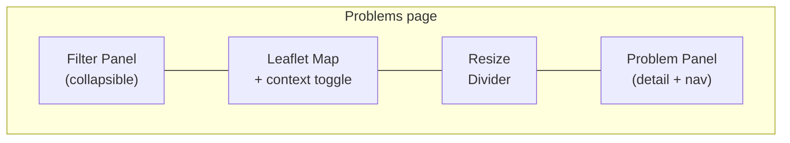
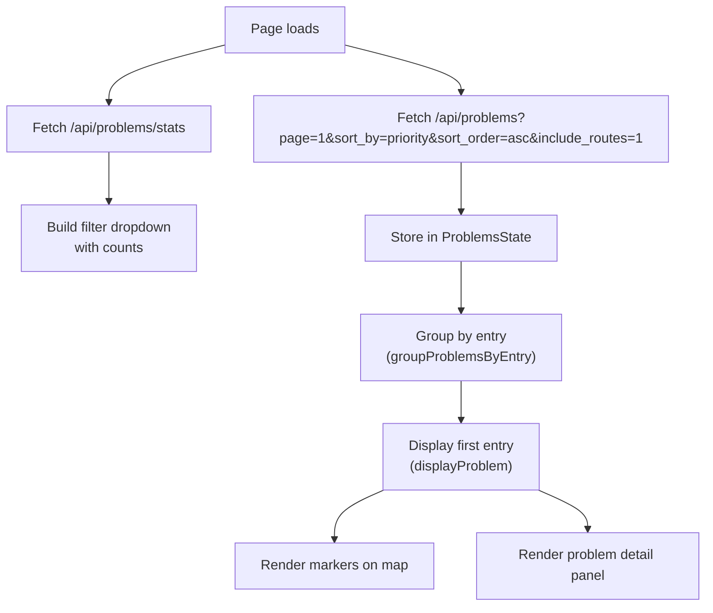

# A2.4 Problems page

The Problems page (`/problems`) presents the [problems](0.1%20Glossary.md#problem) that the engine detected ([E4](../engine/documentation/4.%20Problems.md)) one at a time, most important first, with the stops involved on a map. Reviewers filter them by type, priority and operator, and step through them with buttons or the keyboard.

## Layout



The page is divided into three sections arranged horizontally:

| Section | Purpose |
|---------|---------|
| **Filter Panel** | Problem type, priority, and operator filters. Collapsible to save space. |
| **Map** | Shows markers for the current problem's ATLAS and OSM stops, with optional context markers for nearby stops. |
| **Problem Panel** | Displays problem details, navigation buttons (Prev/Next), and keyboard shortcut hints. |

## Problem types

Problems are grouped by type. Each type has an associated priority level assigned during detection.

| Type | Icon | Description | Priorities |
|------|------|-------------|------------|
| **Distance** | `fa-ruler` | ATLAS and OSM stops are matched but far apart | P1, P2, P3 |
| **Unmatched** | `fa-map-marker-alt` | ATLAS stop has no OSM match (or vice versa) | P1, P2, P3 |
| **Attributes** | `fa-tags` | Matched pair has mismatched attributes (name, operator, etc.) | P1, P2, P3 |
| **Contradicts Route Matching** | `fa-route` | The matched pair conflicts with available route evidence | P2 |
| **Duplicates** | `fa-clone` | Multiple stops share the same identity (UIC ref + local ref or designation) | P2 (ATLAS-side), P3 (OSM-side) |
| **Disused OSM** | `fa-exclamation-circle` (P1), `fa-exclamation-triangle` (P2) | A [disused OSM element](0.1%20Glossary.md#disused-osm-element) still needs attention | P1, P2 |
| **OSM SLOID** (`identifier`) | `fa-exclamation-circle` (P1), `fa-exclamation-triangle` (P2), `fa-info-circle` (P3) | An OSM element's `ref:sloid` or `railway:ref:sloid` names a far or unknown platform, or is not a SLOID | P1, P2, P3 |

### Disused OSM elements

The map draws the OSM element as a [disused marker](2.1%20Map%20Data%20Loading%20and%20Rendering.md#markers). The detail panel names its lifecycle prefix (`osm_lifecycle`, such as `disused`) and explains the case in one banner (`generateDisusedDetailsHtml()` in `problems-ui.js`):

| Priority | Banner | Cause | Suggested action |
|---|---|---|---|
| P1 | Red | ATLAS still lists a stop with the same UIC reference, and that stop has no OSM partner | Check on the ground: if the stop is in service, remove the prefix in OSM; if it is gone, the ATLAS entry is outdated |
| P2 | Amber | The element still looks active to data users: an unprefixed stop tag remains, or a route relation still lists it | Prefix or remove the remaining stop tags, and remove the element from routes that no longer serve it |

The OSM popup lists every tag of the element ([A2.1](2.1%20Map%20Data%20Loading%20and%20Rendering.md#stop-popups)). [E4.1 Stop problems](../engine/documentation/4.1%20Stop%20Problems.md) describes how the engine assigns these priorities.

### OSM SLOIDs

Matching links an OSM element to the ATLAS platform its SLOID names before any other rule runs ([E2.1](../engine/documentation/2.1%20Reference%20matching.md#identifier-matching-identifier)). A value it cannot use becomes an `identifier` problem of the element, on its match rows or its unmatched row. The map draws the pair, or the element alone. The detail panel lists the element's SLOID tags beside the matched platform's SLOID, and explains the case (`generateIdentifierDetailsHtml()` in `problems-ui.js`):

| Priority | Banner | Cause | Suggested action |
|---|---|---|---|
| P1 | Red | The SLOID names a platform more than 150 m away; matching ignored it | It was probably copied from another stop: find which platform the element is and correct the tag |
| P2 | Amber | The SLOID names no ATLAS platform | Look the platform up in ATLAS; the value is outdated or mistyped |
| P3 | Blue | A value is not a SLOID (`ch:1:sloid:…`), such as a UIC number | Replace it with the platform's SLOID, or remove it |

The list API reads the element's tags (`osm_tags`) only for these problems.

## Filtering and sorting

### Filters

| Filter | Control | Effect |
|--------|---------|--------|
| **Problem type** | Dropdown with counts | Restricts to one type (`distance`, `unmatched`, `attributes`, `contradicts_route_matching`, `duplicates`, `disused`, `identifier`) or all; `disused` is the "Disused OSM" checkbox (`#filterProblemTypeDisused`, count `#typeCountDisused`) and `identifier` the "OSM SLOID" one (`#filterProblemTypeIdentifier`, `#typeCountIdentifier`) |
| **Priority** | Circle pills (All, P1, P2, P3) | Restricts by priority level |
| **Operator** | Multi-select dropdown | Restricts by ATLAS operator (`atlas_business_org_abbr`) |

Priority, operator, and problem-type filters are enforced server-side.

### Default order

The page lists problems **by priority** by default:

| Order | Behavior |
|------|----------|
| **Across entries** | `/api/problems` defaults to `sort_by=priority&sort_order=asc`, so entries with at least one P1 issue appear before P2, then P3 |
| **Within an entry** | Issues for the same stop are ordered by ascending priority before secondary tie-breakers |
| **Duplicate groups** | Grouped duplicates are ordered by their derived group priority (minimum member priority), then by stable identifiers |

This ordering is applied at query time. The app does **not** rely on database insertion order, because insert order is not a stable or sufficient guarantee once filtering, grouping, and pagination are involved.

### Explicit sorting

The backend accepts explicit sort parameters on `/api/problems`:

| Sort | Description |
|------|-------------|
| Largest distance | Descending by `distance_m` |
| Smallest distance | Ascending by `distance_m` |
| By priority | Ascending by priority value (`1` first) |

The page itself always requests priority order for its list.

### Active filter chips

Active filters are shown as removable chips below the filter panel using `FilterChipUtils.renderProblemChips`.

## Data flow



### Paging and prefetching

Problems are loaded in pages of 100 stops (or 100 groups in the duplicates-only view). When the user navigates within 20 entries of the end of the loaded list, the next page is automatically prefetched via `prefetchNextPageIfNeeded()`.

A [permalink](#permalinks) can open the list on a later page. The loaded pages then start there: *Next* still loads the following pages, and *Prev* at the first loaded entry loads the page before (`navigateToPreviousProblem()`).

### Entries

Problems are grouped into **entries** by location. Multiple problems at the same stop appear as a single entry with multiple issues that the user can scroll through. The grouping key is:
- For duplicates groups: `group_{group_id}`
- For other problems: `{stop_id}_{lat}_{lon}`

## Navigation

| Action | Trigger |
|--------|---------|
| Next entry | Click **Next** button, press `→` or `Space` |
| Previous entry | Click **Prev** button, press `←`; at the start of a list opened from a link, this loads the page before |
| Scroll issues within entry | `↑` / `↓` arrows |
| Toggle shortcut help | Press `?` |
| Copy a link to the entry | Click **Copy link** next to the entry chip |

When multiple issues exist in one entry, an intersection observer tracks which issue is scrolled into view and highlights the corresponding map markers.

## Duplicate groups

When the **Duplicates** filter is active, the backend performs special grouping logic instead of returning individual problems.

### OSM duplicates (P3)
Grouped by `(uic_ref, osm_local_ref)`. All OSM nodes sharing the same UIC reference and local reference are grouped together.

### ATLAS duplicates (P2)
Grouped by `(uic_ref, atlas_designation)`. All ATLAS stops sharing the same UIC reference and designation are grouped together.

Each group contains a `members` array with individual stop data, and a centroid coordinate for map positioning.

For ordering, each duplicate group also exposes a derived group-level `priority`, computed as the minimum member priority. This lets the duplicates-only view participate in the same priority-first ordering as the rest of the page.

When viewing duplicates in the **All Problems** view, individual entries are shown with their stop details (source, identifier, name, coordinates).

## Context markers

The **"See other markers"** toggle loads nearby ATLAS and OSM stops within ~2 km of the current problem. These context markers are displayed at reduced opacity (0.6) and include connection lines for matched pairs. The context data is fetched from `/api/data` with bounding box parameters.

The current problem is excluded from the context markers by identity, never by position:

- Single problems are excluded by matching `id`, `sloid`, or `osm_node_id`.
- Duplicate groups are first flattened to their `members`, then excluded using member identities.
- Nested `osm_matches` payloads are also checked when present.

Excluding by position would hide co-located duplicate stops, which are real data and stay visible as separate context markers.

## Permalinks

The address bar always names the filters and the entry on screen, so it can be shared:

```text
/problems?problem_type=distance&priority=1&atlas_operator=SBB&sloid=ch:1:sloid:7000:6:32&osm=node/3251097659
```

A matched pair is named by both identifiers, an unmatched stop by its own, a duplicate group by one member. Opening such a link restores the filters and asks `/api/problems` for the page that holds the entry, which can be thousands of entries deep. `Entry N/Total` then counts from that page. [A2.9 Permalinks](2.9%20Permalinks.md#problems) gives the details, including how entry numbers behave away from page 1.

## API endpoints

| Endpoint | Method | Purpose |
|----------|--------|---------|
| `/api/problems` | GET | Paginated problem list with filters and duplicate-group aggregation |
| `/api/problems/stats` | GET | Problem counts by type, with placeholder `solved`/`unsolved` buckets |
| `/api/data` | GET | Context markers (nearby stops) |

### `/api/problems` parameters

| Parameter | Default | Description |
|-----------|---------|-------------|
| `page` | 1 | Page number |
| `limit` | 100 | Items per page (max 1000) |
| `problem_type` | `all` | Filter: `all`, `distance`, `unmatched`, `attributes`, `contradicts_route_matching`, `duplicates`, `disused`, `identifier` |
| `sort_by` | `priority` | Sort: `priority`, `distance`, `default` |
| `sort_order` | `asc` | Order: `asc`, `desc` |
| `atlas_operator` | — | Comma-separated operator abbreviations |
| `priority` | — | One or more comma-separated priority levels, for example `1` or `1,2,3` |
| `include_routes` | `0` | Include route evidence arrays in each result; the Problems page requests `1` |
| `focus_sloid`, `focus_osm_node_id` | — | A stop named by a permalink (OSM ways as `way_<id>`). With priority sorting, the response is the page that holds the stop's first entry, whatever `page` says, and carries `focus_found`. |

With a focus, the response adds `focus_found`: `true` when the returned page holds the stop, `false` when no entry of that stop matches the filters (or the sort is not by priority); the requested page is then returned.

`all` means every type in `VISIBLE_PROBLEM_TYPES` (`backend/blueprints/problems.py`). `/api/problems/stats` returns one entry per type in that list, plus `all`, built by `empty_problem_stats()`.

`/api/problems/stats` returns `solved` and `unsolved` buckets, but they are placeholders: no review state is stored, so `solved` is always `0` and `unsolved` equals the total.

## Code

### Browser modules

| File | Module | Role |
|------|--------|------|
| `static/js/pages/problems-state.js` | `ProblemsState` | Centralized state (IIFE with getter/setter API) |
| `static/js/pages/problems-data.js` | `ProblemsData` | Data fetching, filtering, pagination, navigation |
| `static/js/pages/problems-map.js` | `ProblemsMap` | Map initialization, context loading, resize, filter panel toggle |
| `static/js/pages/problems-ui.js` | `ProblemsUI` | Problem rendering, nav buttons, scroll indicators |
| `static/js/pages/problems-permalink.js` | `ProblemsPermalink` | Filters and entry in the address bar; Copy link |
| `static/js/pages/problems.js` | — | Coordinator: initializes all modules, binds event handlers |

### Backend

| File | Role |
|------|------|
| `backend/blueprints/problems.py` | `/api/problems` and `/api/problems/stats` endpoints |
| `backend/serializers/stops.py` | `format_stop_data()` — serializes `StopsMatched` to JSON |

### Template

`templates/pages/problems.html` — Jinja2 template with filter panel, map container, and problem section. Loads all JS modules in dependency order.

## Related pages

- [E4 Problems](../engine/documentation/4.%20Problems.md) — Problem detection and prioritization pipeline
- [E4.1 Stop problems](../engine/documentation/4.1%20Stop%20Problems.md) — The stop problems: distance, unmatched, attributes, route contradictions, duplicates, disused elements and OSM identifiers
- [A2 Web app](2.%20Web%20app.md) — Web application overview
- [A2.1 Map data loading and rendering](2.1%20Map%20Data%20Loading%20and%20Rendering.md) — Map rendering pipeline (shared components)
- [A2.9 Permalinks](2.9%20Permalinks.md) — Links to an entry with its filters
