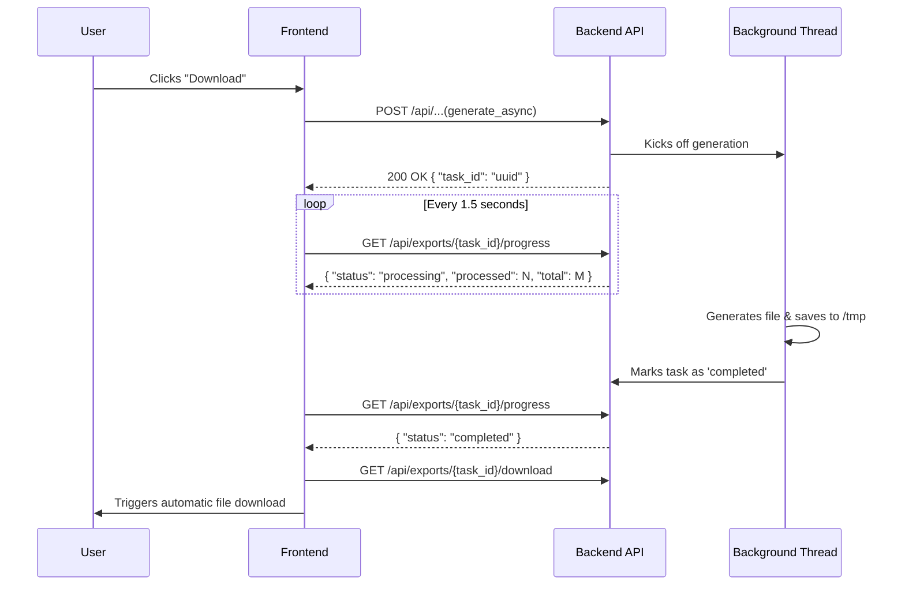

# A2.5 Reports and PDFs

The application produces three kinds of downloads: **data exports** of the filtered stops and problems (CSV or PDF), a **statistics summary PDF**, and the **documentation PDF**. Generating them can take a while, so none of them blocks a request: the server starts a background task, and the browser polls its progress and downloads the file when it is ready.

## How a download works

Data exports, the stats-summary download and the documentation PDF all run in the same progress overlay, `static/js/components/export-progress.js` (`ExportProgress.start`). In all cases, the server immediately returns a Task ID, and the client polls `/api/exports/<task_id>/progress` instead of holding the original request open, then fetches the file from `/api/exports/<task_id>/download`. **Cancel** calls `/api/exports/<task_id>/cancel`, which deletes the task and its file. `start_task` in `backend/services/async_export.py` runs every export the same way.

## The three downloads

### Data exports
Generated from the live PostGIS database based on user-selected filters in the **Export** tab at `/data/export`.

*   **Endpoint:** `/api/generate_report_async`
*   **Payload:** Includes `report_type` (distance, unmatched, problems), `format` (csv, pdf), `limit`, and active filters.
*   **Characteristics:**
    *   **Live Queries:** Directly queries the database and formats results into tabular structures.
    *   **Problem Filters:** Problems exports can filter by `distance`, `unmatched`, `attributes`, `contradicts_route_matching`, `duplicates`, `disused` (the "Disused OSM" checkbox) and `identifier` (the "OSM SLOID" checkbox), plus priority and ATLAS operator. `VISIBLE_PROBLEM_TYPES` in `backend/services/problem_filters.py` lists the accepted types; the unmatched export never includes [disused OSM elements](0.4%20Glossary.md#disused-osm-element).
    *   **No Caching:** Strictly reflects the live database state, so results are always compiled on request.
    *   **Memory Constraints:** The backend rejects non-summary PDFs above 2,000 entries to prevent WeasyPrint from exhausting server memory. The export UI caps CSV input at 10,000 entries.

### Statistics summary PDF
A print-oriented visual report of the main dashboard and statistical metrics.

*   **Endpoint:** `/api/generate_report_async`
*   **Payload:** `{ "report_type": "summary", "format": "pdf" }`
*   **Characteristics:**
    *   **Data Source:** Generated from the precomputed `data/stats.json`, including its problems section.
    *   **Caching Strategy:** Since the stats are static between scheduler runs, the backend caches the first generated PDF. It compares the modification time of `stats.json` against the cached PDF. If up-to-date, it skips rendering and immediately returns the cached file.

### Documentation PDF
Converts the Markdown documentation of both repositories into a single PDF (`documentation/pdf_generator/build_docs_pdf.py`) with internal cross-links and pre-rendered Mermaid SVGs ([A2.8](2.8%20Documentation%20portal.md#pdf-export)).

*   **Endpoint:** `/api/docs/generate_pdf_async`
*   **Payload:** `{ "included_sections": ["engine:1", "app:2"], "include_cover": false, "selected_only": true }`, or `{ "included_pages": ["reference_matching"], "include_cover": false, "selected_only": true }` for single pages (rejected with 400 if an address is unknown).
*   **Characteristics:**
    *   **Pre-rendered Diagrams:** each Mermaid block is drawn from an SVG in `documentation/generated/diagrams/`, named by a hash of its source. `npm run docs:build-pdf` renders missing or changed ones locally before running the Python generator, and the Docker image renders them while it is built. A site without Node downloads, once, the set CI rendered for its commit (`backend/services/docs_diagrams.py`). PDF generation itself never calls Node. A diagram that is still missing becomes a short note pointing to the online page, and the whole-documentation PDF built with such a note is rebuilt on the next request instead of being kept.
    *   **Caching:** Full-documentation exports check the modification times of all Markdown pages, embedded images, print styles, renderer modules and `data/stats.json`, serving the cached PDF when nothing has changed. Partial exports (`selected_only: true`, by section or page) bypass the cache and write a transient PDF (`docs_custom_{task_id[:8]}.pdf` or `<address>.pdf`).

## Clean-up and rate limits

To ensure server stability during heavy generation loads:
*   **File Janitor:** A background cleanup thread runs every hour and deletes the PDF/CSV files in `/tmp` and their task records once they are a week old (`TASK_MAX_AGE_SECONDS` in `backend/services/async_export.py`). The task records live in the export state store under `STATE_DIR`.
*   **Rate Limits:** The report endpoints are rate-limited per client IP address; [A3.2](3.2%20Security%20and%20rate%20limits.md#rate-limits) lists the limits.

## Code

| File | Role |
|---|---|
| `static/js/components/export-progress.js` | `ExportProgress`: starts a download, polls its progress and saves the file, in the overlay of `templates/components/export_overlay.html` |
| `static/js/pages/report.js` | The Data page's export form |
| `static/js/docs/portal.js` | The documentation page's PDF download |
| `backend/blueprints/reports.py` | `/api/generate_report_async` and the data exports; the `/api/exports/<task_id>/…` progress, download and cancel endpoints of every export |
| `backend/services/stats_export.py` | The statistics summary PDF and its cache |
| `backend/blueprints/docs.py` | `/api/docs/generate_pdf_async` and the cache of the whole-documentation PDF |
| `documentation/pdf_generator/build_docs_pdf.py` | Builds the documentation PDF with Mistune and WeasyPrint |
| `scripts/render_docs_mermaid.mjs` | Renders the Mermaid blocks to SVG before the PDF is built |
| `backend/services/async_export.py` | `start_task`, the task records and the hourly clean-up thread |

## Related pages

- [A1.2 Statistics and timestamps](1.2%20Statistics%20and%20timestamps.md): the `stats.json` the summary PDF reads
- [A2.8 Documentation portal](2.8%20Documentation%20portal.md#pdf-export): where readers choose the pages of a documentation PDF
- [A3.2 Security and rate limits](3.2%20Security%20and%20rate%20limits.md#rate-limits): the limits on the report endpoints
- [E4.1 Stop problems](../engine/documentation/4.1%20Stop%20problems.md): the problem types a problems export can select
