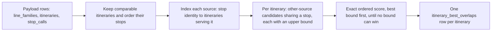

# A2.6 Routes pages

The Routes section exposes three views through a shared server-rendered shell:

- `/routes`: the route browser for comparing ATLAS GTFS and OSM route definitions
- `/routes/non-gtfs`: OSM public transport routes that do not appear in the OpenTransportData GTFS dataset and are excluded from route matching
- `/routes/gtfs-stop-id-sloid`: a diagnostic map for the canonical GTFS `stop_id` ↔ ATLAS `sloid` mapping

All three views are rendered through `templates/pages/routes.html` with an `active_view` switch, so the page keeps one shared tab layout while loading view-specific data and JavaScript.

## Shared shell and routing

`backend/blueprints/routes.py` provides:

- `routes_page()` for the route list tab
- `non_gtfs_routes_page()` for the non-GTFS route tab
- `routes_gtfs_stop_id_sloid_page()` for the GTFS diagnostic map tab
- `_render_routes_template()` to pass shared tab state and GTFS map limits into the template

The template renders page tabs at the top and then chooses between:

- the filterable route-card UI
- the non-GTFS route-card UI
- the GTFS map shell with summary overlay, banner, and full-size Leaflet map container

## Route browser tab

The default `/routes` tab provides these filters and controls:

- ATLAS Operator (searchable multi-select dropdown)
- OSM Route Operator (searchable multi-select dropdown)
- Status (`all`, `matched`, `unmatched`, `unmatched_atlas`, `unmatched_osm`)
- results per page (5, 10, 20, 50, or 100)
- free-text route search

### End-to-end flow

1. User submits filters using the top toolbar.
2. Flask route `backend/blueprints/routes.py::routes_page` normalizes query params.
3. Backend builds a combined route query and applies matched-state filters, optional ATLAS and OSM operator constraints, and optional route-ID search.
4. Matched pairs are returned once, then unmatched Atlas-only and OSM-only rows are appended into the same paginated result set.
5. Results are expanded with route-stop details, itinerary matches, route metadata, and the stored highest overlap of each unmatched variant.
6. Template `templates/pages/routes.html` renders compact route cards.
7. Each card starts collapsed. Expanding a variant row shows its stop comparison and a map of its stops. Each variant row shows a [stop-overlap figure](#variant-stop-overlap).

### Expanded variant layout

Stops are loaded from normalized `stop_calls` joined back to `atlas_stops`, `osm_nodes`, and `stops_matched`. Direction groups are sorted numeric-first.

An expanded variant has two parts:

- **Stop comparison.** The two variants' stops aligned in route order ([how overlap is measured](#how-overlap-is-measured)). The Non-GTFS tab has no ATLAS side and lists the OSM stops grouped by `uic_ref` instead.
- **Map.** On screens at least 1200px wide, it sits to the right of the stops. It is as tall as the stop list, at most the viewport below the page tabs, and stays in view while the list scrolls. On narrower screens it follows the stops.

The page never nests scroll areas: stop lists grow with the page, and the column headers (`ATLAS`, `OpenStreetMap`) stay below the sticky page tabs. Only the candidate list in the comparison picker scrolls on its own.

The map reuses the shared main-map stack (`MapCore`, `MapEntityAdapters`, `MapRenderer`) and fits the variant's stops with pixel padding. It reacts to the comparison:

- The mouse wheel scrolls the page, not the map. Clicking the map turns wheel zoom on until the pointer leaves it; a wheel over the map before that shows a hint.
- Hovering a stop row rings its ATLAS and OSM positions on the map. Clicking the row zooms to them.
- `See other markers` adds surrounding stops from `/api/data`, subdued.

## Variant stop overlap

Every variant row on `/routes` shows a stop-overlap figure next to its status badge. The figure answers one question: **how much of this variant's stop sequence does a variant from the other source also serve, in the same order?**

| Row | Figure | Meaning | Source of the value |
|---|---|---|---|
| Matched variant | `88.9% stop overlap` (green) | Overlap between the ATLAS and OSM variants the engine paired | Computed while the page renders, from the two stop lists already loaded for the card |
| Unmatched ATLAS or OSM variant | `Highest overlap: 66.7%` (blue) | The best overlap this variant reaches with **any** variant of the other source | Read from the `itinerary_best_overlaps` table, which the importer fills |
| Unmatched, nothing in common | `No shared stops` (grey) | No variant of the other source serves any of its stops | Same table, a row whose `best_itinerary_id` is empty |
| Unmatched, no stored row | `Overlap not computed` (grey) | The active dataset was imported before the table existed | Filled by the next import |

Hovering the blue figure names the best counterpart and how many stops it shares in order. Opening the row shows the comparison panel described at the end of this section.

### How overlap is measured

The green figure, the blue figure and the comparison panel all use one definition.

1. **Stop identity.** A stop call has a set of resolved ATLAS identities (`source_sloid` plus any `source_sloid_variants`) and an optional `uic_ref`. Two calls are the same stop when:
   - both have resolved identities and the two sets share at least one value, or
   - at least one of them has no resolved identity and both have the same `uic_ref`.

   Calls with different resolved identities never match, even when their `uic_ref` is the same (two platforms of one station, for example). Opaque source stop IDs and `canonical_stop_key` fallbacks are never treated as proof of identity.
2. **Shared stops in order.** The matched-stop count is the longest run of stops that both variants serve in the same order (a longest common subsequence). Stops may be skipped on either side, but the order cannot go backwards and each call is used at most once. A variant that serves the same stops in reverse therefore scores low.
3. **Percentage.**

   **overlap = shared stops in order ÷ max(ATLAS stop count, OSM stop count)**

Dividing by the longer variant keeps a short variant that sits inside a long one from reaching 100%.

Example: ATLAS `A B C D` and OSM `A X C D Y` share `A C D` in order, so the overlap is 3 / max(4, 5) = 60%.

This is the formula behind the engine's itinerary `stop_score` ([E3.2 Route-route matching](../engine/documentation/3.2%20Route-Route%20Matching.md)). The highest overlap uses it without the engine's pairing restrictions, as described next.

### What "Highest overlap" searches

For an unmatched variant, the best counterpart is chosen from **every** variant of the other source that the route browser can show:

- ATLAS or OSM itineraries whose line family has the same source and is not marked non-GTFS
- in any line family, not only the family the engine paired with this route
- including variants that already have a saved match
- with no threshold and no direction check (the engine requires at least 80% and agreeing directions before pairing two variants)

Ties are broken in a fixed order: higher percentage, then more shared stops, then the lower itinerary ID. The comparison panel ranks candidates in that same order.

The figure is a review aid. It never creates, changes or proposes a saved match.

### Why the value is stored

Finding the best counterpart means scoring one variant against thousands of others. The route list used to do that after every page load, through one API request per batch of unmatched variants. On the Swiss dataset (about 14,500 ATLAS and 8,200 OSM itineraries), a batch of 20 unmatched OSM variants took about 9 seconds.

The answer only changes when a new dataset is published. The importer therefore computes it once per snapshot, and the route page reads one stored row per variant and renders the figure with the page. It makes no follow-up requests. A page of 20 unmatched OSM variants renders in about 0.2 seconds with every figure in place; the stored lookup itself takes under 0.1 seconds even for 800 variants.

### How the import computes it

`compute_best_overlaps()` in `backend/services/route_comparison.py` runs inside `build_fast_insert_payloads()` in `backend/importing/importer.py`. It works on the route rows that are about to be published, before anything is written, and never reads the database.

1. **Filter and order.** Keep the itineraries listed in the previous subsection and build each one's stop identities, ordered by `stop_sequence`.
2. **Index each source.** For ATLAS and OSM separately, map every resolved identity and `uic_ref` to the itineraries that serve it.
3. **Collect candidates.** For each itinerary, look up its stops in the other source's index. Only itineraries that share at least one stop become candidates. For each candidate, count how many of this itinerary's stops it serves in any order, capped at the candidate's own length. The ordered count can never exceed this number, so it is an upper bound.
4. **Score exactly, best bound first.** Sort the candidates by their upper bound and compute the exact ordered score one candidate at a time. As soon as the next upper bound falls below the best exact score found so far, no remaining candidate can win and the search stops. On average fewer than two exact scores are needed per itinerary.
5. **Write one row per itinerary.** This includes itineraries that already have a saved match and itineraries without any candidate.

On the Swiss dataset the whole step takes about 8 seconds for 22,600 itineraries during a full import (about 4.5 seconds when run alone). The import log reports it as the `import.itinerary_best_overlaps` timing stage, inside the "Prepare application records" pipeline step.

The rows are staged and published together with the other route tables, in the same atomic switch. A stored figure therefore always refers to itineraries of the same snapshot.

### Stored table

`itinerary_best_overlaps` holds one row per comparable itinerary:

| Column | Meaning |
|---|---|
| `itinerary_id` | The itinerary the row describes (primary key) |
| `best_itinerary_id` | Its best counterpart in the other source, or empty when no itinerary shares a stop |
| `matched_stop_count` | Shared stops in order with that counterpart (0 when there is none) |
| `stop_ratio` | `matched_stop_count / max(both stop counts)`, from 0 to 1, or empty when there is no counterpart |

When the page renders, `routes_page()` collects the unmatched variants on the current page and calls `load_best_overlaps()` once. That query also joins the counterpart's itinerary and line family to build the hover label. The counterpart's ID lets the comparison panel compare it without waiting for the ranking.

### Comparison panel

Every expanded variant on `/routes` shows a comparison panel (`templates/components/routes-comparison.html`, `static/js/pages/routes-comparison.js`). It renders nothing until the variant is opened.

**Alignment.** Each row pairs an ATLAS stop with an OSM stop, or shows a stop that only one side serves:

- The ATLAS cell is mirrored (number on its inner edge), so both stops of a pair sit next to the centre link: a solid link with a dot for the same resolved stop, a dashed `UIC` link for the same UIC only.
- Rows with a stop on one side only are tinted, and the other side reads `Not in ATLAS` or `Not in OSM`.
- Stop numbers are positions in the variant, 1 to n. OSM `stop_sequence` values follow relation member positions and skip platforms, so they appear only in the number's tooltip.
- A run of matching stops keeps two rows at each end and folds the rest behind `Show N matching stops` when that hides at least five stops.

Above the rows, the score strip shows the overlap, the shared and one-sided stop counts, whether the directions agree, and a link to the OSM itinerary relation.

**Matched variant.** The alignment of the saved pair is computed while the page renders (`stop_comparison` in the variant's JSON) and shown without a request, with a `Saved match` badge.

**Unmatched variant.** The panel compares the variant (fixed) with a candidate of the other source:

1. On opening, it shows the variant's own stops at once: `stop_comparison` holds a one-sided alignment for unmatched variants.
2. When the import stored a best counterpart, the panel compares it right away (`data-best-id`) while it loads the ranking.
3. The picker lists candidates by overlap. Without a search it lists only variants sharing at least one stop (`shared_only=1`) and says how many there are. A search reaches every route of the other source, still ranked by overlap. Arrow keys move through the list, Enter compares, Escape closes, and the previous and next buttons step through the ranking, loading further pages as needed.
4. A candidate that is already the saved match of another variant is flagged `Already matched` in the list, with the variants it is matched to in the flag's tooltip. The score strip names them (`Already matched to ATLAS S10 · Uetliberg -> Zürich HB`). When that saved pair is a variant row on the same route card (found by the row's `data-atlas-itinerary-id` and `data-osm-itinerary-id`), hovering the badge highlights the row, and clicking the name opens it and scrolls to it.

The data stays live because it depends on what the reviewer searches and pages through:

- `/api/routes/comparison/options` ranks the candidates of the other source by overlap, with search and paging. With `shared_only=1` it lists and counts only candidates sharing a stop; otherwise every candidate is listed, zero overlaps last. Without a search, its first entry is the stored best counterpart whenever any candidate shares a stop.
- `/api/routes/comparison` returns the stop-by-stop alignment for the chosen pair, with each side's metadata, including `source_itinerary_id` (the OSM relation) and `matched_with`, the variants of the other source it is the saved match of. Options carry `matched_with` too.

While the next comparison loads, the current one stays visible, dimmed. If it fails, the panel returns to the variant's own stops and offers a retry. The panel never changes the overlap figure on the row, and comparing never changes saved matches.

### Keeping stored and live values consistent

The import-time search and the live ranking share the identity rules and the ordered scoring in `backend/services/route_comparison.py`. `tests/test_route_comparison.py` checks that:

- for every fixture itinerary, the stored best counterpart equals the first candidate of the live ranking
- on random stop sequences (repeated stops, conflicting identities, UIC-only stops, variant identities), the import-time search finds exactly what aligning every possible pair would find

When you change the identity rules or the formula, change them in that module and run those tests. Stored figures update with the next import.

## Non-GTFS routes tab

The `/routes/non-gtfs` tab lists OSM route families marked `is_non_gtfs`. These routes are retained for inspection but are not included in ATLAS–OSM route matching. The tab reuses the route cards, stop details, embedded maps, and pagination shell from the main browser, but intentionally omits the main browser's search, status, and operator toolbar.

## GTFS `stop_id` ↔ `sloid` map tab

The `/routes/gtfs-stop-id-sloid` tab is a full-page diagnostic Leaflet map backed by the imported `gtfs_stops_raw` and `gtfs_stop_identity_resolution` tables.

### What it shows

- GTFS stops with at least one imported coordinate source
- ATLAS stops represented in the imported GTFS/ATLAS state table
- visible matched line segments between GTFS and ATLAS points
- a compact summary overlay showing GTFS coverage, ATLAS coverage, and assignment counts

Marker colors are intentionally fixed:

- matched ATLAS: blue
- unmatched ATLAS: red
- matched GTFS: orange (`#F0AD4E`; described as yellow in the UI legend)
- unmatched GTFS: gray

### Backend APIs

The tab reads four dedicated JSON endpoints from `backend/blueprints/routes.py`:

- `/api/routes/gtfs-stop-id-sloid/summary`
- `/api/routes/gtfs-stop-id-sloid/map`
- `/api/routes/gtfs-stop-id-sloid/search`
- `/api/routes/gtfs-stop-id-sloid/popup`

The query and serialization logic lives in `backend/services/gtfs_stop_id_sloid.py`.

That service builds deduplicated coordinate subqueries from `gtfs_stop_identity_resolution`, computes matched/unmatched counts per side, and returns:

- `gtfs_stops`
- `atlas_stops`
- `matches`
- `meta` (zoom, cap state, overview/detail mode)

### Overview/detail behavior

The map uses two density modes:

- overview mode below zoom `11`: limit `3000` GTFS rows and `3000` ATLAS rows
- detail mode at zoom `11` and above: limit `5000` GTFS rows and `5000` ATLAS rows

Rows are fetched in a balanced way so matched and unmatched states do not starve each other inside a dense viewport.

### Popup behavior

The frontend lazy-loads popup payloads per clicked marker.

GTFS popups include:

- stop identifiers and coordinates
- matched SLOID previews
- same-UIC ATLAS candidate previews

ATLAS popups include:

- SLOID and ATLAS metadata
- matched GTFS stop previews
- same-UIC GTFS candidate previews

The map keeps the shared draggable multi-popup behavior by reusing the common popup helpers and line handler logic.

### Identifier search

The search endpoint accepts exact SLOID, UIC, and GTFS `stop_id` searches. It returns mappable targets, after which the frontend centers the map and reloads the viewport with the identifier filter applied.

## Files and responsibilities

- `backend/blueprints/routes.py`
  - main and non-GTFS route-list query construction and pagination
  - GTFS tab page route and four GTFS JSON endpoints
  - route comparison JSON endpoints (`/api/routes/comparison` and `/api/routes/comparison/options`)
  - shared routes template rendering
  - loading `line_families`, `line_family_matches`, `itineraries`, `itinerary_matches`, `stop_calls`, and `itinerary_best_overlaps` for route cards
- `backend/services/route_comparison.py`
  - stop identity rules and ordered stop alignment
  - live candidate ranking for the comparison panel
  - import-time `compute_best_overlaps()` and page-time `load_best_overlaps()`
- `backend/services/gtfs_stop_id_sloid.py`
  - GTFS summary payloads
  - viewport payloads for GTFS/ATLAS markers and line segments
  - GTFS and ATLAS popup payload builders
- `templates/pages/routes.html`
  - tab shell shared by both Routes views
  - route list toolbar, cards, and pagination
  - GTFS map shell, banner, and summary overlay host
- `static/js/pages/routes.js`
  - route browser toolbar behavior and embedded route preview maps
  - wheel-zoom guard and highlighting of hovered comparison rows
- `templates/components/routes-comparison.html` and `static/js/pages/routes-comparison.js`
  - comparison panel of every variant, rendered only when its row is opened
  - candidate picker of unmatched variants
- `static/js/pages/routes-gtfs-stop-id-sloid.js`
  - GTFS map initialization, viewport fetching, marker rendering, summary updates, and popup loading

## Maintenance guidelines

- Keep the canonical GTFS `stop_id` ↔ `sloid` matcher in `engine/src/transport_matcher/adapters/get_atlas_gtfs.py`.
- Keep GTFS map query logic in `backend/services/gtfs_stop_id_sloid.py`, not in the template or page controller.
- Keep the stop-overlap definition in `backend/services/route_comparison.py`. Route cards read stored overlaps; do not rank candidates per page view.
- Keep the Routes tab shell shared; add view-specific behavior behind `active_view` rather than splitting into parallel templates.
- Preserve the fixed marker-color semantics because they are part of the debugging vocabulary used elsewhere in the docs.
