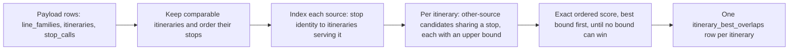

# A2.6 Routes pages

The Routes section exposes three views through a shared server-rendered shell:

- `/routes`: the route browser for comparing ATLAS GTFS and OSM route definitions
- `/routes/non-gtfs`: OSM public transport routes that do not appear in the OpenTransportData GTFS dataset and are excluded from route matching
- `/routes/gtfs-stop-id-sloid`: a diagnostic map for the canonical GTFS `stop_id` ↔ ATLAS `sloid` mapping

All three views are rendered through `templates/pages/routes.html` with an `active_view` switch, so the page keeps one shared tab layout while loading view-specific data and JavaScript.

## Shared shell and routing

The pages and their data are split three ways: `backend/pages/routes.py` renders the HTML tabs, `backend/services/route_listing.py` queries the route lists, and `backend/blueprints/routes.py` answers the JSON endpoints the tabs call.

`backend/pages/routes.py` provides:

- `routes_page()` for the route list tab
- `non_gtfs_routes_page()` for the non-GTFS route tab
- `routes_gtfs_stop_id_sloid_page()` for the GTFS diagnostic map tab
- `_render_routes_template()` to pass the active tab (`active_view`) and its listing endpoint into the template

The template renders page tabs at the top and then chooses between:

- the filterable route-card UI
- the non-GTFS route-card UI
- the GTFS map shell with summary overlay, banner, and full-size Leaflet map container

## Route browser tab

The default `/routes` tab provides these filters and controls:

- ATLAS Operator (searchable multi-select dropdown)
- OSM Route Operator (searchable multi-select dropdown)
- Status (`all`, `matched`, `unmatched`, `unmatched_atlas`, `unmatched_osm`)
- results per page (5, 10, 20, 50, or 100)
- free-text route search

### End-to-end flow

1. User submits filters using the top toolbar.
2. Flask route `backend/pages/routes.py::routes_page` normalizes query params.
3. Backend builds a combined route query and applies matched-state filters, optional ATLAS and OSM operator constraints, and optional search on route IDs and names.
4. Matched pairs are returned once, then unmatched ATLAS-only and OSM-only rows are appended into the same paginated result set.
5. Results are expanded with route-stop details, itinerary matches, route metadata, and the stored highest overlap of each unmatched variant.
6. Template `templates/pages/routes.html` renders compact route cards.
7. Each card starts collapsed. Expanding a variant row shows its stop comparison and a map of its stops. Each variant row shows a [stop-overlap figure](#variant-stop-overlap).

### Expanded variant layout

Stops are loaded from normalized `stop_calls` joined back to `atlas_stops`, `osm_nodes`, and `stops_matched`. Direction groups are sorted numeric-first.

An expanded variant has two parts:

- **Stop comparison.** The two variants' stops aligned in route order ([how overlap is measured](#how-overlap-is-measured)). The Non-GTFS tab has no ATLAS side and lists the OSM stops grouped by `uic_ref` instead.
- **Map.** On screens at least 1200px wide, it sits to the right of the stops and takes 42% of the card; from 1600px the page widens to 1760px and the map takes 45%. Wider below 1600px, the stop rows (SLOID and UIC on each side) get cramped. It is as tall as the stop list, at most the viewport below the page tabs, and stays in view while the list scrolls. On narrower screens it follows the stops.

The page never nests scroll areas: stop lists grow with the page, and the column headers (`ATLAS`, `OpenStreetMap`) stay below the sticky page tabs. Only the candidate list in the comparison picker scrolls on its own.

The map reuses the shared main-map stack (`MapCore`, `MapEntityAdapters`, `MapRenderer`) and fits the variant's stops with pixel padding. It reacts to the comparison:

- The mouse wheel scrolls the page, not the map. Clicking the map turns wheel zoom on until the pointer leaves it; a wheel over the map before that shows a hint.
- Marker colours are those of stop matching, as on the main map: blue and green for matched ATLAS and OSM stops, red and grey for unmatched ones. The comparison never recolours a stop. It adds its own marks instead: a solid line joins the same stop in both variants, a dashed amber line joins the same station at another platform, and a dashed amber ring circles a stop the other variant does not have. A collapsed **Legend** in the map's corner lists them.
- Each stop also shows its own stop matches: a thin line to every stop it is matched to, unless the solid line already joins them, and that stop, faded, when neither variant calls at it. When the two variants call at different platforms of a station, the thin lines show which stop of the other source each platform is matched to. The server gives each compared stop its status and its matches (`stop_type` and `partners`, from `stops_matched`), with one query per page or comparison (`attach_stop_matches()` in `route_comparison.py`).
- Hovering a stop row rings its ATLAS and OSM positions on the map. Clicking the row zooms to them.
- `See other markers` adds surrounding stops from `/api/data`, subdued, except the ones already drawn.
- Clicking a stop opens the main map's popup for it. Route stops carry their source id, so the popup is loaded with `/api/stop_popup?sloid=` or `?osm_node_id=`; stops from `/api/data` use their row id. The map is a card, so it keeps one popup open at a time, pans it clear of the zoom control and the card's buttons, stacks a pair's bubbles in one column and scrolls a popup taller than the map. A popup stays open when the markers are redrawn, e.g. at the zoom where they gain labels.
- The lines and rings are drawn above the stops and ignore clicks, so a click on a stop reaches its popup.
- Each popup has **Open in main map**, a [stop link](2.9%20Permalinks.md#map) in a new tab. The card's **Main map** button opens the main map on the variants this map shows, including a candidate chosen in the comparison, at this map's view (`?atlas_variant=…&osm_variant=…#map=`). The main map narrows its route filter to them ([A2.2](2.2%20Filter%20and%20search%20logic.md#route-filters-and-their-variants)) and shows every stop match of their stops.

### Links to a variant

The address bar names the filters, the page and the open variant, and **Copy link** at the top of an open variant copies it; [A2.9 Permalinks](2.9%20Permalinks.md#routes-and-non-gtfs-routes) gives the parameters and how a link finds the page that shows the variant.

## Variant stop overlap

Every variant row on `/routes` shows a stop-overlap figure next to its status badge. The figure answers one question: **how much of this variant's stop sequence does a variant from the other source also serve, in the same order?**

| Row | Figure | Meaning | Source of the value |
|---|---|---|---|
| Matched variant | `88.9% stop overlap` (green) | Overlap between the ATLAS and OSM variants the engine paired | Computed while the page renders, from the two stop lists already loaded for the card |
| Unmatched ATLAS or OSM variant | `Highest overlap: 66.7%` (blue) | The best overlap this variant reaches with **any** variant of the other source | Read from the `itinerary_best_overlaps` table, which the importer fills |
| Unmatched, nothing in common | `No shared stops` (grey) | No variant of the other source serves any of its stops | Same table, a row whose `best_itinerary_id` is empty |

Hovering the blue figure names the best counterpart and how many stops it shares in order. Opening the row shows the comparison panel described at the end of this section.

### How overlap is measured

The green figure, the blue figure and the comparison panel all use one definition.

1. **Stop identity.** A stop call has a set of resolved ATLAS identities (`source_sloid` plus any `source_sloid_variants`) and an optional `uic_ref`. Two calls are the same stop when:
   - their resolved identities share at least one value (the same platform), or
   - they have the same `uic_ref` (the same station).

   A call at another platform of the station still serves the stop, as in the engine ([E3.2](../engine/documentation/3.2%20Route-route%20matching.md#step-4-pair-the-itineraries)): which platform a train or bus uses is a question for stop matching. The stop list marks such a pair *Same station, other platform*, and the summary counts these rows as *at another platform*. Opaque source stop IDs and `canonical_stop_key` fallbacks are never treated as proof of identity.
2. **Shared stops in order.** The matched-stop count is the longest run of stops that both variants serve in the same order (a longest common subsequence). Stops may be skipped on either side, but the order cannot go backwards and each call is used at most once. A variant that serves the same stops in reverse therefore scores low.
3. **Percentage.**

   **overlap = shared stops in order ÷ max(ATLAS stop count, OSM stop count)**

Dividing by the longer variant keeps a short variant that sits inside a long one from reaching 100%. The stop counts are counts of stop visits: an OSM relation lists a stop's stop position and platform one after the other, and the engine turns the two into one call ([E3.2](../engine/documentation/3.2%20Route-route%20matching.md#step-3-build-itineraries-and-stop-calls)), so both variants count each stop once.

Example: ATLAS `A B C D` and OSM `A X C D Y` share `A C D` in order, so the overlap is 3 / max(4, 5) = 60%.

This is the formula behind the engine's itinerary `stop_score` ([E3.2 Route-route matching](../engine/documentation/3.2%20Route-route%20matching.md)). The highest overlap uses it without the engine's pairing restrictions, as described next.

### What "Highest overlap" searches

For an unmatched variant, the best counterpart is chosen from **every** variant of the other source that the route browser can show:

- ATLAS or OSM itineraries whose line family has the same source and is not marked non-GTFS
- in any line family, not only the family the engine paired with this route
- including variants that already have a saved match
- with no threshold and no direction check (the engine requires at least 80% and agreeing directions before pairing two variants)

Candidates are ranked by overlap ratio, highest first, compared before rounding to a percentage. Between equal ratios, the candidate with more shared stops in order comes first, then the one with the lower itinerary ID. The comparison panel ranks candidates in that same order.

The figure is a review aid, not an engine result. It never creates, changes or proposes a saved match in `itinerary_matches`.

### Why the value is stored

Finding the best counterpart means comparing one variant with every variant of the other source, which is too slow to repeat for each unmatched variant while a page loads. The answer only changes when a new dataset is published. The importer therefore computes it once per snapshot, and the route page reads one stored row per variant and renders the figure with the page. It makes no follow-up requests.

### How the import computes it

`compute_best_overlaps()` in `backend/services/route_comparison.py` runs inside `build_fast_insert_payloads()` in `backend/importing/importer.py`. It works only on the bundle's projected `line_families`, `itineraries` and `stop_calls` rows that are about to be published, before anything is written, and reads neither the database nor raw files.

1. **Filter and order.** Keep the itineraries listed in the previous subsection and build each one's stop identities, ordered by `stop_sequence`.
2. **Index each source.** For ATLAS and OSM separately, map every resolved identity and `uic_ref` to the itineraries that serve it.
3. **Collect candidates.** For each itinerary, look up its stops in the other source's index. Only itineraries that share at least one stop become candidates. For each candidate, count how many of this itinerary's stops it serves in any order, capped at the candidate's own length. The ordered count can never exceed this number, so it is an upper bound.
4. **Score exactly, best bound first.** Sort the candidates by their upper bound and compute the exact ordered score one candidate at a time. As soon as the next upper bound falls below the best exact score found so far, no remaining candidate can win and the search stops.
5. **Write one row per itinerary.** This includes itineraries that already have a saved match and itineraries without any candidate.

The import log reports the step as the `import.itinerary_best_overlaps` timing stage, inside the "Prepare application records" pipeline step.

The rows are staged and published together with the other route tables, in the same atomic switch. A stored figure therefore always refers to itineraries of the same snapshot.

### Stored table

`itinerary_best_overlaps` holds one row per comparable itinerary:

| Column | Meaning |
|---|---|
| `itinerary_id` | The itinerary the row describes (primary key) |
| `best_itinerary_id` | Its best counterpart in the other source, or empty when no itinerary shares a stop |
| `matched_stop_count` | Shared stops in order with that counterpart (0 when there is none) |
| `stop_ratio` | `matched_stop_count / max(both stop counts)`, from 0 to 1, or empty when there is no counterpart |

When the page renders, `routes_page()` calls `attach_best_overlaps()` (`route_listing.py`), which collects the unmatched variants on the current page and calls `load_best_overlaps()` once. That query also joins the counterpart's itinerary and line family to build the hover label. The counterpart's ID lets the comparison panel compare it without waiting for the ranking.

### Comparison panel

Every expanded variant on `/routes` shows a comparison panel (`templates/components/routes-comparison.html`, `static/js/pages/routes-comparison.js`). It renders nothing until the variant is opened.

**Alignment.** Each row pairs an ATLAS stop with an OSM stop, or shows a stop that only one side serves:

- The ATLAS cell is mirrored (number on its inner edge), so both stops of a pair sit next to the centre link: a solid link with a dot for the same resolved stop, a dashed `UIC` link for the same UIC only.
- Rows with a stop on one side only are tinted, and the other side reads `Not in ATLAS` or `Not in OSM`.
- Stop numbers are positions in the variant, 1 to n. OSM `stop_sequence` values follow relation member positions and skip platforms, so they appear only in the number's tooltip.
- A run of matching stops keeps two rows at each end and folds the rest behind `Show N matching stops` when that hides at least five stops.

Above the rows, the score strip shows the overlap, the shared and one-sided stop counts, whether the directions agree, and a link to the OSM itinerary relation.

**Matched variant.** The alignment of the saved pair is computed while the page renders (`stop_comparison` in the variant's JSON) and shown without a request, with a `Saved match` badge.

**Unmatched variant.** The panel compares the variant (fixed) with a candidate of the other source:

1. On opening, it shows the variant's own stops at once: `stop_comparison` holds a one-sided alignment for unmatched variants.
2. When the import stored a best counterpart, the panel compares it right away (`data-best-id`) while it loads the ranking.
3. The picker lists candidates by overlap. Without a search it lists only variants sharing at least one stop (`shared_only=1`) and says how many there are. A search reaches every route of the other source, still ranked by overlap. Arrow keys move through the list, Enter compares, Escape closes, and the previous and next buttons step through the ranking, loading further pages as needed.
4. A candidate that is already the saved match of another variant is flagged `Already matched` in the list, with the variants it is matched to in the flag's tooltip. The score strip names them (`Already matched to ATLAS S10 · Uetliberg -> Zürich HB`). When that saved pair is a variant row on the same route card (found by the row's `data-atlas-itinerary-id` and `data-osm-itinerary-id`), hovering the badge highlights the row, and clicking the name opens it and scrolls to it.

The data stays live because it depends on what the reviewer searches and pages through:

- `/api/routes/comparison/options` ranks the candidates of the other source by overlap, with search and paging. With `shared_only=1` it lists and counts only candidates sharing a stop; otherwise every candidate is listed, zero overlaps last. Without a search, its first entry is the stored best counterpart whenever any candidate shares a stop.
- `/api/routes/comparison` returns the stop-by-stop alignment for the chosen pair, with each side's metadata, including `source_itinerary_id` (the OSM relation) and `matched_with`, the variants of the other source it is the saved match of. Options carry `matched_with` too.

While the next comparison loads, the current one stays visible, dimmed. If it fails, the panel returns to the variant's own stops and offers a retry. The panel never changes the overlap figure on the row, and comparing never changes saved matches.

### Keeping stored and live values consistent

The import-time search and the live ranking share the identity rules and the ordered scoring in `backend/services/route_comparison.py`. `tests/test_route_comparison.py` checks that:

- for every fixture itinerary, the stored best counterpart equals the first candidate of the live ranking
- on random stop sequences (repeated stops, conflicting identities, UIC-only stops, variant identities), the import-time search finds exactly what aligning every possible pair would find

When you change the identity rules or the formula, change them in that module and run those tests. Stored figures update with the next import.

## Non-GTFS routes tab

The `/routes/non-gtfs` tab lists OSM route families marked `is_non_gtfs`. These routes are retained for inspection but are not included in ATLAS–OSM route matching. The tab reuses the route cards, stop details, embedded maps, and pagination shell from the main browser, but intentionally omits the main browser's toolbar: search, status, operators and results per page. Its variants link the same way, with `osm_variant` only.

## GTFS `stop_id` ↔ `sloid` map tab

The `/routes/gtfs-stop-id-sloid` tab is a full-page diagnostic Leaflet map backed by the imported `gtfs_stops_raw` and `gtfs_stop_identity_resolution` tables.

### What it shows

- GTFS stops with at least one imported coordinate source
- ATLAS stops represented in the imported GTFS/ATLAS state table
- visible matched line segments between GTFS and ATLAS points
- a compact summary overlay showing GTFS coverage, ATLAS coverage, and assignment counts

Marker colours are intentionally fixed:

- matched ATLAS: blue
- unmatched ATLAS: red
- matched GTFS: orange (`#F0AD4E`; described as yellow in the UI legend)
- unmatched GTFS: grey

### Backend APIs

The tab reads four dedicated JSON endpoints from `backend/blueprints/routes.py`:

- `/api/routes/gtfs-stop-id-sloid/summary`
- `/api/routes/gtfs-stop-id-sloid/map`
- `/api/routes/gtfs-stop-id-sloid/search`
- `/api/routes/gtfs-stop-id-sloid/popup`

The query and serialization logic lives in `backend/services/gtfs_stop_id_sloid.py`.

That service builds deduplicated coordinate subqueries (GTFS positions from `gtfs_stops_raw`, one ATLAS position per SLOID from `stops_matched`), counts each stop's matches in `gtfs_stop_identity_resolution`, and returns:

- `gtfs_stops`
- `atlas_stops`
- `matches`
- `meta` (zoom, cap state, overview/detail mode)

### Overview/detail behaviour

The page follows the main map's zoom policy (`MapShared.getViewportZoomPolicy()`) and always sends a `limit`:

- below zoom `13` (overview): at most `1800` rows, half GTFS and half ATLAS, without the matched lines (`include_matches=0`)
- at zoom `13` and `14`: at most `1800` rows, with the lines
- from zoom `15`: every row in view (`limit=all`)

The banner asks to zoom in while the view is an overview or a side was capped. Without a `limit`, the endpoint falls back to `3000` rows per side below zoom `11` and `5000` from zoom `11` (`GTFS_STOP_ID_SLOID_OVERVIEW_LIMIT`, `GTFS_STOP_ID_SLOID_DETAIL_LIMIT` and `GTFS_STOP_ID_SLOID_DETAIL_ZOOM`).

Within each side's budget, rows are fetched in a balanced way so matched and unmatched states do not starve each other inside a dense viewport.

### Popup behaviour

The frontend lazy-loads popup payloads per clicked marker.

GTFS popups include:

- stop identifiers and coordinates
- matched SLOID previews
- same-UIC ATLAS candidate previews

ATLAS popups include:

- SLOID and ATLAS metadata
- matched GTFS stop previews
- same-UIC GTFS candidate previews

The map keeps the shared draggable multi-popup behaviour by reusing `MapPopupController` and the popup lines of `MapCore`.

### Identifier search

The search endpoint accepts exact SLOID, UIC, and GTFS `stop_id` searches. It returns mappable targets, after which the frontend centres the map and reloads the viewport with the identifier filter applied.

### Links

The address bar names the map view and the stop whose popup is open, and each popup card has a **Copy link** action; [A2.9 Permalinks](2.9%20Permalinks.md#gtfs-identity-map) gives the parameters and what a link does on load.

## Maintenance guidelines

- Keep the canonical GTFS `stop_id` ↔ `sloid` matcher in `engine/src/osm_public_transport_matcher/adapters/get_atlas_gtfs.py`.
- Keep GTFS map query logic in `backend/services/gtfs_stop_id_sloid.py`, not in the template or page controller.
- Keep the stop-overlap definition in `backend/services/route_comparison.py`. Route cards read stored overlaps; do not rank candidates per page view.
- Keep the Routes tab shell shared; add view-specific behaviour behind `active_view` rather than splitting into parallel templates.
- Preserve the fixed marker-colour semantics because they are part of the debugging vocabulary used elsewhere in the docs.

## Code

| File | Role |
|---|---|
| `backend/pages/routes.py` | The three tab pages, their query parameters and canonical redirects; shared routes template rendering and the maintenance page |
| `backend/pages/pagination.py` | The `page` and `per_page` parameters and the page range, shared with the Operators page |
| `backend/services/route_listing.py` | Main and non-GTFS route-list query construction (`query_route_page()`); finding the page that holds a linked variant (`locate_route_variant_page()`); loading `line_families`, `line_family_matches`, `itineraries`, `itinerary_matches`, `stop_calls`, and `itinerary_best_overlaps` for route cards |
| `backend/blueprints/routes.py` | Four GTFS JSON endpoints; route comparison JSON endpoints (`/api/routes/comparison` and `/api/routes/comparison/options`); the variants of a line for the main map's route filter (`/api/routes/variants`, [A2.2](2.2%20Filter%20and%20search%20logic.md#route-filters-and-their-variants)) |
| `backend/services/route_comparison.py` | Stop identity rules and ordered stop alignment; live candidate ranking for the comparison panel; import-time `compute_best_overlaps()` and page-time `load_best_overlaps()` |
| `backend/services/gtfs_stop_id_sloid.py` | GTFS summary payloads; viewport payloads for GTFS/ATLAS markers and line segments; GTFS and ATLAS popup payload builders |
| `templates/pages/routes.html` | Tab shell shared by the three Routes views; route list toolbar, cards, and pagination; GTFS map shell, banner, and summary overlay host |
| `static/js/pages/routes.js` | Route browser toolbar behaviour and embedded route preview maps; wheel-zoom guard and highlighting of hovered comparison rows; opening a linked variant and keeping the open variant in the address bar |
| `templates/components/routes-comparison.html`, `static/js/pages/routes-comparison.js` | Comparison panel of every variant, rendered only when its row is opened; candidate picker of unmatched variants |
| `static/js/pages/routes-gtfs-stop-id-sloid.js` | GTFS map initialization, viewport fetching, marker rendering, summary updates, popup loading, map view and stop links |

## Related pages

- [E3.2 Route-route matching](../engine/documentation/3.2%20Route-route%20matching.md): how the engine pairs the lines and itineraries shown here
- [A1 Database](1.%20Database%20%26%20bundle%20import.md#routes): the route tables the pages read
- [A1.1 Bundle import and publication](1.1%20Bundle%20import%20and%20publication.md#derived-route-overlaps): when the stored overlaps are computed
- [A2.2 Filter and search logic](2.2%20Filter%20and%20search%20logic.md#route-filters-and-their-variants): the main map's route filter these pages link to
- [A2.9 Permalinks](2.9%20Permalinks.md#routes-and-non-gtfs-routes): the parameters each tab keeps in the address bar
