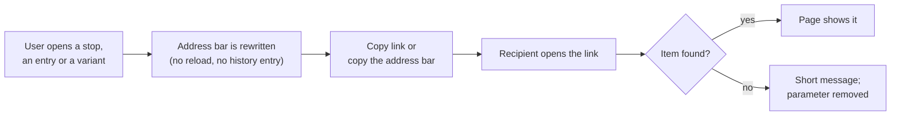

# A2.9 Permalinks

Every page with a map or a list keeps what it shows in the address bar. The address bar is therefore always a [permalink](0.1%20Glossary.md#permalink): a link that opens the page as it is now, ready to bookmark, send to someone or post on the OpenStreetMap community forum. This page lists the link format of each page, explains what happens when a link is opened, and names the code. Read it when you write links to the app from elsewhere, or when you add state to a page.

## Link formats

| Page | Query parameters | Hash | Example |
|---|---|---|---|
| Map `/` | `sloid` or `osm`, `atlas_variant` and/or `osm_variant`, plus every map filter | `#map=` | `/?osm=way/167395649#map=16/46.45493/6.33747` |
| Problems `/problems` | `problem_type`, `priority`, `atlas_operator`, `bbox`, `sloid`, `osm` | none | `/problems?problem_type=distance&sloid=ch:1:sloid:7000:6:32&osm=node/3251097659` |
| Routes `/routes` | `page`, `per_page`, `matched`, `atlas_operator`, `osm_operator`, `q`, `atlas_variant`, `osm_variant` | none | `/routes?osm_variant=2169538` |
| Non-GTFS routes `/routes/non-gtfs` | `page`, `per_page`, `osm_variant` | none | `/routes/non-gtfs?osm_variant=12345` |
| GTFS identity map `/routes/gtfs-stop-id-sloid` | `sloid` or `gtfs_stop_id` | `#map=` | `/routes/gtfs-stop-id-sloid?gtfs_stop_id=8507000:0:1` |

The identifiers are the stable ones of each source, never the database's row numbers, which change with every import:

| Parameter | Value | Example |
|---|---|---|
| `sloid` | An ATLAS [SLOID](0.1%20Glossary.md#sloid) | `ch:1:sloid:7000:6:32` |
| `osm` | The OSM element, written as on openstreetmap.org | `node/3251097659`, `way/167395649` |
| `gtfs_stop_id` | A GTFS [`stop_id`](0.1%20Glossary.md#stop_id) | `8507000:0:1` |
| `atlas_variant` | The ATLAS [itinerary](0.1%20Glossary.md#itinerary) id: GTFS route, direction and headsign | `91-10-A-j26-1:0:Zürich Selnau` |
| `osm_variant` | The OSM [route relation](0.1%20Glossary.md#route-relation) id | `2169538` |

OSM ways are stored as `way_<id>` and nodes as the bare number. Links always use the openstreetmap.org form; the pages convert it.

Scripts and AI agents use the same identifiers with the public lookup: `/?osm=node/3251097659` becomes `/api/lookup?osm=node/3251097659`, which returns the stop's matches as JSON ([A2.10](2.10%20Public%20API.md)).

## Shared behaviour

Read the diagram from left to right: the address bar follows what the user opens, and a link opens the same item for the recipient.

- **The map view** uses the openstreetmap.org convention `#map=<zoom>/<lat>/<lon>`, with the coordinates rounded to 5 decimals. It is rewritten 0.3 s after the map stops moving. When a page loads, a hash whose zoom lies between the review configuration's minimum (`map_min_zoom`) and the map's maximum, 20, and whose point lies inside the configuration's map bounds (`map_bounds`), sets the starting view; any other hash is ignored. Other parts after `&` are ignored, so links copied from openstreetmap.org (`#map=15/46.95/7.44&layers=T`) work.
- **Editing only the hash** of an open page moves the map. Browsers do not reload a page when only the hash changes, so a pasted link that differs only there would otherwise do nothing.
- **The selected item** (stop popup, Problems entry, route variant) is in the query string. Popups and variant panels can stay open side by side; the address bar names the most recently opened one that is still open, and closing it brings back the previous one.
- **Rewriting never reloads and never adds history.** Every change uses `history.replaceState`, which fires no map or `hashchange` event, so Back leaves the page instead of stepping through popups.
- **Other parameters are kept as they are.** A rewrite replaces only its own parameters and leaves the others unchanged, character for character. The Operators page's filter links keep working.
- **Values are encoded like the server's canonical URLs.** `/`, `:` and `,` stay readable, spaces become `+`. The route lists are the exception: their server writes only `,` unencoded, so an `atlas_variant` reads `91-10-A-j26-1%3A0%3AZ%C3%BCrich+Selnau` there.
- **Copy link** copies the item's link to the clipboard and shows *Copied* for 1.5 s. On a plain-HTTP deployment, where browsers offer no clipboard API, it falls back to a text selection. If copying is impossible, a message shows the link so it can be copied by hand.
- **A link that cannot be opened** shows a short message, keeps the rest of the page as linked, and removes the parameter from the address bar.
- **A stop link describes itself.** On the map and the Problems page, the server names the linked stop and its matches in the page's title and description and links to its lookup, so link previews and clients that run no JavaScript see the stop ([A2.10](2.10%20Public%20API.md#page-links-without-javascript)).

## Map

The map at `/` keeps its view in `#map=` and the stop whose popup is open in `sloid` or `osm`. A matched stop has both identifiers; the link uses the side its popup was opened from, so the recipient sees the same popup.

On load, a stop parameter is looked up with a single `/api/stop_by_id` request. The stop's position decides the view, even when the link also has a hash. When the stop is not found, the map keeps the hash's view or the default view.

**Copy link** sits next to *Edit in OSM iD Editor* in each stop popup, including each card of the *See Matches* view. The copied link contains the stop and the current view.

**Filters.** The address bar keeps every map filter, so a link opens the same filtered view. **Copy link** in the summary panel copies it with the current view. The parameters have the names `/api/data` uses ([A2.2](2.2%20Filters%20and%20Search%20logic.md)); lists are comma-separated:

| Parameter | Filter | Example |
|---|---|---|
| `stop_filter` | The scope checkboxes: `matched`, `atlas_unmatched`, `osm_unmatched`, `osm_disused` | `stop_filter=atlas_unmatched` |
| `match_method` | Matching rules and unmatched reasons chosen without their parent | `match_method=reference,no_nearby_counterpart` |
| `transport_types`, `osm_entity_types` | OSM transport types and entity types | `transport_types=platform,tram_stop` |
| `osm_group_types` | `all`, or the chosen OSM group types | `osm_group_types=ptv2_two_sided_stop` |
| `show_duplicates_only` | Duplicate ATLAS | `show_duplicates_only=true` |
| `atlas_operator`, `osm_operator`, `osm_operator_wikidata`, `missing_osm_operator_wikidata` | The operator filters | `atlas_operator=PAG` |
| `problem_type`, `priority` | The Problems dropdown: `all` or problem types, and priorities `1` to `3`; the Problems page's names | `problem_type=distance&priority=1` |
| `top_n` | Top N distances; kept only with a matched scope | `top_n=15` |
| `search` | One per search filter: `uic:<number>`, `source:<stop ID>`, `node/<id>`, `way/<id>`, `route:<id>`, optionally followed by ` dir:0` or ` dir:1` | `search=uic:8503000&search=route:91-10-A-j26-1+dir:0` |

A parent checkbox stands for its children: `stop_filter=matched` selects every matching rule, and `match_method` lists rules only when the parent is not ticked. On load, unknown values are ignored and the address bar is rewritten with the filters that apply. The chips of `search` stop filters are named from [`/api/lookup`](2.10%20Public%20API.md). Example: `/?stop_filter=atlas_unmatched&atlas_operator=PAG#map=12/46.85/9.53` shows PostAuto's ATLAS stops without an OSM match around Chur.

**Route variants.** `atlas_variant` and/or `osm_variant`, with the values the route lists use, add a route filter narrowed to those variants ([A2.2](2.2%20Filters%20and%20Search%20logic.md#route-filters-and-their-variants)). On load, one `/api/routes/variants` request finds the variants and their line. Without a `#map=` hash or a stop link, the map fits their stops. The address bar then follows the filter: choosing another variant in the route chip rewrites the parameters, and choosing a direction or removing the chip drops them. With several narrowed route filters, it names the last one. The other route filters are `search` values, without their variants. An ATLAS variant is found with the timetable year ignored, and the address bar is rewritten with the current id. When neither variant exists, a message says so and the parameters are removed.

Example: `/?atlas_variant=91-10-A-j26-1:0:Z%C3%BCrich+Selnau&osm_variant=1561015` shows the S10's Uetliberg → Zürich Selnau variant and OSM relation 1561015, with every stop match of their stops.

## Problems

The Problems page ([A2.4](2.4%20Problems%20Page.md)) keeps its filters and the entry on screen in the query string. It has no hash: its map always follows the entry.

| Parameter | Value |
|---|---|
| `problem_type` | Comma-separated problem types; absent means all types |
| `priority` | Comma-separated priorities `1`, `2`, `3`; absent means all |
| `atlas_operator` | Comma-separated ATLAS operator abbreviations |
| `bbox` | The drawn area, `west,south,east,north` ([A2.4](2.4%20Problems%20Page.md#area)) |
| `sloid`, `osm` | The stop of the entry on screen |

An entry is named by its stop:

| Entry | Named by |
|---|---|
| Matched pair | Both `sloid` and `osm`, which identify the pair even when a SLOID is matched to several OSM elements |
| Unmatched ATLAS or OSM stop | Its own identifier |
| ATLAS duplicate group | The group's representative SLOID (the first in sort order) |
| OSM duplicate group | The first member's `osm` |

### Opening an entry deep in the list

The list holds tens of thousands of entries and loads them 100 stops at a time, in priority order. A linked entry can therefore be on any page. The page asks the server for it directly:

1. The first `/api/problems` request carries `focus_sloid` and/or `focus_osm_node_id` (stored form, `way_<id>` for ways) with the link's filters.
2. The server ranks the stops in the same order as the list and answers with the page that holds the stop's first entry, and `focus_found: true`. In the duplicates-only view it ranks the duplicate groups and looks for the stop among their members.
3. The page shows that entry. The list now starts on that page: *Next* loads the following pages as usual, and *Prev* at the start loads the page before.

If no entry of that stop matches the filters, the server answers with page 1 and `focus_found: false`. The page shows a message and the first entry. When a stop has several entries (in the all-types view, a stop's duplicate problem forms its own entry), the link opens the first of them.

### Entry numbers

`Entry N of Total` counts from the page where the list was opened: a list opened on page *p* numbers its first entry (*p* − 1) × 100 + 1. The total counts stops, but some stops have two entries, so numbers far from page 1 are approximate. A number never changes while it is on screen. Once *Prev* reaches page 1, the list is numbered from its first entry.

**Copy link** sits next to the entry and priority chips above the problem details. It copies the address bar.

## Routes and non-GTFS routes

The route lists ([A2.6](2.6%20Routes%20Pages.md)) are rendered by the server, so their filters and page number were already in the query string. A permalink adds the open variant: `atlas_variant` and/or `osm_variant`. A matched variant names both.

When a request names a variant, the server finds the card that shows it:

1. It looks up the variant's [line family](0.1%20Glossary.md#line-family) from `itineraries.source` and `source_itinerary_id`.
2. It ranks the cards of the filtered list with the list's own `ORDER BY` and takes the first card of that family (for a matched variant, the card of both families).
3. It renders the page that holds the card. The canonical redirect writes that page number into the address bar, so the link opens the right page even after an import has moved the card.

In the browser, the variant panel opens and scrolls to the top, below the sticky tabs. When the variant is not on the page (it does not match the link's filters, or a newer import removed it), a message says so and the parameter is removed.

**Copy link** sits at the top of each opened variant. The candidate chosen in the comparison panel is not part of the link.

The variant map does not keep its own view in the address bar. It links to the main map instead: a stop popup's **Open in main map** is the main map's stop link (`?sloid=` or `?osm=`). The card's **Main map** button opens the main map on the variants the map shows, `atlas_variant` and/or `osm_variant` (the candidate chosen in the comparison panel included), at the variant map's current `#map=` view. Both open in a new tab.

## GTFS identity map

The `/routes/gtfs-stop-id-sloid` map keeps its view in `#map=` and the stop whose popup is open in `sloid` (ATLAS marker) or `gtfs_stop_id` (GTFS marker).

On load, a stop parameter runs the map's identifier search, as if `sloid:…` or `stop_id:…` had been typed into the search box. The search centres the map on the stop and shows it as an active filter; then the stop's popup opens. If the search finds nothing, its usual message appears under the search box and the parameter is removed.

**Copy link** sits in each ATLAS and GTFS card of a popup. The match-method and unmatched filters are not part of the link.

## Limits

- Links name data of the published [snapshot](0.1%20Glossary.md#snapshot). SLOIDs, OSM ids and GTFS `stop_id`s are stable, but ATLAS itinerary ids contain the timetable year (`j26`), so a route list's variant link stops working when a new timetable is imported. The main map ignores the year in `atlas_variant`, so its links keep working as long as the route keeps its number, letter, direction and headsign.
- A Problems link opens the entry only while the stop still has a problem matching the link's filters.

## Code

| File | Role |
|---|---|
| `static/js/shared/permalinks.js` | Shared rules: `#map=` hash, query rewriting, the open-item tracker, Copy link, the main map's stop parameters (`stopParams`) |
| `static/js/components/popup-renderer.js` | The *Copy link* buttons in stop popups (option `permalinks`) and *Open in main map* links (option `mainMapUrl`) |
| `static/js/pages/main.js` | Map: stop parameters and `/api/stop_by_id` on load; route variant parameters and `/api/routes/variants` on load |
| `static/js/pages/filters.js` | Map: the route chip's variants and the route variant parameters it keeps in the address bar |
| `static/js/pages/problems-permalink.js` | Problems: reading and writing filters and the entry |
| `static/js/pages/problems-data.js` | Problems: loading the linked page and earlier pages |
| `backend/blueprints/problems.py` | `focus_sloid` and `focus_osm_node_id` on `/api/problems` |
| `static/js/pages/routes.js` | Route lists: opening and naming variants; links from variant maps to the main map |
| `backend/pages/routes.py`, `backend/services/route_listing.py` | Route lists: canonical parameters of the three tabs; finding a variant's page |
| `static/js/pages/routes-gtfs-stop-id-sloid.js` | GTFS identity map: view, stop parameters and the linked search |
| `backend/services/url_query.py` | `canonical_query_redirect()`, with the characters each page leaves unencoded |

The tests are `tests/js/permalinks.test.js`, `tests/js/map-permalinks.test.js`, `tests/js/route-variant-filter.test.js`, `tests/js/problems-permalink.test.js`, `tests/js/routes-permalinks.test.js`, the permalink cases in `tests/js/routes-gtfs-stop-id-sloid.test.js`, `tests/test_problems_permalinks.py` and `tests/test_routes_permalinks.py`.

## Related pages

- [A2.1 Map data loading and rendering](2.1%20Map%20Data%20Loading%20and%20Rendering.md)
- [A2.2 Filter and search logic](2.2%20Filters%20and%20Search%20logic.md)
- [A2.4 Problems page](2.4%20Problems%20Page.md)
- [A2.6 Routes pages](2.6%20Routes%20Pages.md)
- [A2.10 Public API](2.10%20Public%20API.md)
