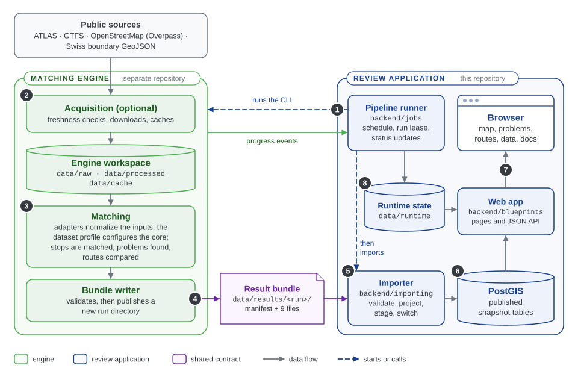
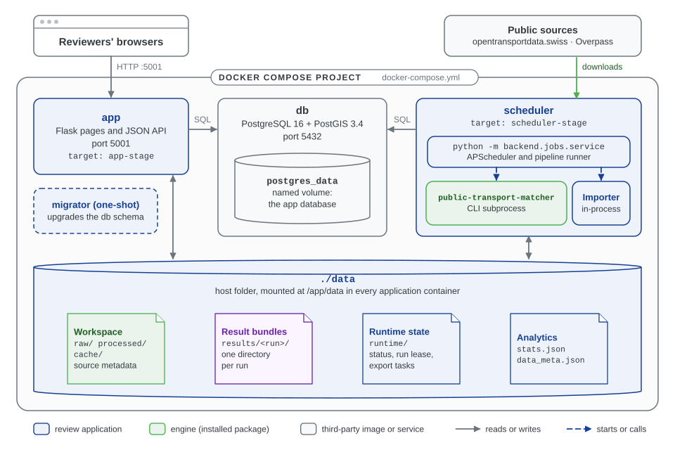

# A3 Application architecture & deployment

This chapter shows how the review application is built, how it runs the separately installed matching engine, and how both are deployed with Docker Compose. Read it before operating a deployment or changing anything that crosses the boundary between the two projects. Terms such as *result bundle* and *dataset profile* are defined in the [glossary](0.1%20Glossary.md).

## The system at a glance

The engine (green) and the review application (navy) are separate repositories; the result bundle (purple) is the contract between them. Follow the numbers:

1. The **pipeline runner** in the scheduler container starts the engine's command-line tool, `transport-matcher`, as a separate process, and reads the progress events it prints.
2. The engine's **acquisition** layer checks whether ATLAS, GTFS and the Swiss boundary changed, downloads what is new and downloads a fresh OSM extract. Verified downloads and prepared products are cached in the engine workspace.
3. **Matching** reads the workspace files through format adapters, applies the Swiss [dataset profile](0.1%20Glossary.md#dataset-profile), matches stops, detects problems and compares routes. The adapters read the files; the matching core itself never touches files, the network or a database.
4. The **bundle writer** validates the complete result and publishes a new directory under `data/results/<run>/`.
5. The runner then calls the **importer** in its own process. It validates the bundle independently and loads it into a private staging schema.
6. One short transaction switches the staged tables into the public schema of **PostGIS**. Until then, readers see the previous snapshot.
7. The **web app** serves pages and a JSON API from the published snapshot to reviewers' browsers.
8. Run status and the run lease are kept as **runtime state** files, which the web app reads to show live pipeline progress.

[A1.1](1.1%20Import%20Process.md) details steps 5 and 6, [A3.3](3.3%20Background%20Scheduler.md) and [A3.5](3.5%20Pipeline%20Progress.md) steps 1 and 8, and the engine chapters [E1](../engine/documentation/1.%20Download%20and%20process%20data.md) to [E4](../engine/documentation/4.%20Problems.md) steps 2 to 4.

## The boundary between engine and application

Only three things cross the boundary, and each is versioned or documented:

| Connection | Direction | Form | Contract |
|---|---|---|---|
| CLI call | application → engine | `transport-matcher swiss --workspace <dir> --output <dir>/<run>`, plus `--download` in `full` mode and `--force` when `PIPELINE_FORCE_FULL_REFRESH` is true | Command-line options of the engine |
| Progress events | engine → application | JSON lines on standard output with `progress_schema_version: 2`; other output is only logged | [E5.3 Progress contract](../engine/documentation/5.3%20Pipeline%20Progress%20Contract.md) |
| Result bundle | engine → application | A directory with `manifest.json` and nine record files | [Result bundle format](../engine/documentation/Result%20bundle%20format.md) |

The runner removes `DATABASE_URI`, `SECRET_KEY` and `FLASK_SECRET_KEY` from the engine process's environment, so the engine cannot reach the application database even when both run in one container. `MATCHER_COMMAND` (default `transport-matcher`) selects another executable; it is split into arguments without a shell.

The code follows these dependency rules, which static checks in `make quality` enforce:

- The engine imports no `backend`, Flask or SQLAlchemy code, and the application imports no `transport_matcher` code. The application's importer implements the published bundle format independently.
- Inside the engine, the matching core receives normalized records, per-run state and an explicit profile. It reads no files, environment variables or databases.
- Format adapters parse explicit input files; network downloads live in a separate, optional acquisition layer.
- Swiss specifics, such as SLOIDs, the GTFS-to-ATLAS identity mapping, duplicate groups and route-year codes, belong to the Swiss integration and profile, not to the core.
- The engine ships only curated, maintained adapters. Other datasets can use external adapters that implement its public adapter contract, without changes to the engine repository.

## Deployment

`docker-compose.yml` defines these services. `docker-compose.override.yml` builds them locally from the `dockerfile` stages and mounts the source tree for development.

| Service | Built from | Runs | Restart |
|---|---|---|---|
| `db` | `postgis/postgis:16-3.4` | PostgreSQL 16 with PostGIS 3.4 on port 5432; data in the `postgres_data` volume | unless stopped |
| `migrator` | `app-stage` | `python backend/importing/init.py && flask db upgrade`: waits for the database, applies the Alembic migrations, exits | no |
| `app` | `app-stage` | Flask on port 5001: the debug server when `FLASK_DEBUG=1`, otherwise Gunicorn with two workers | unless stopped |
| `scheduler` | `scheduler-stage` | `python -m backend.jobs.service`: APScheduler, the pipeline runner and importer, and the installed engine CLI | unless stopped |
| `test` | `test-stage` | The application test tools, without the engine | no |

The `app` and `scheduler` services start only after `db` is healthy and `migrator` has finished. Restart policies recover crashed processes; they are not a production high-availability design.

> [!IMPORTANT]
> The Compose defaults are for local development: `FLASK_DEBUG=1` runs Flask's debug server, the database password is a placeholder, and PostgreSQL's port is published on the host. For a public deployment, set `FLASK_DEBUG=0`, choose credentials in `.env`, and do not publish port 5432.

The host folder `./data` is mounted at `/app/data` in the `app`, `scheduler`, `migrator` and `test` containers. The scheduler's engine workspace is `/app` (`PIPELINE_WORKSPACE`), so the engine's files land in the same folder:

| Path below `data/` | Written by | Read by | Contents |
|---|---|---|---|
| `raw/`, `processed/`, `cache/`, `source_metadata.json` | engine acquisition | engine | Downloaded sources, prepared products, cache metadata |
| `results/<run>/` | engine bundle writer | importer | One immutable result bundle per run (`PIPELINE_BUNDLE_DIR`) |
| `runtime/` | runner, scheduler, web app | web app, scheduler | Pipeline status, run lease, export tasks (`STATE_DIR`) |
| `stats.json`, `data_meta.json`, `gtfs_atlas_stats.json` | importer, runner | web app | Analytics and metadata of the published snapshot |

Builds pin the engine to one commit: Docker receives the verified sibling checkout as a named build context. [A3.1](3.1%20Dependency%20Management%20&%20Build%20Strategy.md) explains the image stages, version identifiers and the upgrade procedure.

## Who owns which state

- **Engine:** matching state is created fresh for each call; nothing is shared between runs. The acquisition workspace holds source caches with their fingerprints and HTTP validators.
- **Application:** the database tables and their migrations, the runtime state under `data/runtime`, asynchronous exports and the presentation settings.

The application has no stored human-review decisions. If they are added, they must live outside the replaceable snapshot tables and refer to the stable problem and entity keys of the bundle.

## Presentation configuration and matching policy

Two kinds of configuration exist, and they never affect each other:

| | Review configuration | Dataset profile |
|---|---|---|
| Changes | What the website shows | How stops are matched |
| Where | A JSON file named by `REVIEW_CONFIG` | Python code in the engine (`MatchingProfile`) |
| Examples | `config/switzerland.json`, `config/gtfs-example.json` | `profiles.SWITZERLAND`, the generic default |
| Contains | Title, flag, source and identifier labels, link template, map centre, zoom and bounds, enabled views, route-search normalization | Reference rules, rule order, OSM grouping, distance and priority thresholds |

A view is enabled only when the review configuration enables it **and** the active bundle has the matching [capability](0.1%20Glossary.md#capability) (`routes`, `gtfs_identity`). A bundle without routes therefore never shows an empty route page.

## Legacy names in schema 1

The database and some code still use Swiss names such as `atlas_stops`, `sloid` and `unmatched_atlas` for the generic source side. The importer maps namespaced source keys into these fields; the names do not mean that the application parses ATLAS. A generic GTFS bundle works with the generic presentation, and Swiss-only views stay hidden through capabilities.

These names are acknowledged debt. Removing them needs an application migration together with a new result-schema version, not a silent rename within schema 1.

## Related pages

- [A1.1 Bundle import and publication](1.1%20Import%20Process.md)
- [A3.1 Dependencies and builds](3.1%20Dependency%20Management%20&%20Build%20Strategy.md)
- [A3.3 Background scheduler](3.3%20Background%20Scheduler.md)
- [A3.5 Pipeline progress](3.5%20Pipeline%20Progress.md)
- [E5.1 Source snapshot caching](../engine/documentation/5.1%20Atlas-Cached%20Import%20Optimization.md) and [E5.2 Pipeline performance](../engine/documentation/5.2%20Pipeline%20Performance.md)
- [Contributing](Contributing.md)
