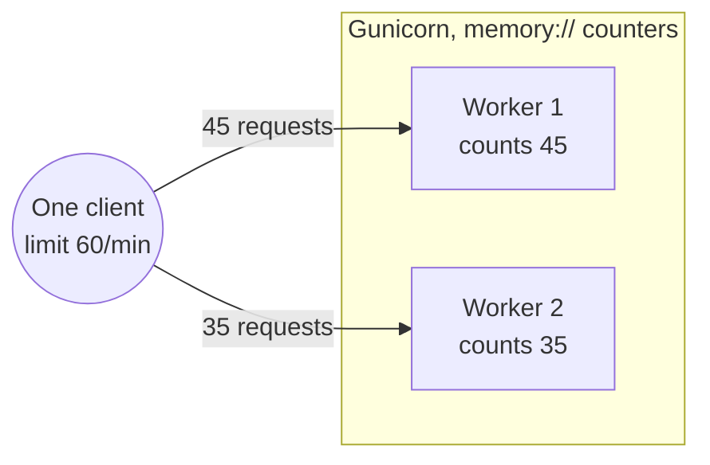
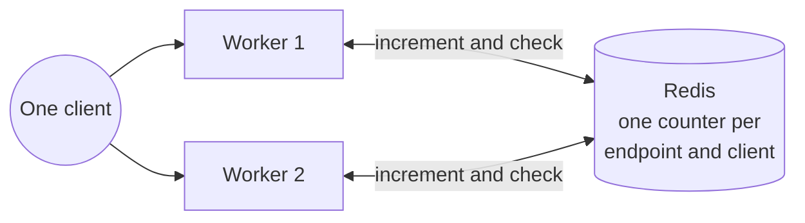

# A3.2 Security and rate limits

The review application is a public, read-only dashboard: it has no user accounts and stores no personal data. Its protections therefore aim at availability, so that no single client can exhaust the shared web workers or the database. This page describes the rate limits, the bounds on database work and search, and the optional HTTPS redirect.

## Rate limits

`Flask-Limiter` counts requests per client IP address (`get_remote_address`). Every route without its own limit allows **500 requests per minute** (`default_limits` in `backend/extensions.py`). Expensive or easily abused routes are stricter:

| Endpoint(s) | Limit | Defined in |
|---|---:|---|
| `/api/data` | 30/minute | `backend/blueprints/data.py` |
| `/api/atlas_operators`, `/api/osm_operators`, `/api/osm_operator_wikidata`, `/api/osm_route_operators`, `/api/route_stops` | 60/minute | `backend/blueprints/data.py` |
| `/api/stop_popup` | 120/minute | `backend/blueprints/data.py` |
| `/api/search`, `/api/top_matches`, `/api/stop_by_id` | 60/minute | `backend/blueprints/search.py` |
| `/api/random_stop` | 30/minute | `backend/blueprints/search.py` |
| `/api/problems`, `/api/problems/stats` | 120/minute | `backend/blueprints/problems.py` |
| `/api/global_stats` | 30/minute | `backend/blueprints/stats.py` |
| `/api/system/pipeline_status` | 120/minute | `backend/blueprints/system.py` |
| `/api/generate_report_async` | 10/hour | `backend/blueprints/reports.py` |
| `/api/report_progress/<task_id>` | 240/minute | `backend/blueprints/reports.py` |
| `/api/download_report/<task_id>` | 20/minute | `backend/blueprints/reports.py` |
| `/api/cancel_report/<task_id>` | 60/minute | `backend/blueprints/reports.py` |
| `/api/generate_report` | 20/day | `backend/blueprints/reports.py` |

The documentation PDF routes (`/api/docs/...`) have no limit of their own and use the default. A client over a limit receives **HTTP 429 Too Many Requests**.

> [!WARNING]
> Behind a reverse proxy, `get_remote_address` sees the proxy's address, so all visitors share one set of counters. The application does not read `X-Forwarded-For`. Either enforce limits at the proxy, or wrap the application in Werkzeug's `ProxyFix` with the exact number of trusted proxies; trusting the header without a proxy that overwrites it would let clients choose their own address.

### Where the counters live

`RATELIMIT_STORAGE_URI` selects the counter store; the default is `memory://`. The rate-limit store is independent of the pipeline status, run lock and export progress, which Compose keeps as JSON files under `STATE_DIR` (`data/runtime`, `STATE_BACKEND=file`).

With `memory://`, each Gunicorn worker counts on its own. The production command starts two workers, so a client can make up to twice the stated number of requests:

Here the client made 80 requests in a minute, but neither worker reached 60, so none was rejected. A shared store such as Redis (`RATELIMIT_STORAGE_URI=redis://…`; the `redis` client is already a dependency) gives all workers one atomic counter per endpoint and client, without changing any decorator:

## Bounded database work

Every PostgreSQL connection of the web application carries limits, so a slow query or a held lock fails quickly instead of occupying a worker until Gunicorn's 30-second worker timeout:

| Setting | Default | Allowed range | Effect |
|---|---:|---|---|
| `WEB_DB_CONNECT_TIMEOUT_SECONDS` | 5 | 1–60 | Stops waiting for a database connection |
| `WEB_DB_LOCK_TIMEOUT_MS` | 3000 | 100–120000 | Fails a query that waits for a lock, for example during the [snapshot switch](1.1%20Import%20Process.md#5-switch-publishswap) |
| `WEB_DB_STATEMENT_TIMEOUT_MS` | 25000 | 1000–300000 | Cancels a query that runs too long |

Values outside the range are clamped to it; values that are not integers fall back to the default. Connections are checked before reuse (`pool_pre_ping`). The settings are read in `backend/app.py`.

## Search guardrails

`/api/search` scans text columns, so `backend/blueprints/search.py` bounds every query:

| Guardrail | Value | Constant |
|---|---|---|
| Shortest query | 3 characters; shorter queries return no results | `SEARCH_MIN_QUERY_LENGTH` |
| Longest query | 50 characters; longer queries return HTTP 400 | `SEARCH_MAX_QUERY_LENGTH` |
| Wildcards | `%` and `_` in the input are escaped, so they match literally in `ILIKE` | `_escape_like_literal` |
| Statement timeout | 1.5 s per search, on PostgreSQL | `SEARCH_STATEMENT_TIMEOUT_MS` |
| Results | At most 200 matched and 200 unmatched rows | `SEARCH_MAX_RESULTS_PER_QUERY` |

## HTTPS and browser headers

HTTPS redirection is optional. With `FORCE_HTTPS=true`, a `before_request` hook in `backend/app.py` redirects plain HTTP requests to `https://` with status 301. A request counts as plain HTTP when `X-Forwarded-Proto` is `http` (or absent) and the connection itself is not secure. The reverse proxy in front of the application must overwrite any `X-Forwarded-Proto` header sent by clients. When `FORCE_HTTPS` is unset or false, the application never redirects.

The application sends no Content Security Policy or other hardening headers of its own, because it serves public data without accounts or sessions. Add them at the reverse proxy if a deployment requires them.

## Related pages

- [A3 Architecture](3.%20System%20Architecture.md#deployment) for the services and their settings
- [A2.5 Reports and PDFs](2.5%20Generate%20Reports%20and%20PDFs.md#clean-up-and-rate-limits) for the export limits in context
