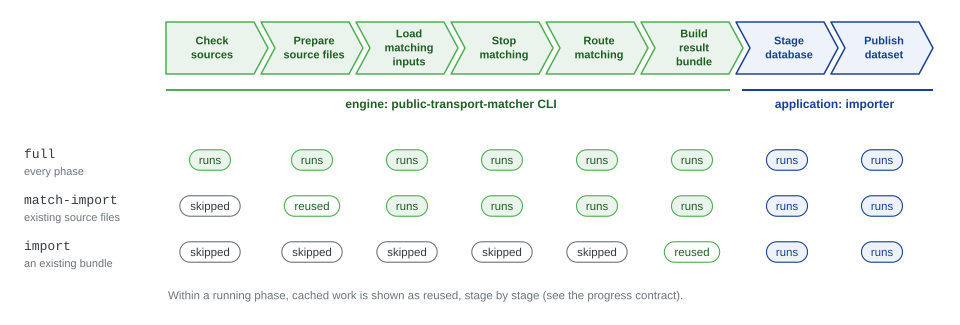
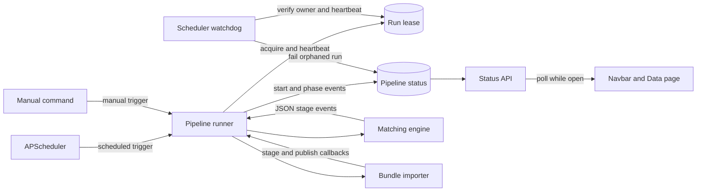
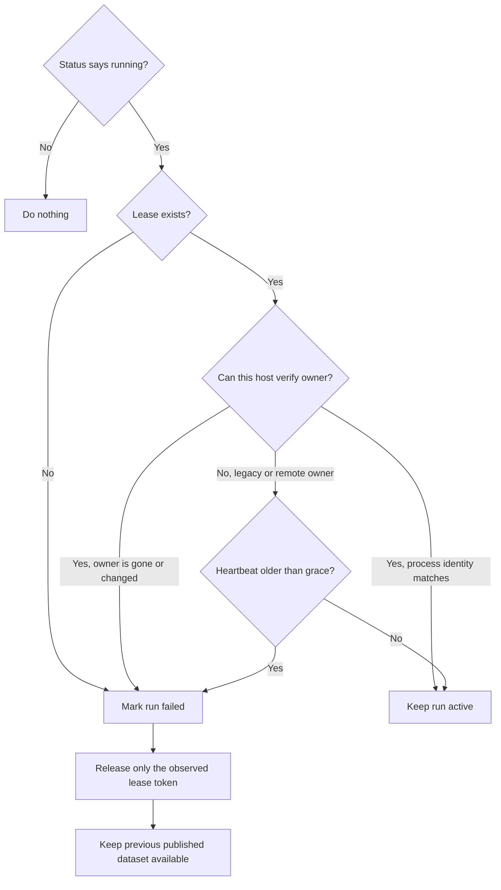

# A3.3 Background scheduler

The scheduler service refreshes the published data on a fixed interval. Each run starts the engine as a separate program, imports the bundle it writes ([A1.1](1.1%20Import%20Process.md)) and reports its progress to the website; it never imports engine code. This page explains the run modes, how runs are started and kept from overlapping, how a dead run is detected, and how the website shows progress. The code is in `backend/jobs/`.

## Run modes



A run has eight phases. The engine performs the first six as a subprocess; the application's importer performs the last two. The three modes differ in where they start:

| Mode | Engine command | Use it to |
|---|---|---|
| `full` | `transport-matcher swiss --workspace <workspace> --output <bundle> --download` | Check and refresh the sources, match and import. Scheduled runs use this mode |
| `match-import` | The same command without `--download` | Match again with the source files already in the workspace, for example after an engine upgrade |
| `import` | None | Import the existing bundle named by `PIPELINE_BUNDLE`. No engine installation is needed |

With `PIPELINE_FORCE_FULL_REFRESH=true`, `full` runs add `--force`: the engine ignores its freshness checks and rebuilds every cached source product ([E5.1](../engine/documentation/5.1%20Atlas-Cached%20Import%20Optimization.md)).

`MATCHER_COMMAND` (default `transport-matcher`) names the engine executable. It is split into arguments like a shell command line, but never run through a shell. The engine writes each bundle to a new directory below `PIPELINE_BUNDLE_DIR`. Nothing deletes old bundles; a Swiss bundle is about 40 MB, so remove the ones you no longer need.

Run the job by hand from the application root or inside the scheduler container:

```bash
python -m backend.jobs.job_runner --mode full --trigger manual
PIPELINE_BUNDLE=data/results/<bundle> python -m backend.jobs.job_runner --mode import --trigger manual
```

The command exits with `0` after a successful run, `1` after a failed run and `2` when another run is active and this one was skipped.

## Schedule

`backend/jobs/service.py` uses APScheduler to start a `full` run every `PIPELINE_SCHEDULE_INTERVAL_HOURS` hours (default 24) in `PIPELINE_TIMEZONE` (default `Europe/Zurich`). The interval counts from the moment the scheduler starts, so the first scheduled run comes one full interval after startup: **a new deployment has no data until you run the pipeline by hand**. A trigger that fires while a run is still active is skipped.

## How the pieces fit together



The runner keeps two separate records:

- The **status record** explains the run to people: run ID, phase, message, stage timings, outcome and the next scheduled time.
- The **lease record** proves that a particular runner process still owns the run. Its heartbeat shows liveness and is never displayed.

Keeping them apart prevents a stale status message from being mistaken for proof that a process is alive. Both are JSON files under `STATE_DIR`, written atomically under a file lock; a Redis backend is also available.

## Who writes the status

The scheduler and the runner share `pipeline_status.json` but own different fields:

| Writer | Fields |
|---|---|
| Scheduler service | `next_run_at` and its `schedule_updated_at` timestamp only |
| Active runner | The run state: `status`, `phase`, messages, counters, timestamps, phase history and result metadata |
| Import completion | `last_pipeline_data_import_ended_at` and the published result metadata |

Starting or restarting the scheduler never resets the run state to `idle`: a manual run may start at almost the same moment, and resetting it would hide that run from the website.

Every status change is an atomic patch of its own fields. The file backend takes the shared runtime guard before reading, merging and replacing the file; the Redis backend merges with `WATCH`/`MULTI` and retries when another writer wins. A `next_run_at` update therefore cannot restore an older copy of the runner's phase, and a phase update cannot discard the next scheduled time.

## Detecting a dead runner

The run lease is the authority on whether a run is active. The runner acquires it before it publishes `status=running`, and records its host, process ID, process start identity and container lifetime. It refreshes `heartbeat_at` throughout long engine work and releases the lease after success or failure. The four-hour lease expiry is only the last safeguard against overlapping runs; it is not how long the website takes to notice a dead runner.

The scheduler runs a watchdog at startup and every `PIPELINE_WATCHDOG_INTERVAL_SECONDS`:



On the same host, the watchdog checks that the recorded process ID still identifies the original process; after a container restart, the changed runtime identity proves at once that the old owner is gone. When the owner cannot be checked locally, for a lease from another host or an older format, the watchdog waits until the heartbeat is older than `PIPELINE_LOCK_STALE_SECONDS`. Recovery releases only the lease token it observed, marks the run failed with an interruption message, and leaves the last published dataset in place.

In the opposite direction, the status reader shows an unfinished `idle` record with a live lease as `running`, and infers the current phase from the phase history until the runner writes its next update. This repairs state left by deployments that reset an active run when the scheduler started.

## Publishing safely

- Downloading, matching and staging happen while readers keep using the published snapshot. PostgreSQL serializes only the final table switch, which takes a moment ([A1.1](1.1%20Import%20Process.md#5-switch-publishswap)).
- A failed engine run or a rejected bundle marks the run failed and leaves the published data unchanged. Files of failed runs are never imported.
- The publication code serializes switches itself, even when called outside the scheduler.
- When a Routes query times out on a lock during the switch, the Routes pages answer `503` with `Retry-After: 30` instead of an error. They answer the same way while the status record has `blocking_maintenance` set; no pipeline step sets it.

A successful run records the new active run ID and the publication timestamps.

## Live status in the web interface

Every page polls `/api/system/pipeline_status`: every ten seconds when idle, every 1.5 seconds during a run. The navbar is rendered with the current state on the server, so a run in progress is visible before the first poll.

The pipeline card does not depend on the published statistics. It stays visible during the first run of a new deployment, when `stats.json` does not exist yet; the notice about missing statistics appears below the card until the first publication succeeds.

The Data page turns the phase history into a live timeline. Its phases describe the work a user can see rather than process boundaries:

| Phase | Work |
|---|---|
| Check sources | Probe ATLAS and GTFS freshness, validate reusable caches and prepare the geographic boundary |
| Prepare source files | Download and filter or reuse ATLAS, download and extract or reuse GTFS, prepare timetable patterns, identities and routes, then download the current OSM extract |
| Load matching inputs | Read ATLAS stops and cached timetable products, optionally prepare a supplied GTFS feed, then parse OSM stops, route relations and evidence |
| Stop matching | Group OSM stops, run the stop-matching rules and detect stop problems |
| Route matching | Normalize and compare line families, itineraries, directions and stop sequences |
| Build result bundle | Record fingerprints and quality metrics, write and compress the result, write checksums and validate the bundle |
| Stage database | Validate the bundle independently, prepare application rows, load an isolated PostgreSQL schema and build indexes, while readers keep the previous snapshot |
| Publish dataset | Switch the staged tables into public view in one transaction, generate statistics and update the publication metadata. This publishes data; it does not deploy the website |

The runner reads the engine's JSON `stage_started` and `stage_progress` events and copies them to the scheduler log. Each event names its phase and position; the engine's diagnostic log lines about cache decisions do not drive the display. `stage_outcome` events mark cached preparation stages as `Reused`, and a mode that leaves out work marks it as `Skipped`. The importer reports staging and the table switch itself. Cards report "N/M finished", counting completed, reused and skipped stages. [A3.5](3.5%20Pipeline%20Progress.md) describes the version-2 progress contract.

### Stage timestamps and history

The status store records every stage event with a UTC ISO 8601 timestamp; the browser shows it in the viewer's time zone. The time below each bar is:

| Stage state | Time shown | Duration |
|---|---|---|
| Running | `phase_started_at` | Browser clock minus the stage start, refreshed every second |
| Completed or failed | The history entry's `started_at` | `finished_at - started_at`, calculated by the backend |
| Reused | When the cache decision arrived | `0`; the UI says `Reused` instead of `0s` |
| Skipped | When the mode decision was recorded | `0`; the UI says `Skipped` instead of `0s` |
| Waiting | None yet | None yet |

Reused and skipped stages are recorded as events with zero duration, so every stage has a time without pretending that cached work took time. A run recorded before these events existed shows `—` for such stages, because the exact time cannot be reconstructed.

A completed stage:

```json
{
  "phase": "stop_matching",
  "started_at": "2026-09-21T14:18:23.120000+00:00",
  "finished_at": "2026-09-21T14:46:45.390000+00:00",
  "duration_seconds": 1702.27
}
```

A cache decision uses the same fields:

```json
{
  "phase": "atlas",
  "started_at": "2026-09-21T14:18:23.100000+00:00",
  "finished_at": "2026-09-21T14:18:23.100000+00:00",
  "duration_seconds": 0.0,
  "status": "reused"
}
```

The other timestamps of the status record mean different things:

| Field | Meaning |
|---|---|
| `started_at` | Start of the whole run; never changes during the run |
| `phase_started_at` | Start of the active phase; cleared when the run ends |
| `phase_history[].started_at` / `finished_at` | Measured boundaries of completed, failed, reused or skipped stages |
| `updated_at` | Last change of the record; neither a stage boundary nor proof of liveness |
| `finished_at` | End of the run, successful or failed |
| `last_success_at` | End of the most recent successful run |
| `last_pipeline_data_import_ended_at` | Publication time used by the statistics snapshot |
| `schedule_updated_at` / `next_run_at` | Scheduler metadata, independent of any run |
| Lease `acquired_at` / `heartbeat_at` / `expires_at` | Lease ownership and health; never used as stage times |

How the timeline behaves:

- Completed stages show a green check, the active stage a spinner, and stages that have not started stay white at their minimum width on the right.
- The active stage's elapsed time and width update in the browser every second, without waiting for the next poll.
- A completed stage keeps its measured duration as its weight; the active stage gains one unit per elapsed second. As a later stage runs, earlier stages take a shrinking share of the bar and their boundaries move left.
- After a successful run, all stages use their measured durations. Without duration data, the template's fixed proportions are used.
- A failed stage stays visually distinct, and the stages before it keep their measured proportions.
- Labels stay within their stage and end with an ellipsis when they do not fit; the full name appears on hover and keyboard focus. Narrow screens use two columns instead of overlapping labels.
- Each time has a hover text such as `Started at`, `Reuse decided at` or `Skip decided at`, with the full local date and time.

The timeline shows elapsed time, not an estimate of the remaining time. `processed`, `total` and `eta_seconds` may appear in status text, but never set a stage's duration.

## Operational checks

For a manual run, start the services, then run the job in the scheduler container:

```bash
docker compose up -d db migrator app scheduler
docker compose ps
docker exec stop_sync_osm_atlas_scheduler \
  python -m backend.jobs.job_runner --mode full --trigger manual
```

A manual run may overlap with the scheduler's startup safely, but waiting until the services are ready makes the logs easier to read. During a run, `/api/system/pipeline_status` reports `status: "running"`, and the lease file under `STATE_DIR` keeps receiving `heartbeat_at` updates. If the runner is killed, the scheduler marks the run failed at its next start or watchdog pass, releases the stale lease and allows a new run.

For a compact view of a run:

```bash
curl -s http://localhost:5001/api/system/pipeline_status \
  | jq '{status, phase, message, started_at, phase_started_at, phase_history}'
```

Read it as follows:

- `status: "running"` with a current lease heartbeat and a verifiable owner means the process is alive.
- A changing `updated_at` alone proves nothing: scheduler metadata also updates the record.
- Within a run, `phase_history` only grows, except that a reuse or skip marker is replaced when that stage actually starts.
- `status: "failed"` with an interruption message means the watchdog recovered an abandoned run. The published dataset is still there.

## Settings

| Setting | Default | Meaning |
|---|---|---|
| `PIPELINE_SCHEDULE_INTERVAL_HOURS` | `24` | Hours between scheduled `full` runs; must be greater than 0 |
| `PIPELINE_TIMEZONE` | `Europe/Zurich` | Time zone of the schedule |
| `PIPELINE_FORCE_FULL_REFRESH` | `false` | Adds `--force` to `full` runs, rebuilding all cached source products |
| `MATCHER_COMMAND` | `transport-matcher` | Engine executable and any leading arguments |
| `PIPELINE_WORKSPACE` | `.` (`/app` in Compose) | Engine workspace that holds the source files |
| `PIPELINE_BUNDLE_DIR` | `data/results` (`/app/data/results` in Compose) | Directory for the bundles of engine runs |
| `PIPELINE_BUNDLE` | none | Bundle to import in `import` mode |
| `PIPELINE_LOG_LEVEL` | `INFO` | Log level of the scheduler and the runner |
| `PIPELINE_LOCK_TTL_SECONDS` | `14400` | Lease expiry, the last safeguard against overlapping runs |
| `PIPELINE_LOCK_HEARTBEAT_SECONDS` | `60` | How often the runner refreshes its heartbeat |
| `PIPELINE_LOCK_STALE_SECONDS` | `135` | Longest heartbeat silence accepted when the owner cannot be checked directly |
| `PIPELINE_WATCHDOG_INTERVAL_SECONDS` | `60` | How often the watchdog runs (at least 5) |

`PIPELINE_IMPORT_ETA_SECONDS` appears in `env.example` and Compose, but no code uses its value.
