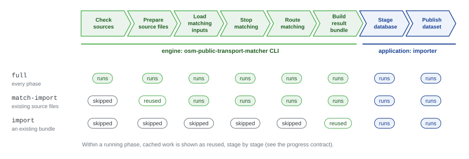
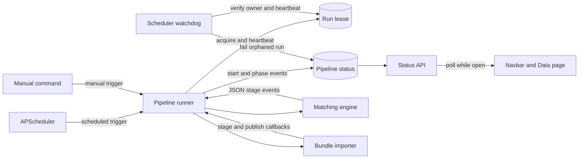
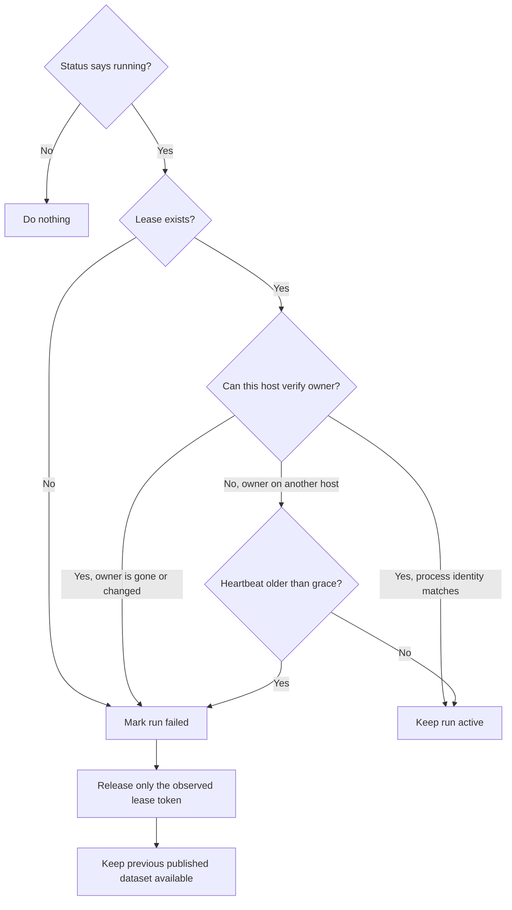

# A3.3 Background scheduler

The scheduler service refreshes the published data on a fixed interval. Each run starts the engine as a separate program, imports the bundle it writes ([A1.1](1.1%20Import%20Process.md)) and reports its progress to the website; it never imports engine code. This page explains the run modes, how runs are started and kept from overlapping, how a dead run is detected, and how to check a run. The code is in `backend/jobs/`.

## Run modes



A run has eight phases ([A3.5](3.5%20Pipeline%20Progress.md#execution-order)). The engine performs the first six as a subprocess; the application's importer performs the last two. The three modes differ in where they start:

| Mode | Engine command | Use it to |
|---|---|---|
| `full` | `osm-public-transport-matcher swiss --workspace <workspace> --output <bundle> --download` | Check and refresh the sources, match and import. Scheduled runs use this mode |
| `match-import` | The same command without `--download` | Match again with the source files already in the workspace, for example after an engine upgrade |
| `import` | None | Import the existing bundle named by `PIPELINE_BUNDLE`. No engine installation is needed |

With `PIPELINE_FORCE_FULL_REFRESH=true`, `full` runs add `--force`: the engine ignores its freshness checks and rebuilds every cached source product ([E5.1](../engine/documentation/5.1%20Source%20snapshot%20caching.md)).

`MATCHER_COMMAND` (default `osm-public-transport-matcher`) names the engine executable. It is split into arguments like a shell command line, but never run through a shell. The runner removes `DATABASE_URI`, `SECRET_KEY` and `FLASK_SECRET_KEY` from the engine process's environment, so the engine cannot reach the application database even when both run in one container. The engine writes each bundle to a new directory below `PIPELINE_BUNDLE_DIR`. Nothing deletes the bundles of earlier runs; remove the ones you do not need.

Run the job by hand from the application root or inside the scheduler container:

```bash
python -m backend.jobs.job_runner --mode full --trigger manual
PIPELINE_BUNDLE=data/results/<bundle> python -m backend.jobs.job_runner --mode import --trigger manual
```

The command exits with `0` after a successful run, `1` after a failed run and `2` when another run is active and this one was skipped.

## Schedule

`backend/jobs/service.py` uses APScheduler to start a `full` run every `PIPELINE_SCHEDULE_INTERVAL_HOURS` hours (default 1) in `PIPELINE_TIMEZONE` (default `Europe/Zurich`). The interval counts from the moment the scheduler starts, so the first scheduled run comes one full interval after startup: **a new deployment has no data until you run the pipeline by hand**. A trigger that fires while a run is still active is skipped.

## How the pieces fit together



The runner keeps two separate records:

- The **status record** explains the run to people: run ID, phase, message, stage timings, outcome and the next scheduled time.
- The **lease record** proves that a particular runner process still owns the run. Its heartbeat shows liveness and is never displayed.

Keeping them apart prevents a stale status message from being mistaken for proof that a process is alive. Both are JSON files under `STATE_DIR`, written atomically under a file lock; a Redis backend is also available.

## Who writes the status

The scheduler and the runner share `pipeline_status.json` but own different fields:

| Writer | Fields |
|---|---|
| Scheduler service | `next_run_at`, its `schedule_updated_at` timestamp and `schedule_interval_hours` only |
| Active runner | The run state: `status`, `phase`, messages, counters, timestamps, phase history and result metadata |
| Import completion | `last_pipeline_data_import_ended_at` and the published result metadata |

Starting or restarting the scheduler never resets the run state to `idle`: a manual run may start at almost the same moment, and resetting it would hide that run from the website.

Every status change is an atomic patch of its own fields. The file backend takes the shared runtime guard before reading, merging and replacing the file; the Redis backend merges with `WATCH`/`MULTI` and retries when another writer wins. A `next_run_at` update therefore cannot restore an older copy of the runner's phase, and a phase update cannot discard the next scheduled time.

## Detecting a dead runner

The run lease is the authority on whether a run is active. The runner acquires it before it publishes `status=running`, and records its host, process ID, process start identity and container lifetime. It refreshes `heartbeat_at` throughout long engine work and releases the lease after success or failure. The four-hour lease expiry is only the last safeguard against overlapping runs; it is not how long the website takes to notice a dead runner.

The scheduler runs a watchdog at startup and every `PIPELINE_WATCHDOG_INTERVAL_SECONDS`:



On the same host, the watchdog checks that the recorded process ID still identifies the original process; after a container restart, the changed runtime identity proves at once that the old owner is gone. When the owner cannot be checked locally, for example for a lease taken on another host, the watchdog waits until the heartbeat is older than `PIPELINE_LOCK_STALE_SECONDS`. Recovery releases only the lease token it observed, marks the run failed with an interruption message, and leaves the last published dataset in place.

## Publishing safely

- Downloading, matching and staging happen while readers keep using the published snapshot. PostgreSQL serializes only the final table switch, which takes a moment ([A1.1](1.1%20Import%20Process.md#5-switch-publishswap)).
- A failed engine run or a rejected bundle marks the run failed and leaves the published data unchanged. Files of failed runs are never imported.
- A bundle whose ATLAS platforms, OSM elements or matches fell by more than `PIPELINE_MAX_DROP_PERCENT` against the published snapshot is rejected ([A1.1](1.1%20Import%20Process.md#1-validate-databasevalidate)).
- The publication code serializes switches itself, even when called outside the scheduler.
- When a Routes query times out on a lock during the switch, the Routes pages answer `503` with `Retry-After: 30` instead of an error. They answer the same way while the status record has `blocking_maintenance` set; no pipeline step sets it.

A successful run records the new active run ID and the publication timestamps.

## Live status in the web interface

Every page polls `/api/system/pipeline_status`, so the navbar shows a run in progress, and an amber dot in the navbar warns when the latest update failed or the published data is overdue. The Data page (`/data/analytics`) shows each phase and stage of the run with its state and duration and, after a failure, the error of the first stage that reported one. The engine command and its exit code stay in the scheduler log. [A3.5](3.5%20Pipeline%20Progress.md) describes the phases, the timeline, the timestamps and these messages.

## Operational checks

For a manual run, start the services, then run the job in the scheduler container:

```bash
docker compose up -d db migrator app scheduler
docker compose ps
docker exec stop_sync_osm_atlas_scheduler \
  python -m backend.jobs.job_runner --mode full --trigger manual
```

The scheduler image installs the engine when it is built; the source bind mount does not update installed packages in a running container. After changing `engine.ref`, or when a run fails with `No such file or directory: osm-public-transport-matcher`, rebuild and replace the scheduler, then check that the command exists:

```bash
docker compose build scheduler
docker compose up -d --no-deps --force-recreate scheduler
docker exec stop_sync_osm_atlas_scheduler osm-public-transport-matcher --help
```

A manual run may overlap with the scheduler's startup safely, but waiting until the services are ready makes the logs easier to read. During a run, `/api/system/pipeline_status` reports `status: "running"`, and the lease file under `STATE_DIR` keeps receiving `heartbeat_at` updates. If the runner is killed, the scheduler marks the run failed at its next start or watchdog pass, releases the stale lease and allows a new run.

For a compact view of a run:

```bash
curl -s http://localhost:5001/api/system/pipeline_status \
  | jq '{status, phase, message, started_at, phase_started_at, phase_history}'
```

Read it as follows:

- `status: "running"` with a current lease heartbeat and a verifiable owner means the process is alive.
- `updated_at` changes with every status write; judge liveness by the lease heartbeat, not by `updated_at`.
- Within a run, `phase_history` only grows, except that a reuse or skip marker is replaced when that stage actually starts.
- `status: "failed"` with an interruption message means the watchdog recovered an abandoned run. The published dataset is still there.

## Settings

| Setting | Default | Meaning |
|---|---|---|
| `PIPELINE_SCHEDULE_INTERVAL_HOURS` | `1` | Hours between scheduled `full` runs; must be greater than 0 |
| `PIPELINE_TIMEZONE` | `Europe/Zurich` | Time zone of the schedule |
| `PIPELINE_FORCE_FULL_REFRESH` | `false` | Adds `--force` to `full` runs, rebuilding all cached source products |
| `PIPELINE_MAX_DROP_PERCENT` | `20` | Largest accepted drop, in percent, of ATLAS platforms, OSM elements or matches against the published snapshot; `100` disables the check |
| `OVERPASS_API_URL` | `https://overpass-api.de/api/interpreter` | Overpass endpoints the engine tries in order, separated by commas ([E1.3](../engine/documentation/1.3%20OSM%20data.md#the-download)) |
| `MATCHER_COMMAND` | `osm-public-transport-matcher` | Engine executable and any leading arguments |
| `PIPELINE_WORKSPACE` | `.` (`/app` in Compose) | Engine workspace that holds the source files |
| `PIPELINE_BUNDLE_DIR` | `data/results` (`/app/data/results` in Compose) | Directory for the bundles of engine runs |
| `PIPELINE_BUNDLE` | none | Bundle to import in `import` mode |
| `PIPELINE_LOG_LEVEL` | `INFO` | Log level of the scheduler and the runner |
| `PIPELINE_LOCK_TTL_SECONDS` | `14400` | Lease expiry, the last safeguard against overlapping runs |
| `PIPELINE_LOCK_HEARTBEAT_SECONDS` | `60` | How often the runner refreshes its heartbeat |
| `PIPELINE_LOCK_STALE_SECONDS` | `135` | Longest heartbeat silence accepted when the owner cannot be checked directly |
| `PIPELINE_WATCHDOG_INTERVAL_SECONDS` | `60` | How often the watchdog runs (at least 5) |

`PIPELINE_IMPORT_ETA_SECONDS` appears in `env.example` and Compose, but no code uses its value.

## Code

| File | Role |
|---|---|
| `backend/jobs/service.py` | The APScheduler service: the interval trigger, `next_run_at` and the watchdog |
| `backend/jobs/job_runner.py` | One run: the lease and its heartbeat, the engine subprocess and the import |
| `backend/services/pipeline_status.py` | The status record, the run lease and the recovery of an orphaned run |
| `backend/services/pipeline_state_store.py` | The file, Redis and in-memory stores with their atomic patches |
| `backend/services/state_backend_config.py` | `STATE_BACKEND`, `STATE_DIR` and the Redis URL |
| `backend/blueprints/system.py` | `/api/system/pipeline_status` |

## Related pages

- [A3.5 Pipeline progress](3.5%20Pipeline%20Progress.md): the phases, stages and timestamps a run reports.
- [A1.1 Bundle import and publication](1.1%20Import%20Process.md): what the import does with the bundle, and the snapshot switch.
- [A3 Architecture](3.%20System%20Architecture.md#deployment): the scheduler among the other services.
- [A3.1 Dependencies and builds](3.1%20Dependency%20Management%20%26%20Build%20Strategy.md#engine-release-identity-and-deployment-pin): how the engine in the scheduler image is pinned and upgraded.
- [E5.1 Source snapshot caching](../engine/documentation/5.1%20Source%20snapshot%20caching.md): which sources a `full` run reuses or downloads again.
