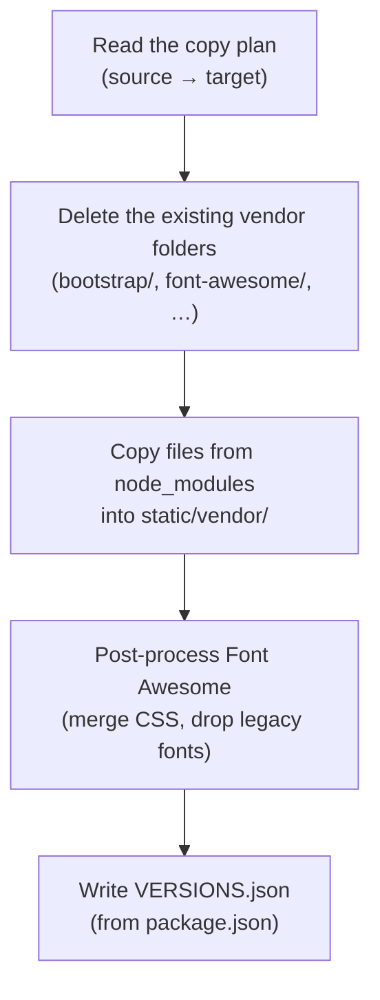

# A3.4 Frontend asset management

The web app serves every third-party browser library from `static/vendor/` instead of loading it from a public CDN. This page explains why, which files are copied and how they are trimmed, and how to update a library.

## Motivation

| Concern | CDN approach | Local vendor approach |
|---|---|---|
| **Privacy** | Browser contacts third-party domains (jsdelivr, cdnjs, etc.) on every page load | All requests stay on our domain |
| **Reliability** | UI breaks if CDN is blocked, rate-limited, or down | No external dependency at runtime |
| **Reproducibility** | CDN URLs can silently change or disappear | Exact versions tracked in `package.json` and committed to the repo |
| **Auditability** | Hard to diff or review what changed | Changes to vendored files are visible in Git |

## Vendored libraries

npm installs the libraries; the sync script `scripts/sync_vendor_assets.mjs` copies the files the app needs into `static/vendor/`:

| Library | Version | What is copied | Used by |
|---|---|---|---|
| Bootstrap | 5.3.3 | `bootstrap.min.css`, `bootstrap.bundle.min.js` | All pages (layout, modals, dropdowns) |
| Font Awesome | 5.15.3 | Merged `all.min.css` + solid/regular woff2 webfonts | All pages (icons) |
| Leaflet | 1.9.4 | `leaflet.css`, `leaflet.js`, marker images | Map pages (index, problems, routes) |
| Mermaid | 10.9.8 | `mermaid.min.js` | Docs page only |
| MathJax | 3.2.2 | `tex-mml-chtml.js` + CHTML font assets | Docs page only |

The versions in `package.json` (`devDependencies`) are authoritative. The sync script also writes `static/vendor/VERSIONS.json`, a machine-readable list of the vendored versions.

## Directory layout

```text
static/
    vendor/
        VERSIONS.json
        bootstrap/
            css/bootstrap.min.css
            js/bootstrap.bundle.min.js
        font-awesome/
            css/all.min.css
            webfonts/
                fa-solid-900.woff2
                fa-regular-400.woff2
        leaflet/
            leaflet.css
            leaflet.js
            images/
        mermaid/
            mermaid.min.js
        mathjax/
            es5/
                tex-mml-chtml.js
                output/chtml/fonts/
                    tex.js
                    woff-v2/
```

The whole `static/vendor/` directory is committed to the repository.

## Templates

Templates load the files with Flask's `url_for('static', ...)` or with paths below `/static/vendor/`:

| Template | Libraries loaded |
|---|---|
| `templates/layouts/base.html` | Bootstrap CSS/JS, Font Awesome CSS |
| `templates/pages/index.html`, `problems.html`, `routes.html` | Leaflet CSS/JS |
| `templates/pages/docs.html` | Mermaid JS, MathJax JS |
| `templates/layouts/printable.html` | Bootstrap CSS, Font Awesome CSS |

### PDF rendering caveat

PDF generation uses WeasyPrint with a file-system `base_url`, where absolute web paths such as `/static/...` do not resolve. Therefore:

- `templates/layouts/printable.html` uses a `pdf_assets_prefix` variable (default: `/static/vendor/`).
- PDF generation code passes `pdf_assets_prefix='static/vendor/'` so WeasyPrint resolves local files relative to the repository root.
- Affected call sites: `backend/blueprints/reports.py` and `backend/services/stats_export.py`.

## The sync script

`scripts/sync_vendor_assets.mjs` performs these steps:



### npm scripts

| Script | Command | Purpose |
|---|---|---|
| `vendor:sync` | `node scripts/sync_vendor_assets.mjs` | Copy and optimize vendor assets |
| `vendor:check-cdn` | `node scripts/check_no_cdn_templates.mjs` | Fail if templates reference external CDN URLs |

### VS Code task

The **Sync vendor libraries** task in `.vscode/tasks.json` runs `npm run vendor:sync`.

### CI integration

`scripts/run_quality.py` runs `vendor:check-cdn` as its `vendor-cdn` check, both in `make quality-fast` and in the CI quality job. A template that references a CDN therefore fails CI.

## Keeping the files small

### General approach

1. Only minified distribution files are copied (`*.min.js`, `*.min.css`).
2. Only the files the application uses are copied, never whole library trees.
3. The copy plan lists every file explicitly, without glob patterns.

### Font Awesome trimming

The sync script trims Font Awesome while copying it:

1. **No brands**: Only `fas` (solid) and `far` (regular) icon styles are used. Brand icons and their ~1 MB of webfonts are excluded entirely.
2. **woff2 only**: Legacy font formats (eot, woff, ttf, svg) are stripped. Only woff2 is kept, which is supported by all modern browsers.
3. **Merged CSS**: The modular upstream CSS files (`fontawesome.min.css`, `solid.min.css`, `regular.min.css`) are merged into a single `all.min.css` with rewritten `@font-face` rules pointing to woff2 only.

This reduces the Font Awesome web fonts from about 2.9 MB in 15 files to about 91 KB in 2 files, 97% less.

### MathJax subset

MathJax is large (about 60 MB unpacked). Only the runtime subset is copied:

- `tex-mml-chtml.js` — the entry point for TeX → MathML → CHTML rendering.
- `output/chtml/fonts/tex.js` — the CHTML font metrics module.
- `output/chtml/fonts/woff-v2/*` — the actual glyph files for math rendering.

These are exactly the files the CHTML output loads at runtime; formulas break if one is missing.

### Trimming that is not applied

| Technique | Why not applied |
|---|---|
| PurgeCSS for Bootstrap | Dynamic templates and JS-injected classes (`classList.add(...)`) make CSS purging error-prone |
| Bootstrap custom build | Adds Sass compilation to the build pipeline for modest gains |
| Font Awesome glyph subsetting | Requires `fonttools`/`pyftsubset` and a maintained list of icons; fragile for a few dozen icons |
| Leaflet custom build | Monolithic library; no tree-shakeable module system |

Selective copying and the automatic Font Awesome trimming give most of the savings while keeping the setup simple and stable.

## What stays external

Only map tiles are loaded from other servers, because they are live imagery rather than static files: OpenStreetMap (`tile.openstreetmap.org`), the transport layer (`tile.memomaps.de`) and Esri World Imagery (`server.arcgisonline.com`). See [A2.1](2.1%20Map%20Data%20Loading%20and%20Rendering.md#base-maps).

## Updating a library


1. Update the version in `package.json`.
2. Run `npm install`.
3. Run `npm run vendor:sync`.
4. Check the map pages, the documentation page and the PDF reports by hand.
5. Commit `package.json`, `package-lock.json`, and the updated `static/vendor/` files.
