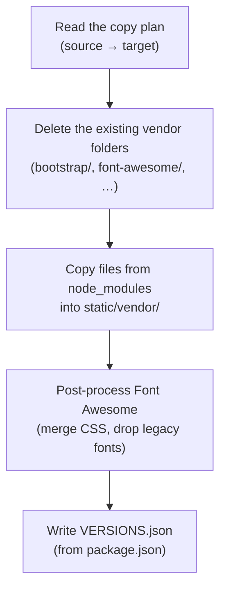

# A3.4 Frontend asset management

The web app serves every third-party browser library from `static/vendor/` instead of loading it from a public CDN, so a page contacts no third-party domain for code and keeps working when a CDN is blocked or down. The exact versions are set in `package.json`, and every change to a vendored file shows in Git. This page explains which files are copied, how they are trimmed and how to update a library.

## Vendored libraries

npm installs the libraries; the sync script `scripts/sync_vendor_assets.mjs` copies the files the app needs into `static/vendor/`:

| Library | Version | What is copied | Used by |
|---|---|---|---|
| Bootstrap | 5.3.3 | `bootstrap.min.css`, `bootstrap.bundle.min.js` | All pages (layout, modals, dropdowns) |
| Font Awesome | 5.15.3 | Merged `all.min.css` + solid/regular woff2 webfonts | All pages (icons) |
| Leaflet | 1.9.4 | `leaflet.css`, `leaflet.js`, marker images | Map pages (index, problems, routes) |
| Mermaid | 10.9.8 | `mermaid.min.js` | Docs page only |
| Cytoscape.js | 3.34.3 | `cytoscape.min.js` | Code quality dashboard only (module map) |
| MathJax | 3.2.2 | `tex-mml-chtml.js` + CHTML font assets | Docs page only |

The versions in `package.json` (`devDependencies`) are authoritative. The sync script also writes `static/vendor/VERSIONS.json`, a machine-readable list of the vendored versions.

## Directory layout

```text
static/
    vendor/
        VERSIONS.json
        bootstrap/
            css/bootstrap.min.css
            js/bootstrap.bundle.min.js
        font-awesome/
            css/all.min.css
            webfonts/
                fa-solid-900.woff2
                fa-regular-400.woff2
        leaflet/
            leaflet.css
            leaflet.js
            images/
        mermaid/
            mermaid.min.js
        cytoscape/
            cytoscape.min.js
        mathjax/
            es5/
                tex-mml-chtml.js
                output/chtml/fonts/
                    tex.js
                    woff-v2/
```

The whole `static/vendor/` directory is committed to the repository.

## Templates

Templates load the files with Flask's `url_for('static', ...)` or with paths below `/static/vendor/`:

| Template | Libraries loaded |
|---|---|
| `templates/layouts/base.html` | Bootstrap CSS/JS, Font Awesome CSS |
| `templates/layouts/map.html` | Leaflet CSS, for the map pages `index.html` and `problems.html` |
| `templates/components/_map_scripts.html` | Leaflet JS, for `index.html` and `problems.html` |
| `templates/pages/routes.html` | Leaflet CSS/JS |
| `templates/pages/docs.html` | Mermaid JS, MathJax JS |
| `templates/pages/quality.html` | Cytoscape.js |
| `templates/reports/printable.html` | Bootstrap CSS, Font Awesome CSS |

### PDF rendering caveat

PDF generation uses WeasyPrint with a file-system `base_url`, where absolute web paths such as `/static/...` do not resolve. Therefore:

- `templates/reports/printable.html` uses a `pdf_assets_prefix` variable (default: `/static/vendor/`).
- PDF generation code passes `pdf_assets_prefix='static/vendor/'` so WeasyPrint resolves local files relative to the repository root.
- Affected call sites: `backend/blueprints/reports.py` and `backend/services/stats_export.py`.

## The sync script

`scripts/sync_vendor_assets.mjs` performs these steps:



### npm scripts

| Script | Command | Purpose |
|---|---|---|
| `vendor:sync` | `node scripts/sync_vendor_assets.mjs` | Copy and optimize vendor assets |
| `vendor:check-cdn` | `node scripts/check_no_cdn_templates.mjs` | Fail if templates reference external CDN URLs |

### VS Code task

The **Sync vendor libraries** task in `.vscode/tasks.json` runs `npm run vendor:sync`.

### CI integration

`scripts/run_quality.py` runs `vendor:check-cdn` as its `vendor-cdn` check, both in `make quality-fast` and in the CI quality job. A template that references a CDN therefore fails CI.

## Keeping the files small

### General approach

1. Only minified distribution files are copied (`*.min.js`, `*.min.css`), except `leaflet.css`, which Leaflet ships unminified.
2. Only the files the application uses are copied, never whole library trees.
3. The copy plan lists every file explicitly, without glob patterns; only two asset directories are copied whole, Leaflet's `images/` and MathJax's `woff-v2/`.

### Font Awesome trimming

The sync script trims Font Awesome while copying it:

1. **No brands**: Only the `fas` (solid) and `far` (regular) icon styles are used. Brand icons and their webfonts are not copied.
2. **woff2 only**: Only the woff2 files of the two styles are copied; every modern browser supports the format. The eot, woff, ttf and svg fonts are not copied.
3. **Merged CSS**: The upstream CSS files (`fontawesome.min.css`, `solid.min.css`, `regular.min.css`) are merged into a single `all.min.css` whose `@font-face` rules name the woff2 files only.

### MathJax subset

MathJax is large, so only the runtime subset is copied:

- `tex-mml-chtml.js` — the entry point for TeX → MathML → CHTML rendering.
- `output/chtml/fonts/tex.js` — the CHTML font metrics module.
- `output/chtml/fonts/woff-v2/*` — the actual glyph files for math rendering.

These are exactly the files the CHTML output loads at runtime; formulas break if one is missing.

### What is copied unchanged

Bootstrap, Leaflet, Mermaid and Cytoscape.js are copied as their upstream distribution files, without CSS purging or custom builds, and the Font Awesome fonts keep all their glyphs.

## What stays external

Only map tiles are loaded from other servers, because they are live imagery rather than static files: OpenStreetMap (`tile.openstreetmap.org`), the transport layer (`tile.memomaps.de`) and Esri World Imagery (`server.arcgisonline.com`). See [A2.1](2.1%20Map%20Data%20Loading%20and%20Rendering.md#base-maps).

## Updating a library


1. Update the version in `package.json`.
2. Run `npm install`.
3. Run `npm run vendor:sync`.
4. Check the map pages, the documentation page, the code quality dashboard and the PDF reports by hand.
5. Commit `package.json`, `package-lock.json`, and the updated `static/vendor/` files.

## Code

| File | Role |
|---|---|
| `package.json` | The library versions and the `vendor:sync` and `vendor:check-cdn` scripts |
| `scripts/sync_vendor_assets.mjs` | Copies, trims and records the vendored files |
| `scripts/check_no_cdn_templates.mjs` | Fails when a template references a CDN |
| `static/vendor/VERSIONS.json` | The vendored versions, written by the sync script |
| `templates/reports/printable.html` | The `pdf_assets_prefix` that lets WeasyPrint find the vendored files |

## Related pages

- [A3.1 Dependencies and builds](3.1%20Dependency%20Management%20%26%20Build%20Strategy.md): how `package.json` and the images fit together.
- [A2.1 Map data loading and rendering](2.1%20Map%20Data%20Loading%20and%20Rendering.md#base-maps): the map tiles that stay external.
- [A2.5 Reports and PDFs](2.5%20Generate%20Reports%20and%20PDFs.md): the PDF exports that load the vendored files from disk.
- [A4.4 Running the quality checks](4.4%20Running%20Quality%20Checks.md#ci-and-repository-setup): the CI job that runs the CDN check.
